# Campus Chefs

[](https://github.com/gitchrisqueen/campus-chefs/actions/workflows/ci.yml?query=branch%3Amain)

**Home-cooked meals, made by students who love to cook.**

<p>
  <picture>
    <source media="(prefers-reduced-motion: reduce)" srcset="docs/screenshots/walkthrough/01-home.png">
    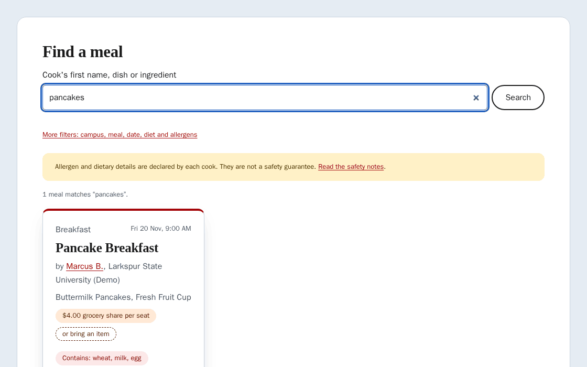
  </picture>
</p>

The walkthrough shows the eight booking screens, and six more from after the meal, as still pictures: [open the walkthrough](docs/walkthrough.md).

Campus Chefs matches students who want a home-cooked meal with students who like to cook. A cook posts a meal: the dishes, the time, the seats and what the groceries cost. A diner asks for a seat and chips in toward those groceries with a share of the cost, an item from the cook's bring list, or terms the two of them agree on. The cook gets help with the grocery bill and never a profit.

**This is a portfolio demo, not a live service.** The people, campuses and meals are made up, and no money moves through the app. [Why this is a demo](#why-this-is-a-demo) has the details.

**For hiring teams:** I set the scope and made the decisions, and AI coding agents wrote the code from a plan I reviewed, one phase per pull request. The outcome is 358 tests green on `main` ([run 44521109607](https://github.com/gitchrisqueen/campus-chefs/actions/runs/44521109607)), 98.19% statement coverage, and the original code's SQL-injection login bypass closed with a regression test ([For developers and hiring teams](#for-developers-and-hiring-teams)).

| If you are | Start here |
|---|---|
| A student, or anyone curious about the product | [What a student sees](#what-a-student-sees) |
| Someone who wants to click around | [Run the demo](#run-the-demo), one command |
| A business owner with an old app to rescue | [Contact](#contact) |
| A developer or a hiring team | [For developers and hiring teams](#for-developers-and-hiring-teams) |

## What a student sees

The home page says what the app is for and lets you search straight away. The same pages reflow for a phone.

<p>
  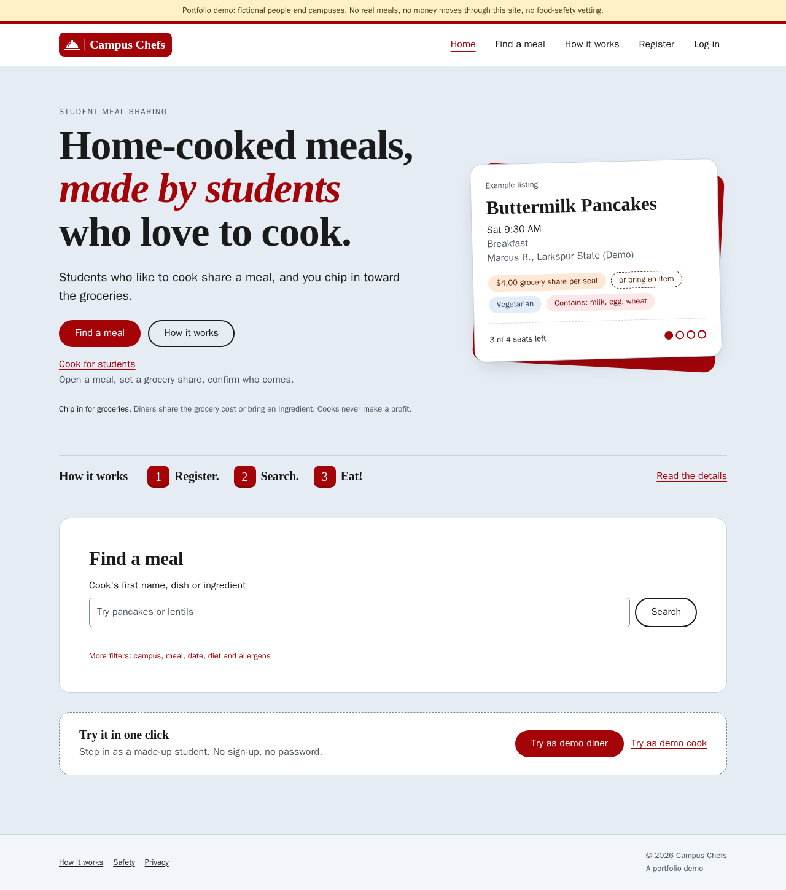
  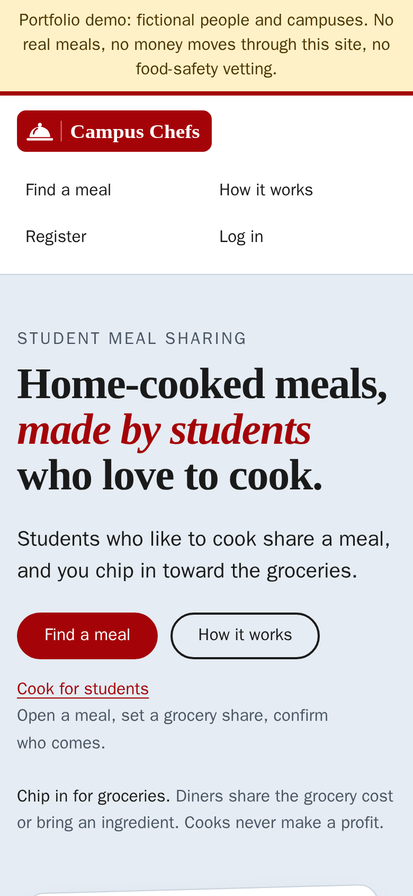
</p>

### 1. Find a meal

Search by a cook's first name, a dish or an ingredient. Narrow it by campus, meal, date, dietary tag and the most you want to chip in, and leave out dishes that contain an allergen you name. The results update as you type. The same form works with JavaScript turned off.

<p>
  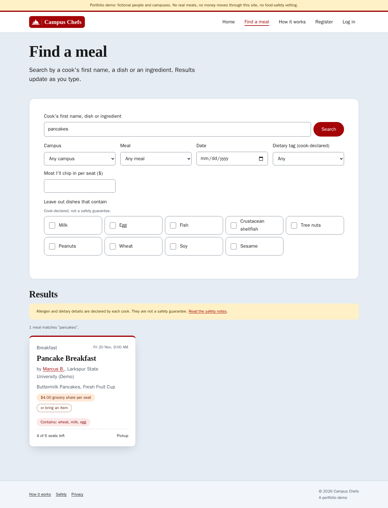
  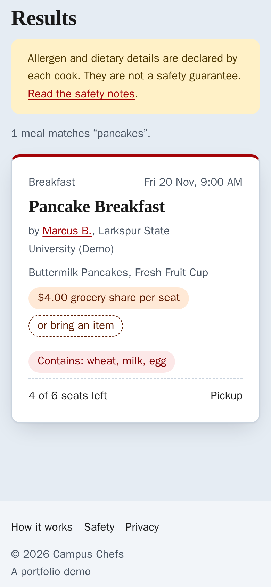
</p>

### 2. See who is cooking

Each cook has a page with their specialties, a menu grouped into breakfast, lunch and dinner, the meals they have coming up, and reviews. A review has two parts, "The good" and "The bad". Cooks appear as a first name and an initial, and no email address is shown on a public page.

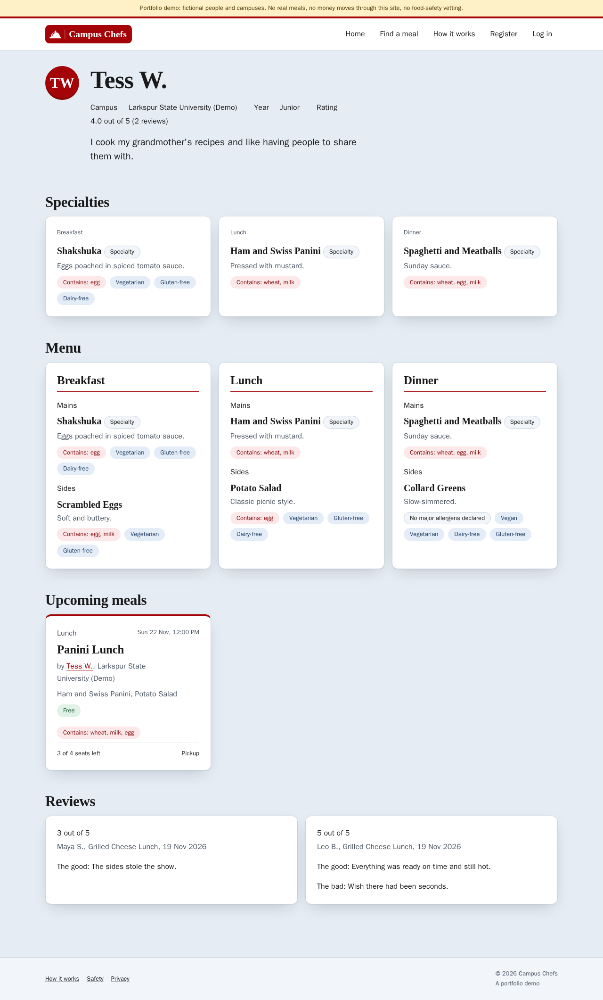

### 3. Ask for a seat and chip in

Pick 1 to 4 seats and choose how you will chip in: the grocery share, an item from the bring list, or your own terms. You have to tick that you read the allergens before the request can be sent.

<p>
  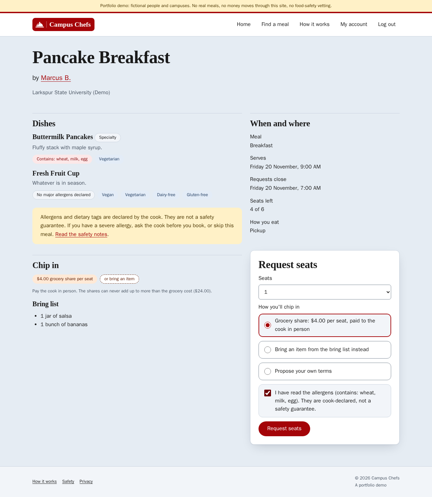
  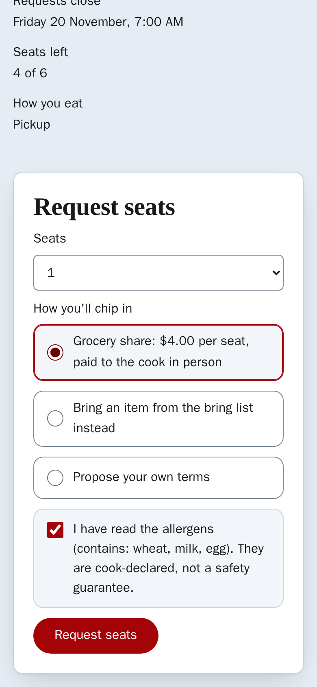
</p>

The cook confirms or declines. Your booking page then shows what you agreed and a timeline. You pay the cook in person, and the cook marks the share received.

<p>
  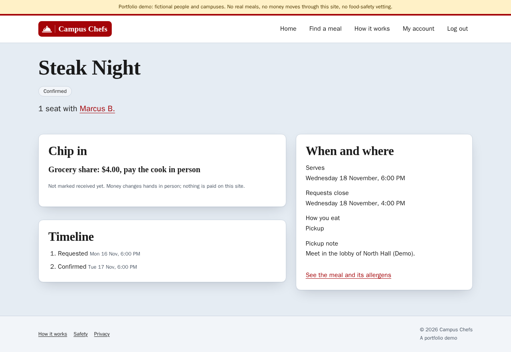
  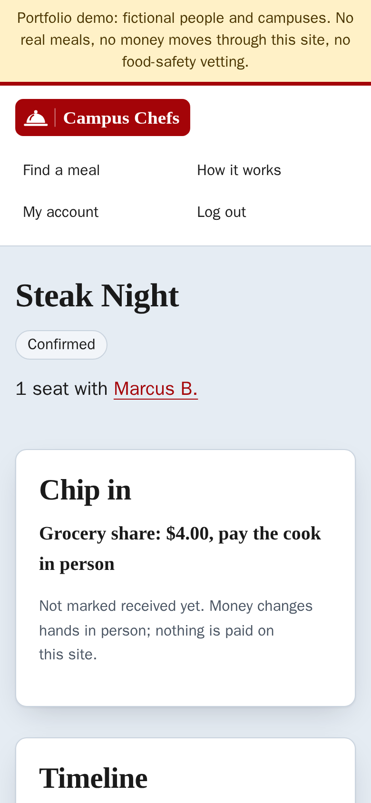
</p>

Your account page keeps your bookings in one place. Your email is shown only to you.

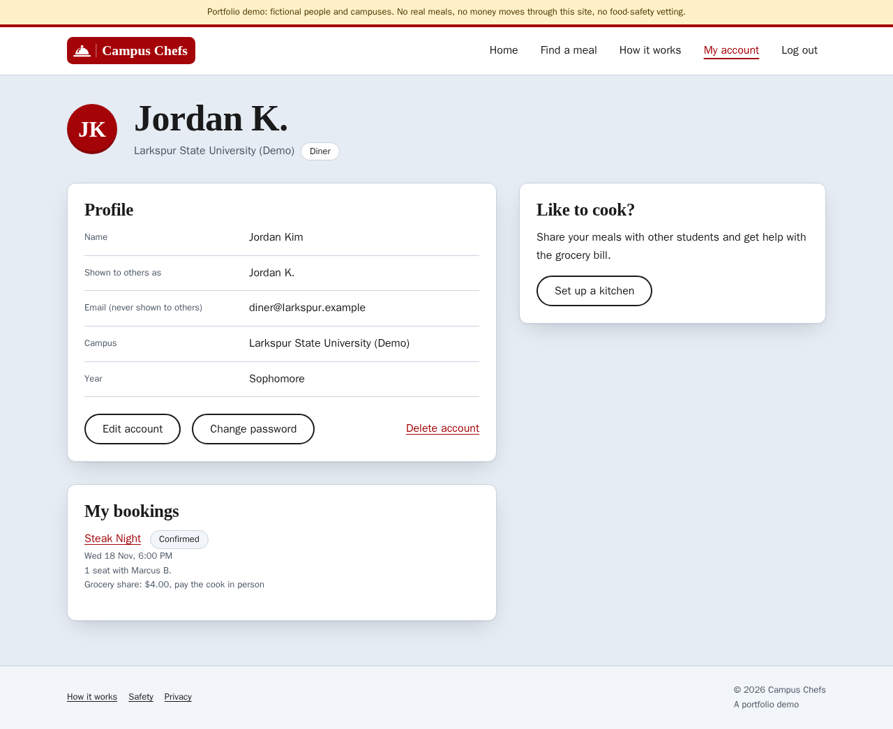

### 4. Cook for other students

The kitchen is where a cook keeps a menu and opens meals. Each meal shows the seats left, the grocery estimate, the share per seat and how much of the chip-ins have been received. The form suggests the grocery estimate divided by the number of seats plus one, because the cook eats too. It refuses a share that would add up to more than the groceries cost.

<p>
  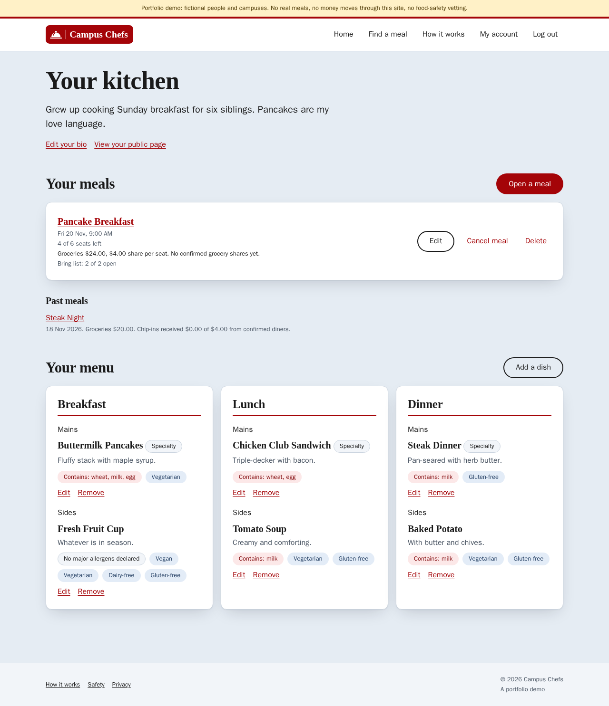
  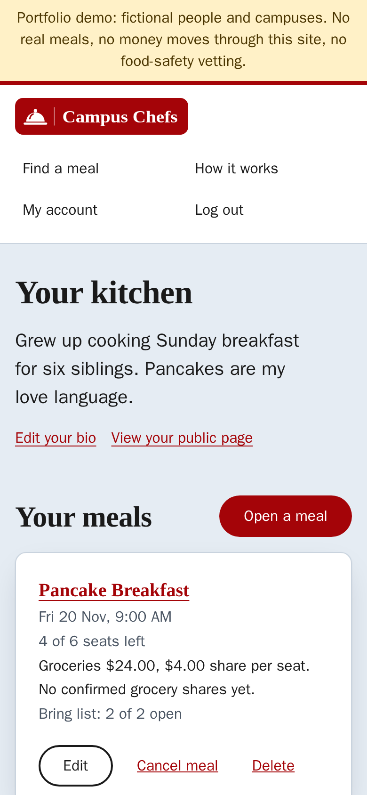
</p>

## Run the demo

You need:

- Docker Engine with the Compose plugin (`docker compose`). It was tested with Engine 29.9.3 and Compose v5.7.0.
- `make`, `curl` and `jq`.
- About 3 GB of free disk space, and port 8000 free.

```sh
git clone https://github.com/gitchrisqueen/campus-chefs.git
cd campus-chefs
make demo
```

`make demo` builds the image, starts four containers and waits for the app. The first run pulls the base images and builds the app image; later runs reuse them. Its last line reads `wait-healthy: web healthy after 6s`, where the number of seconds varies. Then check it:

```sh
curl http://127.0.0.1:8000/healthz      # prints: ok
```

Open <http://127.0.0.1:8000>. You do not need an account or a password:

- **Try as demo diner** logs you in as Jordan K., who has one confirmed booking.
- **Try as demo cook** logs you in as Marcus B., who has a menu, one upcoming meal and one past meal.

Both buttons are on the home page and on the login page. The seeded accounts have no passwords, so the buttons are the only way in to them. You can also register with made-up details.

| Task | Command |
|---|---|
| Stop, keeping the data | `docker compose down` |
| Reset everything, data and generated secrets | `docker compose down -v`, then `make demo` |
| Refresh the demo data | `make reseed` |
| Use another port | `WEB_PORT=8010 make demo` |
| Follow the app log | `docker compose logs -f web` |
| Unit and integration tests | `make test` |
| Browser tests. The demo must be running (`make demo`), because they call the `web` container and do not start it. They reseed first | `make e2e` |
| Lint and static checks | `make lint` |

The seed is 3 campuses, 8 cooks, 14 diners, 48 dishes, 16 meals, 26 bookings and 12 reviews, all fictional. Meal times are set relative to the first start, so after about a week no meal is in the future: run `make reseed`. [docs/OPERATIONS.md](docs/OPERATIONS.md) covers the admin account, moderation and what to do when something breaks.

## Why this is a demo

Sharing food between students carries legal and health risk that an app cannot remove. So this project stops at a local demo, and it says so on every page.

- **Scope.** It runs on your machine with made-up people and campuses. It is not hosted, and it was not built to take public sign-ups. Do not deploy it with public sign-ups; `CC_REGISTRATION_OPEN=false` turns registration off.
- **Allergens.** Each cook types in the allergens and dietary tags of their own dishes. Nobody checks them, and nobody inspects a kitchen. The app asks the cook to confirm each list and asks the diner to tick that they read it. Those are records of a click, not food-safety or legal compliance.
- **Food rules.** Rules on home-cooked food made for other people vary by state, county, city and campus. The app does not check them.
- **Money.** The app never handles money. A share is capped at the grocery cost, and some places may still treat that as a sale of food. Nothing here is legal advice.
- **What stays on.** The yellow banner shows while `CC_DEMO_MODE=true`. The [`/safety`](templates/core/safety.html) and `/privacy` pages, the `noindex` tag and a `robots.txt` that disallows everything are on in every mode.

## For developers and hiring teams

In short, with the evidence for each line:

- **A legacy rescue with proof.** The original is 1,003 lines of PHP. Read from the code, its login can be bypassed with SQL injection; the original app is never run, so the bypass was not reproduced. The plan lists 33 defects and 6 TODOs, and each fix that has behavior names the test that proves it ([before and after](#before-and-after)).
- **358 tests, green on `main`.** 340 unit and integration tests against real PostgreSQL and 18 browser tests, with 98.19% statement coverage against a 90% gate ([run 44521109607](https://github.com/gitchrisqueen/campus-chefs/actions/runs/44521109607)).
- **One command to run.** Four containers, secrets generated at first start, nothing secret in the repository ([architecture](#architecture)).
- **Security decisions with their costs written down.** A strict content security policy, one secrets volume per service, a database role that cannot change the schema, and rules enforced by the database ([security and data decisions](#security-and-data-decisions)).
- **An AI feature behind a flag.** An optional menu import that is off by default, sends only the pasted text, and treats the model's reply as untrusted input ([AI menu import](#ai-menu-import-optional)).
- **Scope held on purpose.** No payments, no messaging, no uploads, and the reasons ([deliberately not built](#deliberately-not-built)).
- **Methods that carry over to a client app.** Start with file-and-line evidence, add regression tests for fixed behavior, keep a one-command local run, and hand off a runbook. Each client app needs its own scope and release checks; this demo's results do not predict another app's outcome.

IDs such as AUTH-07 and CHK-04 name a test or a static check in the [plan](docs/MODERNIZATION_PLAN.md#7-test-strategy), and each test function carries its ID in its name.

| Layer | What it uses |
|---|---|
| App | Django 6.1.3 on Python 3.14, server-rendered templates, htmx 4.0.1 for live search and the booking panel, no JavaScript build step |
| Data | PostgreSQL 18.7 |
| Runtime | Docker Compose: gunicorn behind a loopback port, WhiteNoise for static files |
| Tests | pytest, pytest-django, Playwright with Chromium, axe-core 4.14.0 |
| CI | GitHub Actions, one job |
| Optional menu import | The anthropic SDK 2.5.0 and pydantic 2.14.2. The SDK is installed in the image and imported only when the flag is on and a cook submits a menu |

### Architecture

The diagram in words: the browser reaches only `web` on a loopback port, `web`, `migrate` and `tests` reach `db` over an internal network, and `keygen` writes the secrets into three volumes, one per consumer.

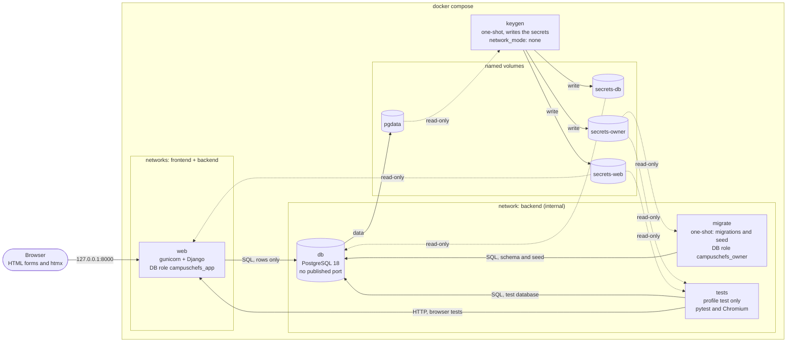

Solid arrows are traffic or writes. Dotted arrows are read-only volume mounts. The diagram names every service, network and volume in [`compose.yaml`](compose.yaml), and `make lint` fails if one is missing from it.

| Service | Starts after | What it does |
|---|---|---|
| `keygen` | nothing | Runs once with no network. Writes random secrets into three volumes, one per consumer. It reads `pgdata` only to refuse to make new passwords for a database that already exists |
| `db` | `keygen` exited 0 | PostgreSQL on the internal network only. Its init script creates an owner role and an app role |
| `migrate` | `db` healthy | Runs once as the owner role: migrations, cache table, expired sessions, and the seed on an empty database |
| `web` | `migrate` exited 0 | The app, as the app role, with a read-only root filesystem, no Linux capabilities and user id 10001. The only published port, bound to `127.0.0.1` |
| `tests` | `db` healthy | Started only with `--profile test`. Runs pytest and Chromium against the stack, with the source mounted read-only |

There is no cache server, queue or scheduler. Sessions and the failed-login counters live in PostgreSQL. [docs/architecture.md](docs/architecture.md) has the booking state machine, the versions tested and every place the build departed from the plan.

### Before and after

This project began as a student web app written in 2008 in PHP 5. The original code is kept in [`legacy/`](legacy/README.md), redacted and read-only, and it is never run: its landing page was rendered once to static HTML for the picture below.

<p>
  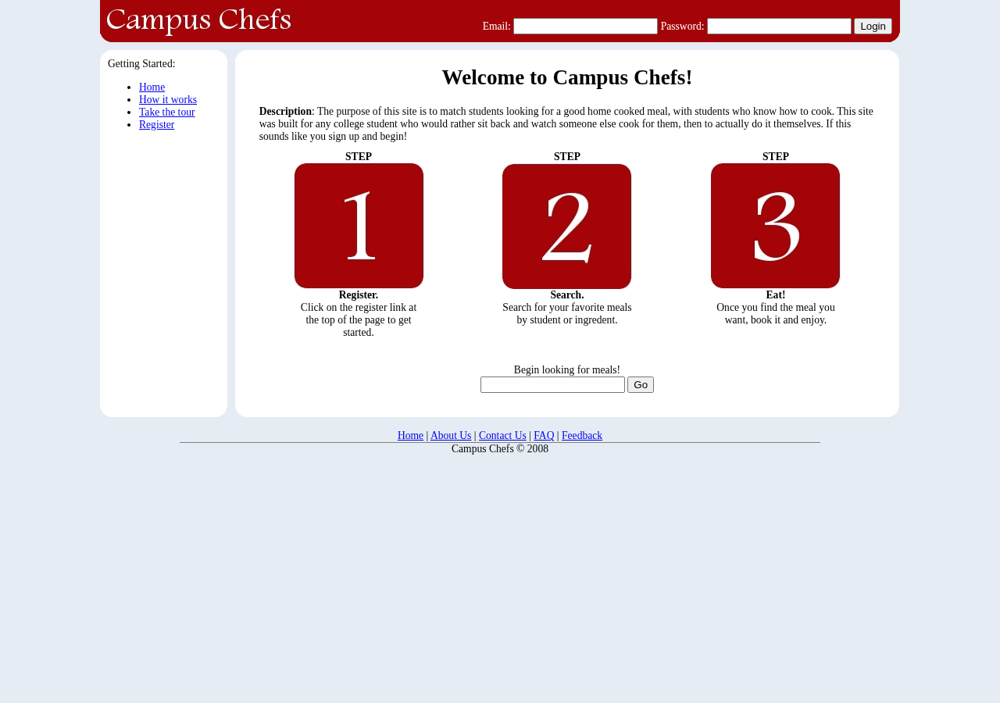
  
</p>

| 2008 defect | 2026 fix | Proof |
|---|---|---|
| Login bypass: SQL built by pasting strings together (`legacy/src/sqlQueries.php:58`). Read from the code, the email `' OR 1=1 -- ` would log anyone in; the 2008 app is never run, so this was not reproduced | No SQL strings. The ORM binds every value, and a static check fails the build on raw SQL | AUTH-07, SRCH-03, CHK-04 |
| Passwords stored and compared as plain text | Argon2id hashes | REG-01 |
| Login and registration sent by GET, so passwords sat in the URL | POST only, with a CSRF token | AUTH-03, REG-08, AUTH-10 |
| The "email" was compared with the `first_name` column, and no session was created | Email login; the session key changes at login | AUTH-07, AUTH-01 |
| Database user `root` with an empty password | Generated secrets, one set per service; the app's role cannot create or drop tables | SEC-04, SEC-05, SEC-08 |
| Profile page hardcoded to user 1 (`//HACK! fix this`) | The logged-in user, and queries scoped to rows they own | LEG-02 |
| Registration saved campus and profile type in each other's columns | Named model fields | LEG-04 |
| The cook's email printed on a public page | No email on any public page | AZ-06 |
| Database errors printed to the visitor | A generic error page | LEG-06 |
| Search led to "Under Construction"; booking and reviews were never built | Search with filters, a booking state machine, two-part reviews | SRCH, BOOK and REV tests, LEG-07 |
| Fixed 1024 px layout; images without alt text; labels not tied to inputs | Responsive from 320 px; WCAG 2.2 AA checked by axe in light and dark mode | E2E-04, A11Y-01, CHK-02 |
| A photo of a real person and real names in test strings | Replaced before the first commit; a denylist scan runs in CI and before every push | SEC-06 |

[docs/before-after.md](docs/before-after.md) has the full table of 29 rows, the code excerpts, and why `htmlentities()` did not stop the injection. The plan counts 33 defects and 6 TODOs, and that table has 29 rows, because three rows join two entries each and seven entries have no row (defects 14, 22, 26, 27, 30 and 33, and TODO T5). [docs/LEGACY-MAP.md](docs/LEGACY-MAP.md) maps each 2008 file to its new home.

### Security and data decisions

Each row is a choice, what it protects and what it costs. [docs/SECURITY.md](docs/SECURITY.md) lists what is not defended.

| Decision | What it buys | What it costs | Proof |
|---|---|---|---|
| **Content security policy** of `default-src 'self'`, with no inline script or style anywhere | An injected `<script>` or `style` attribute does not run | No inline handlers or styles: htmx's injected indicator CSS is switched off and shipped in the stylesheet, and conditional form fields use CSS `:has()`. Adding a third-party asset means changing the policy | SEC-01, E2E-06; the booking journeys E2E-01 to E2E-04 also fail on any console error |
| **One secrets volume per consumer** | `web` can read its own database password and the Django key, and nothing else. The superuser password is visible only to `db` | Three volumes and a one-shot generator that needs two Linux capabilities. If the secrets volume is lost while the data is kept, the stack refuses to start until it is reset | SEC-08 (smoke check 4), OPS-02 |
| **Least-privilege database role** | `web` connects as a role limited to SELECT, INSERT, UPDATE and DELETE. A takeover of the web process cannot create, alter or drop a table | A second role and a separate one-shot container for migrations | SEC-04, SEC-05, run while connected as that role |
| **Rules live in the database** as 19 named CHECK constraints and 5 unique constraints | A bug in a form or view cannot store 0 seats, a 6-star rating, a cutoff after the meal or two active bookings by one diner for one meal | Each rule is written twice, once for a readable form error and once as a constraint, and changing one needs a migration | DATA-03, BOOK-08 |
| **No-profit rule**: `share_per_seat_cents * capacity <= grocery_estimate_cents` | The shares for a meal cannot add up to more than the groceries cost, whatever the form sends | It trusts the cook's estimate. There are no receipts | CONTRIB-01, CONTRIB-12 |
| **Money is recorded, never moved** | No card, payout or payment-handle data exists to leak, and there is no payment provider to integrate or secure. The only money columns are three integer `*_cents` fields | No proof of payment and no refunds. Settling up is between two students | DATA-02 |
| **Another user's object returns 404, not 403** | The response does not confirm that the object exists | A real permission bug looks like a missing page, so the authorization tests check both cases | AZ-02, AZ-03 |
| **Failed logins are limited per email, not per IP** | Behind Docker's port publishing every client can share one address, so a per-IP limit would lock out everyone at once | Someone who knows an email can lock that account for 15 minutes | AUTH-05 |

### AI menu import (optional)

A cook can paste a menu as plain text and get a draft of the dishes to edit. The feature is off by default, and the demo above runs without it.

- **Off means absent.** With `CC_AI_ENABLED=false`, the default, `/kitchen/import` returns 404 for everyone and the SDK is never imported (AI-01).
- **The flow.** The cook pastes up to 4,000 characters. The reply is validated against a fixed schema whose allowed values come from the app's own dish model, and the draft fills an editable form. Nothing is saved until the cook ticks the allergen confirmation and submits (AI-02, AI-04, AI-05).
- **What is sent.** Only the pasted text and a fixed system prompt go to Anthropic's Claude API: no name, email, campus or id (AI-02). The paste screen and `/privacy` say so, and tell the cook what not to paste (AI-07).
- **The reply is untrusted.** A reply with any value outside the schema is rejected whole, and every value is escaped on the page. Text in a pasted menu that tries to give the model instructions can at most produce a wrong draft, which the cook sees and edits before saving (AI-03).
- **Cost limit.** A cook can ask for 5 drafts in 10 minutes and 20 in a day. Over a limit, no API call is made (AI-06).
- **Not run against the real API.** Its 45 tests make no network call: a test double stands in for the API client, so CI needs no key and the repository holds none. This code has never sent a request to the real API. The default model id comes from the API documentation and was not checked with a live call.

[docs/OPERATIONS.md](docs/OPERATIONS.md#ai-menu-import-optional) covers what to read before turning it on, the key file, the first live check and each logged error. [docs/SECURITY.md](docs/SECURITY.md#the-ai-menu-import) lists its risks.

### Tests and CI

The numbers below are from [run 44521109607](https://github.com/gitchrisqueen/campus-chefs/actions/runs/44521109607), the green run on `main` at commit `4b3ed2e`. It took 3 minutes 36 seconds.

- **340 unit and integration tests** run against PostgreSQL 18 as a role that is not a superuser. There is no SQLite and no mocked database. The menu-import tests use a test double for the external API client and make no network call.
- **18 browser tests** drive Chromium against the running containers. They cover both halves of the booking story, a keyboard-only registration and booking with a visible focus ring at every stop, no sideways scroll at 320 px, search and booking with JavaScript off, and an axe scan of every main screen in light and dark mode.
- **Coverage is 98.19%** of 1,713 statements. CI fails below 90%.
- **Tests are named by plan ID**, so `make test K="auth_07"` runs the login-bypass regression. In the accounts phase the regression tests for the original defects were committed failing, before the code that fixes them ([`f1d2f5c`](https://github.com/gitchrisqueen/campus-chefs/commit/f1d2f5c)).

| ID family | What it covers | Tests | Browser tests |
|---|---|---|---|
| AUTH | Login, logout, CSRF, lockout after failed logins, password change | 22 | 2 |
| REG | Registration rules, Argon2id, nothing created by GET | 15 | |
| ACCT | Account edits and deletion | 6 | |
| AZ | Who can read or change what, and mass assignment | 8 | |
| MENU | Dishes, specialties, allergen confirmation and lock | 8 | |
| SRCH | Search, filters, injection and wildcard input, surnames never searchable | 11 | |
| BOOK | The booking state machine: every transition by every actor, capacity, two diners racing for one seat, time limits | 93 | |
| CONTRIB | Grocery shares, the bring list, the no-profit cap, custom terms | 15 | |
| REV | Reviews, the 14-day window, hiding, averages | 13 | |
| DATA | Schema constraints, the seed, no payment columns | 19 | |
| SEC | Security headers, cookies, the database role, deploy check, denylist, demo switches | 11 | |
| LEG | Regression tests for the original app's defects | 13 | 6 |
| AI | The optional menu import: the flag, what is sent, bad and hostile replies, the length cap, the allergen confirmation, the rate limit. The plan lists AI-01 to AI-05; AI-06 and AI-07 were added during the build | 45 | |
| UX and A11Y | Color contrast of the design tokens, form markup, the axe scan | 7 | 4 |
| E2E | The six browser journeys | | 6 |
| HEALTH and OPS | The health endpoint and an idempotent bootstrap | 2 | |
| No plan ID | Supporting tests that close coverage gaps | 52 | |
| **Total** | | **340** | **18** |

To recount a family, list the tests and filter by prefix. This prints 93:

```sh
docker compose --profile test run --rm tests pytest --collect-only -q | grep -c '::test_book_'
```

CI is one job in [`.github/workflows/ci.yml`](.github/workflows/ci.yml), with no path filters, a 30-minute timeout, actions pinned by commit SHA and images pinned by digest. In order, it runs:

1. gitleaks over the full history, then a denylist scan that prints locations and never the matched text.
2. A gate that fails a pull request that touches `legacy/`, unless it carries the `legacy-change` label, and a checksum check of that folder.
3. `make lint`: ruff, djlint, codespell, eight static checks (for example no raw SQL, no `|safe`, every form control labeled) and a link check of these docs.
4. `make sast`: bandit and pip-audit.
5. Django's migration check and `check --deploy` with production settings.
6. The unit and integration tests with the coverage gate.
7. The image build and a Trivy scan for HIGH and CRITICAL findings.
8. `make demo && make smoke`: seven checks against the real containers, including that `web` is not root, that each service sees only its own secrets, and that data survives a restart.
9. The browser tests.

### How it was built

- **Plan first.** [docs/MODERNIZATION_PLAN.md](docs/MODERNIZATION_PLAN.md) was written before any code: the audit of the 2008 files, the data model, the test catalog and a phased roadmap. It was reviewed before work started, and its review log (section 13) records 44 numbered findings and two owner change requests (rows R3-1 and R3-2), with what changed for each.
- **One pull request per phase.** A phase was done when its exit commands passed and CI was green. Ten of the twelve pull request descriptions link a green CI run; #3 and #4 do not.
- **Reviews that try to break it.** The working rule is that reviewers with different jobs read each pull request before it merges: one checks every claim against its evidence, one tries to run it with no help, one attacks the security. Changes to screens also get a design and accessibility review on screenshots at phone and desktop width, in light and dark mode. What the public record shows: each of the twelve merged pull requests carries a summary comment with the number of review rounds, how many reviewers passed and failed in each round, and the final result. A later round re-runs only the reviewers that failed the round before, so its tally is smaller than the first round's. Every review took two or three rounds and ended with all reviewers passing, and on eleven of the twelve at least one reviewer failed the first round. The reviewers' full verdicts are kept privately and are not in this repository.
- **Who did what.** AI coding agents wrote the code from the plan, one builder per phase on its own branch, with a coordinator that integrated and verified the work. I set the scope, reviewed the plan (my two change requests are rows R3-1 and R3-2 of its review log), made the decisions recorded in plan section 10.3 and approve what is published here.

The rows are in merge order, which is not phase order.

| Phase | Pull request |
|---|---|
| 0 Repository, redacted legacy import, public-safety scans | first commit, [`723beb9`](https://github.com/gitchrisqueen/campus-chefs/commit/723beb9) |
| 1 Skeleton, Docker demo, CI, CSP and htmx trial | [#1](https://github.com/gitchrisqueen/campus-chefs/pull/1) |
| 2 Data model, constraints, seed | [#2](https://github.com/gitchrisqueen/campus-chefs/pull/2) |
| 10a Static "before" evidence | [#3](https://github.com/gitchrisqueen/campus-chefs/pull/3) |
| 3 Accounts: registration, login, account page | [#4](https://github.com/gitchrisqueen/campus-chefs/pull/4) |
| 8 Design system (part 1) | [#5](https://github.com/gitchrisqueen/campus-chefs/pull/5) |
| 4 Kitchen, menu, meals, cook page | [#6](https://github.com/gitchrisqueen/campus-chefs/pull/6) |
| 5 Search | [#7](https://github.com/gitchrisqueen/campus-chefs/pull/7) |
| 6 Bookings and grocery cost-sharing | [#8](https://github.com/gitchrisqueen/campus-chefs/pull/8) |
| 7 Reviews | [#9](https://github.com/gitchrisqueen/campus-chefs/pull/9) |
| 8 Browser tests, accessibility gate, design pass (part 2) | [#10](https://github.com/gitchrisqueen/campus-chefs/pull/10) |
| 9 Security hardening and coverage | [#11](https://github.com/gitchrisqueen/campus-chefs/pull/11) |
| 12 Optional AI menu import, off by default | [#12](https://github.com/gitchrisqueen/campus-chefs/pull/12) |
| 11 This README, the screenshots and the docs | [#13](https://github.com/gitchrisqueen/campus-chefs/pull/13) |

### Design and accessibility

The red, `#a40408`, is the original brand color. The type is a system serif for headings and the system UI font for text, so no font files load. Dark mode follows the system setting.

<p>
  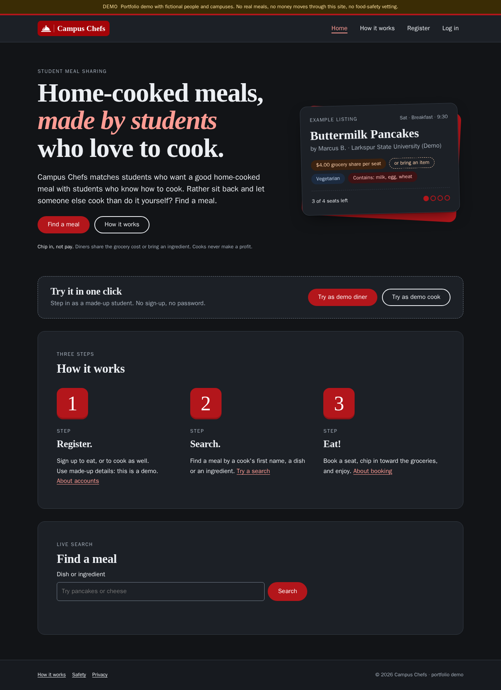
  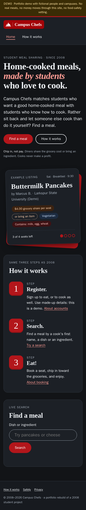
</p>

The accessibility gate is part of the browser tests: axe-core with its WCAG 2.0 A and AA, 2.1 AA and 2.2 AA rules on every main screen in both color schemes, plus the keyboard-only journey and the 320 px check. [docs/design-plan.md](docs/design-plan.md) has the palette and the type scale.

## Deliberately not built

| Not built | Why |
|---|---|
| Payment processing, stored card or payout details, payment handles, tips, pricing for profit | Legal and card-data exposure, and student privacy. The app records what was agreed, and money moves between students outside it |
| Messaging, notifications, email, password reset, email verification | A local demo has no mail transport. A real deployment would need verified campus email first |
| Photo uploads, maps, delivery | Privacy and driving liability |
| Full-text search | The seed has 48 dishes. A plain substring match is enough and simpler |
| Cross-checks between dietary tags and allergens, such as vegan against milk | They are doubtful in the domain itself (honey, gelatin) and would give false assurance. Tags are labeled "cook-declared" |
| A no-show status, a booking audit table, a cap on open requests per diner | The three-step story does not need them. The timeline comes from timestamps |
| Rate limits on registration, search and booking | The demo is local, and per-IP limits misfire behind Docker's port publishing. Only failed logins and the optional menu import are limited |
| A scheduled dependency-audit workflow | Dependabot and the pip-audit step on every pull request cover it while the repository is active |
| A recommender that suggests meals | Speculative |
| A hosted public sign-up | A decision, not a gap: see [why this is a demo](#why-this-is-a-demo) |
| A live demo of the original login exploit | Running an app whose code has a login bypass is not worth the risk. The bypass is read from the code and was not reproduced: [docs/before-after.md](docs/before-after.md#2-the-login-bypass) shows the query and the SQL the payload would build |

The plan listed dark mode and an animated demo as stretch goals, and the AI menu import as an optional phase. All three were built.

## What I would do next

1. **Verified campus email and password reset.** This needs a mail transport, and it closes the two gaps the demo accepts: anyone can register someone else's address, and the registration form reveals whether an email has an account.
2. **A hosted demo with sign-up off.** Demo logins only, a nightly reseed and real HTTPS. The settings for HTTPS already pass `check --deploy`.
3. **Card payments in a provider's test mode,** behind a legal review. A checkout per booking and a webhook that marks the share received. The plan sketches it as one added table and a webhook that sets the existing "received" timestamp (plan section 3.5).
4. **Counter-offers on custom terms.** Today a diner who wants different terms cancels and asks again, because there is no messaging.
5. **An atomic failed-login counter,** and a lockout that an outsider cannot trigger for someone else's email.
6. **Full-text search with an index** once there are more than a few hundred dishes.
7. **Django 6.2 LTS** when it is released, before 6.1 leaves security support. The plan header records both dates as checked on 2026-11-18.
8. **A first live run of the menu import,** after reading the API provider's data terms. Until then the feature stays off, and its API path has been tested only against a test double.

## Contact

The same method carries over to a client's legacy app: an audit by file and line, regression tests written before the fixes, a one-command local run and a runbook. Reach me through [my GitHub profile](https://github.com/gitchrisqueen).

## More to read

| Doc | What is in it |
|---|---|
| [docs/walkthrough.md](docs/walkthrough.md) | The booking story step by step, with a picture of every screen |
| [docs/architecture.md](docs/architecture.md) | Containers, the booking state machine, versions tested, deviations from the plan |
| [docs/SECURITY.md](docs/SECURITY.md) | What is defended, what is not, and how to report a problem |
| [docs/OPERATIONS.md](docs/OPERATIONS.md) | The runbook: commands, admin account, moderation, the optional AI menu import, when it breaks |
| [docs/before-after.md](docs/before-after.md) | The original code next to the fixes, defect by defect |
| [docs/LEGACY-MAP.md](docs/LEGACY-MAP.md) | Where each original file's job lives now |
| [docs/MODERNIZATION_PLAN.md](docs/MODERNIZATION_PLAN.md) | The plan, the test catalog and the decisions |
| [docs/design-plan.md](docs/design-plan.md) | Palette, type and layout |

**Contributing:** CI's denylist step fails closed on pull requests from forks, because forks cannot read the secret it needs. A maintainer re-runs such a change from a branch.

## License

[MIT](LICENSE) for the new code. The `legacy/` folder is kept for historical reference only, and no license is granted for it. The vendored axe-core file under `tests/e2e/vendor/` keeps its own MPL-2.0 license.
