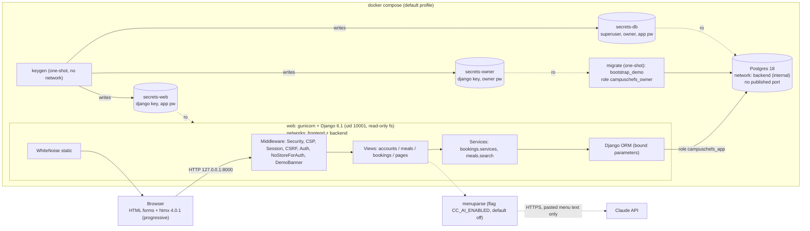
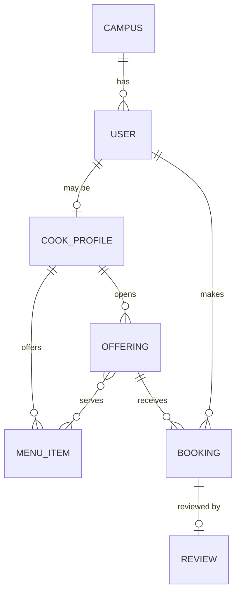
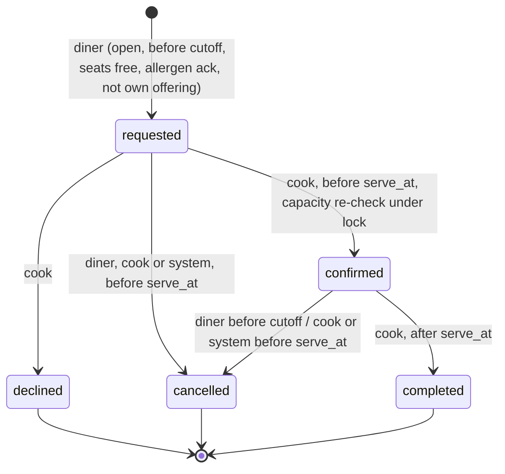

# Campus Chefs 2008 to 2026: Modernization Plan (revision 3)

> **Revision 3 (2026-11-18), owner input:** the 2008 intent was that a diner **chips in toward the groceries**. A diner either pays a share of the grocery cost or brings ingredients, which supplements the food budget of a student who likes to cook. Revision 2 had banned money entirely, which removed that idea. Revision 3 restores grocery cost-sharing as a core feature (section 3.5, CONTRIB-01..12, decision D10). The app still never moves money: it records what each diner agreed to contribute, and the cook marks it received.

**Stack: Django 6.1 + htmx 4.0.1, PostgreSQL 18, Python 3.14, Docker Compose, GitHub Actions.**

**Source:** I read every file in the original 2008 tree (kept outside this repo): src/, view/, tests/, css/, dbconnection/ and img/, plus the IDE metadata (`.project`, `.settings/`, `.cache/.dataModel`). I also opened the step images, the logo and the small profile photo. Nothing was modified. The line references below come from those files and were checked again for this revision.

**Version facts checked on 2026-11-18:**
- **Django:** 6.1.3 is current. PyPI shows it uploaded on 2026-11-03, with `requires_python >=3.12` and classifiers for Python 3.12 to 3.15.
  - Django 6.1 gets security fixes until December 2027. The project gives no exact day.
  - 6.2 LTS is planned for April 2027.
- **htmx** (npm registry): `latest` is 2.0.11 (2026-09-22) and `next` is 4.0.2 (published 2026-11-18, today).
  - 4.0.0 shipped on 2026-08-28 and 4.0.1 on 2026-11-01.
  - The pin rule says a release must be at least 14 days old, so the pin is **4.0.1**.
- **PostgreSQL** (docker-library `versions.json` and `18/alpine3.24/Dockerfile`):
  - 18.7 is current, and the default Alpine variant is 3.24.
  - In PG18 the image declares `VOLUME /var/lib/postgresql` and sets `PGDATA=/var/lib/postgresql/18/docker`.
- **Python** (docker-library `versions.json`): 3.14.10 is the current 3.14 patch.
  - 3.15.2 also exists. We stay on 3.14 because argon2-cffi and psycopg, which need native wheels, are more likely to have 3.14 wheels. Check this again at implementation.

**Not verified here** (marked "latest stable at implementation time, verify" where they are used):
- uv, Playwright, axe-core, gitleaks, Trivy, mermaid-cli, exiftool and the PHP images;
- the GitHub Action SHAs and the image digests;
- the minimum Docker Compose version;
- Dependabot uv support;
- the Claude model id;
- the exact names of Django's CSP settings and htmx 4's config keys.

---

## 0. Stack decision

| Option | Evidence | Verdict |
|---|---|---|
| **Django 6.1 + htmx 4 + Postgres 18 (chosen)** | Django ships the ORM, auth, sessions, CSRF, forms, migrations, autoescape, admin and `check --deploy`. Django 6.0 added built-in CSP and template partials. These close most of the 2008 defect classes without extra packages. Python is the common language of agent and integration work. | **Winner.** Least code to own, the strongest hiring signal, and real DB constraints. |
| Laravel 13 + Blade/Livewire 4 + MySQL 9.7 | Best same-language lineage: the legacy files map one-to-one onto Fortify, policies and Blade. | **Lost.** PHP is a weaker hiring signal for agent and integration roles, and nobody has verified Livewire 4 under a strict CSP. |
| Next.js 16 + Better Auth + Drizzle + Postgres | Typed end to end and Playwright-native. | **Lost.** The most moving parts: Drizzle 1.0 is still an RC, Next.js ships security releases about once a month, and auth comes from a third-party library. |

**Ideas taken from the losing proposals:**
- the keygen secrets container;
- the legacy SQLi exploit, mirrored by a 2026 regression test;
- the no-payment-column test (revised in revision 3 to allow only grocery-share columns) and the escape-once test;
- `linguist-vendored` for `legacy/`;
- the denylist held in a CI secret, and the CI gate that keeps `legacy/` read-only;
- the link crawler and the "no Under Construction" crawl;
- a 404, not a 403, for other users' objects.

---

## 1. Intent recap and scope

### 1.1 What it is, in 2026 terms

Campus Chefs is a campus meal-sharing marketplace, run as a **portfolio demo**.
- A student who cooks publishes a menu: breakfast, lunch and dinner, each split into mains and sides, plus one specialty per meal. The cook then opens dated meal slots called "offerings".
- A student who wants a home-cooked meal searches by a cook's first name or by dish or ingredient. They request seats with an allergen acknowledgment, choose how they will **chip in toward the groceries** (a per-seat grocery share, or an item from the cook's bring list), and they eat once the cook confirms.
- The cook gets help with the grocery bill, never a profit. A DB constraint caps the diners' total share at the cook's grocery estimate.
- Afterward the diner leaves a review in two parts, "The good" and "The bad". This is the 2008 `theGood`/`theBad` idea from `src/cook_main.php:118-124`.

**Ground rules:**
- the app never moves money: it records grocery shares and bring-list claims, and the students settle up in person (D10);
- all people and campuses are synthetic;
- every page shows a demo banner;
- allergens are mandatory declarations, and the site says plainly that it is not food-safety vetted.

### 1.2 MVP features mapped to the original 3 steps

| 2008 step | 2026 MVP feature |
|---|---|
| **1 Register** | POST registration with email, password and confirmation, first and last name, a campus `<select>`, optional classification, an 18+ attestation and a role radio ("I want to eat" / "I also cook"). Cooks also tick a food-safety acknowledgment. The form says "Use made-up details." `CC_REGISTRATION_OPEN` (default `true`) can switch registration off. Login and logout are POST. Session auth. A `/me` dashboard, account edit, password change and account deletion. Changing the email or password, or deleting the account, requires the current password. |
| **1 (cook)** | Kitchen: bio, and menu-item CRUD with meal type, course, ingredients, dietary tags and a specialty flag. Allergens need an explicit "list is complete" confirmation and are locked while active bookings exist. Offering CRUD covers serve time, booking cutoff, capacity, fulfillment and a private pickup note. |
| **2 Search** | `/search` matches a cook's first name, or a dish's name, description or ingredients (`icontains`). Filters: campus, meal type, date, dietary tag, and exclude-allergen. The exclude filter carries the note "cook-declared, not a safety guarantee". Results update live through htmx and also work without JavaScript. The public cook page shows specialties, a menu grid (meal type by course), upcoming offerings and reviews. |
| **3 Book it and eat** | A booking request is for 1 to 4 seats and needs the allergen acknowledgment. The cook confirms or declines. Either side can cancel within the rules. The cook marks the booking completed after serve time. The timeline comes from timestamp columns. |
| **3 Chip in** | The cook sets a grocery estimate and a per-seat share (the form suggests estimate ÷ (capacity + 1), because the cook eats too), and can add a "bring list" of ingredients. When booking, the diner picks "grocery share" or claims one bring-list item. A free offering skips this step. The share is snapshotted onto the booking. The cook marks it received. See 3.5. |
| **3 (after)** | A diner can review a completed booking within 14 days: 1 to 5 stars, "The good" and "The bad". Staff can hide a review in the admin. |
| **Demo layer** | A banner. "Try as demo cook" and "Try as demo diner" buttons, shown only when `CC_DEMO_MODE=true`. `/how-it-works`, `/safety` and `/privacy` pages. `noindex` on every page. `/healthz`. |
| **Optional, phase 12, owner decision D4** | AI menu import: the cook pastes a free-text menu and gets back an editable draft. Nothing is saved until the cook confirms the allergens. The feature flag is off by default. |

### 1.3 Every defect and TODO: disposition

Section 12 gives the full file:line inventory. Section 7 defines the test and check IDs.

| # | Defect / TODO | Decision | How / proof |
|---|---|---|---|
| 1 | SQL injection everywhere (`sqlQueries.php:40-43,58,87`). Read from the code (the app is never run), it is directly exploitable: PHP 5 `htmlentities()` defaults to `ENT_COMPAT`, which leaves `'` unescaped, so the email `' OR 1=1 -- ` would log in | **Fixed** | ORM only. AUTH-07, SRCH-03, CHK-04 |
| 2 | `htmlentities()` used to sanitize input (`login.php:7-8`, `registration_form.php:13-25`, `successful.php:23-27`). The other half of the bug: `cook_main.php:36-41` echoes DB values with no output escaping, so input encoding was the only defense | **Fixed** | Store raw values and escape on output (autoescape). REG-09, LEG-05, CHK-05 |
| 3 | Plaintext passwords, stored and compared | **Fixed** | Argon2id. REG-01 |
| 4 | Credentials sent over GET (`header.php:11`, `registration_form.php:29`) | **Fixed** | POST-only views with CSRF. AUTH-03, REG-08, AUTH-10 |
| 5 | DB user `root` with an empty password (`db_information.php:4-5`) | **Fixed** | Generated secrets, kept apart per service. The app role can only run DML. SEC-04, SEC-05, SEC-08, CHK-06 |
| 6 | `authenticate()` compares the email input with `first_name` (`sqlQueries.php:58`) | **Fixed** | `USERNAME_FIELD="email"`. AUTH-07 |
| 7 | `authenticate()` returns `"Valid"` and throws away `$userID` (`:66-79`); no session | **Fixed** | `login()` rotates the session key. AUTH-01 |
| 8 | JS redirect with stray quotes (`login.php:22`) | **Fixed** | Server-side 302, no JavaScript. AUTH-01 |
| 9 | `//HACK! fix this`, `$userID = 1` (`cook_main.php:7-8`) | **Fixed** | `request.user` plus scoped querysets. LEG-02 |
| 10 | The "Gender:" label prints `$age` (`cook_main.php:39-40`) | **Fixed by removal** | Gender and age are no longer collected (5.4). LEG-01 |
| 11 | Menu and specialties are hardcoded HTML (`cook_main.php:44-108`) | **Fixed** | `MenuItem` rows with `is_specialty`. MENU-03, MENU-04 |
| 12 | The cook's email is shown publicly (`cook_main.php:37`) | **Fixed** | Email is never rendered on public pages. AZ-06 |
| 13 | `profile.php:8` hardcodes `$profile_type="cook"` | **Fixed** | `/me` branches on whether a cook profile exists. LEG-03 |
| 14 | `customer_main.php` is empty; `Cook_Profile.html` and `Customer_Profile.html` are empty stubs | **Replaced / dropped** | `/me` diner dashboard. The stubs are not ported |
| 15 | Search posts to `hi.php` ("Under Construction"); `searchUsers()` is empty | **Fixed** | `/search`. SRCH-*, LEG-07 |
| 16 | Booking was never built | **Built** | 5-state machine (3.3). BOOK-* |
| 17 | Comments (the good and the bad) were never built | **Built** | `Review.the_good`, `Review.the_bad`. REV-* |
| 18 | `successful.php` inserts on GET with no validation, no confirmation check and no duplicate check, and always says "Thank you" | **Fixed** | `RegistrationForm` and a `Lower(email)` unique constraint. REG-02, REG-03, REG-08 |
| 19 | **INSERT column/value swap** (`sqlQueries.php:40-43`). The columns end `…car, campus, profileType`, but the values end `…$transportation, $profileType, $campus` | **Fixed** | Named ORM fields. LEG-04 |
| 20 | Hardcoded `http://localhost/workspace/CampusChefs` URLs. The footer uses `Campuschefs` (`footer.php:4-8`), which 404s on case-sensitive filesystems | **Fixed** | `` only. CHK-01, LEG-08 |
| 21 | `die(... mysql_error())` leaks DB errors (`sqlQueries.php:16,24`) | **Fixed** | `DEBUG=False` and a generic 500 page. LEG-06 |
| 22 | Dangling `else` in `connect()` (`sqlQueries.php:18-22`); the `mysql_*` extension was removed from PHP | **Dropped** | Django DB layer |
| 23 | CSS problems in `styles.css`: `@CHARSET "ISO-8859-1"` (`:1`); `//` comments (`:9-10,76,86`); `float: rightt` (`:31`); fixed `1024px` widths (`:7,180`); rounded corners faked with **6 corner JPGs** (4 `newcorner*.jpg`, 2 `headerbottom*.jpg`); `<center>` | **Fixed** | A UTF-8 `app.css` built on tokens, with grid layout, `border-radius` and mobile-first rules. CHK-03, E2E-04 |
| 24 | Accessibility: no alt text, labels not tied to inputs, HTML 4.01 Transitional | **Fixed** | WCAG 2.2 AA with an axe gate. CHK-02, A11Y-* |
| 25 | `footer.php:11`: the copyright sign is an ISO-8859-1 byte, so it turns into mojibake under UTF-8 | **Fixed** | UTF-8 everywhere. LEG-09 |
| 26 | `tests/control.php` and `tests/db_test.php` only echo, with no assertions; `db_test.php:34-36` labels `id` as "first name" | **Replaced** | pytest suite (section 7) |
| 27 | The `menu.php:2-5` header comment says "Consumer class"; the commented-out loop has `i <` (`:75`); "funtions" (`:16,33`) | **Dropped** along with the PHP bean classes | Logged in `docs/before-after.md` |
| 28 | Typos: "ingredent" (`welcome.php:39`), "Potatoe" and "Macaronii" (`cook_main.php:104-105`), "then to actually" (`welcome.php:24`), "clolsing" (`db_test.php:40`) | **Fixed** | Copy rewritten. LEG-10, CHK-09 |
| 29 | `welcome.php:32` says "register link at the top of the page", but the link was in the left nav | **Fixed** | The header now has a Register button |
| 30 | The `Cook` and `Consumer` beans carry `residence` and `school`; the rating `"2100"` has no scale | **Changed** | `school` becomes the campus FK, `residence` is dropped, and the rating is a computed 1–5 average |
| 31 | `img/profile_pic.jpg` and `img/profile_pic_small.jpg` are photos of a real person (checked by viewing them); `cook_main.php:31` shows the small one | **Never published** | Replaced by a placeholder. The phase 0 hash check proves it |
| 32 | Test literals that may name a real person, school or email (`cook_profile.php:100,116,128`, `customer_profile.php:91,107,115`, `tests/control.php:10,26,38`) | **Redacted at import** | `REDACTIONS.md` lists file:line only. SEC-06 |
| 33 | Unused assets: no PHP or CSS file references `img/logo.jpg` (420×300), `img/logo_trans.jpg`, `img/profile_pic.jpg` (the large photo) or `img/whiterounded.gif`. Only `logo2.jpg` is used as the logo | **Documented** | Listed as dead in `docs/LEGACY-MAP.md` |
| T1 | TODO "Transportation (change to radio buttons)" (`registration_form.php:57`) | **Changed** | Car ownership is not collected. It becomes a per-offering `fulfillment` radio: `pickup` or `dine_in` (D8) |
| T2 | TODO "Profile Type (change to radio buttons)" (`:62`) | **Fixed** | Role radio fieldset. REG-06 |
| T3 | TODO "campus (change to drop down menu)" (`:67`) | **Fixed** | `<select>` filled from the `Campus` table. REG-05 |
| T4 | TODO: take the user ID from the session (`cook_main.php:10`) | **Fixed** | See #9 |
| T5 | "delete later" test blocks (`cook_profile.php:93-129`, `customer_profile.php:84-116`, `menu.php:66-77`) | **Dropped** | Kept only in the redacted `legacy/` |
| T6 | About, Contact, FAQ, Feedback, How it works and Take the tour all point to `hi.php` | **Partly built** | **Built:** `/how-it-works` (which takes in About, the tour and the FAQ), `/safety`, `/privacy`. **Dropped:** Contact and Feedback. The footer links to the issue tracker through `CC_FEEDBACK_URL`, which is blank by default |

### 1.4 Deliberately not built

| Not built | Why |
|---|---|
| Payment processing, stored card or payout details, payment handles, tips, profit pricing | Legal and PCI exposure, and student privacy. The app only records grocery shares, and money moves between students outside the app (D10). DATA-02 proves no card, payout, handle or tip columns exist; the no-profit CHECK caps shares at the grocery cost |
| Messaging, notifications, email sending, password reset, email verification | A local demo has no mail transport. A real deployment would need `.edu` verification (documented in `SECURITY.md`) |
| Photo uploads, maps, delivery | Privacy and driving liability |
| Postgres full-text search and a GIN index | About 48 rows; `icontains` is enough and simpler |
| Cross-checks between dietary tags and allergens (for example vegan against milk) | They are doubtful on the domain itself (honey, gelatin) and give false assurance. Tags are labeled "cook-declared" |
| A no-show status, a booking audit table, a cap on each diner's open requests | The 1-2-3 story does not need them. The timeline comes from timestamps |
| Rate limits beyond login | The demo is local, and per-IP limits misfire behind Docker's port publishing (5.2) |
| Dark mode, a scheduled audit workflow, a demo GIF | **Stretch goals.** The tokens are laid out so that dark mode is one `@media` block later |
| An LLM "meal-match" recommender | Speculative |
| A hosted public sign-up | Owner decision D5 |

---

## 2. Architecture

### 2.1 Components

| Service | Image / role |
|---|---|
| `keygen` | One-shot `alpine:3.24`, pinned by digest, with `network_mode: none`. On its first run it writes random secrets of 80 hex characters. If DB data exists but the DB secrets are missing, it exits 1 (6.2) |
| `db` | `postgres:18.7-alpine3.24`, pinned by digest, on the `backend` network (`internal: true`), with no published port. On first init it creates `campuschefs_owner`, which owns the DB and has CREATEDB, and `campuschefs_app`, which can run DML only. The `postgres` superuser password is random, and no other container ever sees it |
| `migrate` | One-shot, on the same image as `web`, on `backend`. It runs `bootstrap_demo` as the owner role: `migrate`, `createcachetable`, `clearsessions`, then `seed_demo --if-empty` |
| `web` | Django 6.1 on gunicorn (3 sync workers, `--timeout 30 --graceful-timeout 20`) with WhiteNoise. UID 10001, read-only root filesystem, connects as `campuschefs_app`. It sits on `backend` and `frontend`, because port publishing needs a non-internal network |
| `tests` (profile `test`) | The `dev` build target: dev dependencies plus Playwright Chromium. UID 10001, on `backend` only. The repository is bind-mounted read-only at `/src` |
| Legacy harness (separate file, optional) | `legacy-support/harness/compose.legacy.yml`: PHP 5.6 + MySQL 5.7, loopback only, never in CI (6.4) |

There is no Redis, no queue and no scheduler. Sessions and the counters of failed logins live in Postgres. `clearsessions` runs on every `up`.

### 2.2 Diagram



### 2.3 Request flow: a diner books a meal

1. `GET /offerings/<id>` is public. It renders:
   - the dishes, with the allergens and dietary tags of each item;
   - the seats left and the disclaimer;
   - `<form method="post" action="/offerings/<id>/book" hx-post hx-target="#booking-panel">` with ``, `seats` and a required `allergen_ack` checkbox.
2. The POST passes `CsrfViewMiddleware`, then `@login_required`. Anonymous users go to `/login?next=`.
3. `BookingRequestForm` validates `seats` (1 to 4) and `allergen_ack`.
4. `bookings.services.request_booking(offering, diner, seats, now=None)` runs inside `transaction.atomic()` with `Offering.objects.select_for_update().get(pk=…)`. `now` defaults to `timezone.now()`, so tests can inject a time without freezegun. The service checks, in this order:
   1. the status is `open` and `now < booking_cutoff_at`;
   2. the diner is not the cook;
   3. requested seats, plus confirmed seats, plus the new seats do not exceed `capacity`.

   It then inserts `Booking(status=REQUESTED, allergen_ack_at=now)`.
5. With an `HX-Request` header, the response is the `booking_panel` partial (``). Without the header, the response is a 303 to `/bookings/<id>`.
6. The cook sees the request on `/me`. `POST /bookings/<id>/transition` with `to=confirmed` calls `services.transition(booking, to, actor, now=None)`. The view applies the status-code rule in section 3.3.

### 2.4 Auth and session model

- **User model:** `accounts.User(AbstractUser)` with `username` removed, `USERNAME_FIELD="email"` and `UniqueConstraint(Lower("email"))`. It ships in `accounts/0001` from day one.
- **Password hashing:**
  - `PASSWORD_HASHERS = [Argon2PasswordHasher, PBKDF2PasswordHasher]`.
  - Validators: minimum length 12, a custom maximum of 128, CommonPassword, UserAttributeSimilarity and Numeric.
  - Password change uses Django's `PasswordChangeView`. It calls `update_session_auth_hash`, so the current session survives and the other sessions are logged out.
- **Sessions:**
  - DB-backed, with a 2-week age.
  - Cookies are `HttpOnly` and `SameSite=Lax`.
  - `Secure` cookies and HSTS stay on unless `CC_DEMO_LOCAL_HTTP=true`.
  - Settings raise `ImproperlyConfigured` if `CC_DEMO_LOCAL_HTTP=true` while `ALLOWED_HOSTS` holds anything other than `127.0.0.1`, `localhost`, `[::1]` or `web` (SEC-09).
  - Logout is POST-only.
- **Roles:**
  - Any user can book.
  - A user is a cook when a `CookProfile` row exists for them.
  - Staff exists only for Django admin, and no staff account is seeded.
- **Authorization:**
  - The checks live in `core/permissions.py`.
  - Querysets are always scoped (`MenuItem.objects.filter(cook__user=request.user)`), so another user's object returns **404, not 403**.
  - Every ModelForm lists explicit `fields` (CHK-07, AZ-08).
- **Re-authentication:** changing the email, changing the password and deleting the account each need the current password.
- **Demo login:**
  - `POST /demo/login/<persona>`, where the persona is `cook`, `diner` or `cook2`.
  - The route exists only when `CC_DEMO_MODE=true`.
  - Seeded users have unusable passwords.

### 2.5 Directory layout

```
campus-chefs/
├── legacy/                         # 2008 tree, copied by allowlist, redacted, metadata-stripped, read-only; linguist-vendored; in .dockerignore
│   └── src/ view/ css/ dbconnection/ tests/ img/   # profile_pic*.jpg replaced by placeholders with the same names
├── legacy-support/
│   ├── SHA256SUMS  REDACTIONS.md (file:line + replacement only)  placeholder.jpg  placeholder-small.jpg
│   ├── render-static.sh            # renders legacy/view/welcome.php with a pinned PHP CLI image (required "before" evidence)
│   └── harness/                    # optional (D3): Dockerfile.php56 php-legacy.ini schema.sql seed.sql compose.legacy.yml exploit-demo.sh README.md
├── config/        settings.py urls.py wsgi.py
├── core/          views.py (home, how-it-works, safety, privacy, healthz)  ratelimit.py  permissions.py
│                  middleware.py (DemoBanner, NoStoreForAuthenticated)  secrets.py (*_FILE reader)
│                  management/commands/{bootstrap_demo,seed_demo}.py  seed_data.py
├── accounts/  meals/  bookings/    # models forms views admin services tests/
├── menuparse/                      # optional phase 12
├── templates/  static/ (css/app.css, js/htmx.min.js 4.0.1 vendored, img/logo.svg)
├── tests/         conftest.py  e2e/ (pytest-playwright, vendor/axe.min.js pinned)
├── docker/        entrypoint.sh  keygen.sh  postgres-init/01-roles.sh
├── scripts/       denylist.sh  check-image-metadata.sh  static_checks.py  wait-healthy.sh  smoke.sh  ops-checks.sh  capture_screenshots.py
├── docs/          architecture.md  before-after.md  LEGACY-MAP.md  SECURITY.md  OPERATIONS.md  walkthrough.md  screenshots/{before,after}/  puppeteer.json
├── .github/       workflows/ci.yml  dependabot.yml
├── Makefile  Dockerfile  compose.yaml  .dockerignore  .env.example  .gitignore  .gitattributes  .gitleaksignore
├── pyproject.toml  uv.lock  manage.py  README.md  LICENSE
```

---

## 3. Data model

These rules apply to every table:
- `id bigint identity`, plus `created_at` and `updated_at` as `timestamptz`, stored in UTC and shown in the campus timezone.
- Enums are `TextChoices`, each backed by a `CheckConstraint`.
- Every form rule that the DB can express is also enforced in the DB.



### 3.1 Tables

**`meals_campus`**
- `name` varchar(120), unique; `slug`, unique; `timezone`, default `America/New_York`.
- Seeded with fictional names that end in "(Demo)".

**`accounts_user`**

| Field | Rule |
|---|---|
| `email` | unique on `Lower(email)` |
| `password` | Argon2id hash |
| `first_name`, `last_name` | varchar(60), required. Shown publicly as "Ava R." |
| `campus_id` | FK, PROTECT, required |
| `classification` | `freshman`, `sophomore`, `junior`, `senior` or `graduate`; nullable |
| `adult_attested_at` | timestamptz NOT NULL |
| `is_active`, `is_staff`, `date_joined` | Django defaults |

Removed compared with 2008: gender, age, car, profileType, rating and residence.

**`meals_cookprofile`**
- `user_id` is both the PK and a 1:1 link to the user.
- `bio` varchar(500).
- `food_safety_ack_at` timestamptz NOT NULL.

**`meals_menuitem`**

| Field | Rule |
|---|---|
| `cook_id` | FK |
| `name` | varchar(80) |
| `description` | varchar(500), blank allowed |
| `ingredients` | varchar(500). `clean()` trims, lowercases and de-duplicates it |
| `meal_type` | `breakfast`, `lunch` or `dinner` |
| `course` | `main` or `side` |
| `allergens` | `ArrayField(varchar(24))` with CHECK `<@ ARRAY[milk, egg, fish, crustacean_shellfish, tree_nuts, peanuts, wheat, soy, sesame]` (the 9 major US allergens) |
| `allergens_confirmed_at` | timestamptz NOT NULL |
| `dietary_tags` | `ArrayField` with CHECK `<@ ARRAY[vegetarian, vegan, dairy_free, gluten_free]`; labeled "cook-declared, not verified" |
| `is_specialty` | bool |
| `is_active` | bool, default true. Items are archived, and never hard-deleted once offered |

Constraints and rules on `meals_menuitem`:
- `UniqueConstraint(cook, Lower(name), meal_type, condition=Q(is_active=True))`.
- `UniqueConstraint(cook, meal_type, condition=Q(is_specialty=True, is_active=True))`. This keeps the 2008 "Specialties: Breakfast / Lunch / Dinner" idea.
- **Allergen lock:** the item form rejects allergen edits while the item belongs to an offering that has `requested` or `confirmed` bookings. A diner's acknowledgment therefore always refers to the list they saw (MENU-05).

**`meals_offering`**

| Field | Rule |
|---|---|
| `cook_id` | FK |
| `title` | varchar(80) |
| `meal_type` | enum |
| `items` | M2M through `meals_offeringitem`. The form and the service enforce that every item belongs to the same cook (AZ-07) |
| `serve_at`, `booking_cutoff_at` | timestamptz, with CHECK `booking_cutoff_at <= serve_at` |
| `capacity` | smallint, CHECK 1..12 |
| `fulfillment` | `pickup` or `dine_in` |
| `pickup_note` | varchar(200). Shown only to the cook and to confirmed diners |
| `status` | `open` or `cancelled` |
| `grocery_estimate_cents` | integer, NOT NULL, default 0, CHECK 0..20000 (at most $200) |
| `share_per_seat_cents` | integer, NOT NULL, default 0, CHECK `>= 0` |

- Index on `(status, serve_at)`.
- **No-profit CHECK:** `share_per_seat_cents * capacity <= grocery_estimate_cents`. Diners together can never be asked for more than the groceries cost.
- Money is integer cents everywhere. There are no floats or decimals, and no payment columns (DATA-02).

**`meals_offeringneed`** (the bring list)

| Field | Rule |
|---|---|
| `offering_id` | FK, CASCADE |
| `label` | varchar(80), for example "1 lb spaghetti" |
| `claimed_by_booking_id` | OneToOne to booking, nullable, SET_NULL. One booking claims at most one item, and an item has at most one claimant |

**`bookings_booking`**

| Field | Rule |
|---|---|
| `offering_id` | FK, PROTECT |
| `diner_id` | FK, PROTECT |
| `seats` | smallint, CHECK 1..4 |
| `status` | `requested`, `confirmed`, `declined`, `cancelled` or `completed` |
| `allergen_ack_at` | timestamptz NOT NULL |
| `note` | varchar(280) |
| `decided_at`, `closed_at` | nullable |
| `cancelled_by` | `diner`, `cook` or `system`; nullable. CHECK: set if and only if `status='cancelled'` |
| `contribution` | `none`, `share`, `ingredients` or `custom` |
| `share_cents` | integer, NOT NULL, CHECK `>= 0`. Snapshot of `seats × share_per_seat_cents` at request time. CHECK: `share_cents = 0` unless `contribution` is `share` or `custom`. For `custom`, it holds the amount the diner offers (0 allowed) |
| `terms` | varchar(280), blank allowed. Required when `contribution='custom'`, for example "I'll bring drinks and $3". Shown only to the cook and that diner |
| `contribution_received_at` | timestamptz, null. Only the cook sets it, and only on a `confirmed` or `completed` booking |

- Partial `UniqueConstraint(offering, diner, condition=Q(status__in=["requested","confirmed"]))`.
- Indexes on `(diner)` and `(offering, status)`.
- The timeline reads "Requested `created_at`", then "Confirmed/Declined `decided_at`", then "Cancelled by X / Completed `closed_at`". There is no audit table.

**`bookings_review`**

| Field | Rule |
|---|---|
| `booking_id` | OneToOne, PROTECT |
| `rating` | smallint, CHECK 1..5 |
| `the_good`, `the_bad` | varchar(500), blank allowed |
| `hidden_at` | timestamptz, null |

- The author is `booking.diner` and the cook is `booking.offering.cook`. Neither is stored a second time, so neither can drift.
- The cook's rating is the `Avg` and `Count` of that cook's reviews with `hidden_at IS NULL`. It is computed when read and never stored.

### 3.2 Search (`meals/search.py::search_offerings`)

1. **Base set:** `Offering` rows with `status=open` and `booking_cutoff_at > now()`.
2. **Text match:** when `q` is given, a row matches either way:
   - `items__name`, `items__description` or `items__ingredients` `icontains q`;
   - `cook__user__first_name icontains q`.

   **Last names are never searched.** This stops search from revealing a surname that the page shows only as an initial (SRCH-10). `icontains` escapes `%` and `_`.
3. **Filters:** campus slug, meal type, date, dietary tag (every item on the offering carries the tag), and exclude-allergens (`~Q(items__allergens__overlap=[...])`).
4. `.distinct()`, ordered by `serve_at`, 20 per page.

### 3.3 Booking state machine (`bookings/services.py`)



- **Source of truth:** `ALLOWED: dict[tuple[Status, Status], frozenset[Actor]]`, which holds exactly these 5 edges.
- **System actor:** cancels a booking when its offering is cancelled or when the cook deletes their account.
- **Transactions:** each transition writes the status and its timestamp in one transaction, under `select_for_update` on the offering.
- **Status-code rule** (the same rule everywhere):
  - a user who is not a participant gets **404**;
  - a participant whose role is not allowed on an edge that exists gets **403**;
  - an edge that does not exist, or a failed time guard, gets **409**.
- **Expired requests:** a `requested` booking whose `serve_at` has passed renders as "expired". It is not a stored status.

### 3.4 Migrations and seed

- **Migrations:**
  - Migrations are committed, and CI runs `makemigrations --check --dry-run`.
  - Roles and grants live in `docker/postgres-init/01-roles.sh`. CI runs the same script against its service container.
- **Seed content:** `seed_demo` is deterministic (`random.Random(2008)`). It uses hand-written lists in `core/seed_data.py` and no Faker. It creates:
  - 3 campuses: "Larkspur State University (Demo)", "Cobalt Bay Institute (Demo)" and "Maple Hollow College (Demo)". Before publishing, search for real institutions with these names.
  - 3 personas: `cook@larkspur.example`, `diner@larkspur.example` and `cook2@cobaltbay.example`.
  - 8 cooks and 14 diners, all with `.example` emails.
  - About 48 menu items covering every meal type and course. The 2008 dishes come back with corrected spelling: "Baked Potato", "Macaroni and Cheese", "Collard Greens", "French Toast".
  - 16 offerings timed relative to the seed time: past, today, and 1 to 7 days ahead.
  - Bookings in every status. The demo diner has **a confirmed booking on a demo-cook offering served yesterday**, which E2E-02 uses.
  - 12 reviews, 1 of them hidden.
  - Offerings that cover every contribution type: free, a cash share only, a bring list only, and both. The demo diner's seeded confirmed booking carries a $4.00 share that is not yet received.
- **The demo goes stale, stated honestly:**
  - A fresh volume seeds relative to the first boot.
  - `--if-empty` never reseeds, so a volume kept for more than a week runs out of future offerings.
  - `make reseed` (`seed_demo --reset`, allowed only with `CC_DEMO_MODE=true`) refreshes it.
  - `make e2e` reseeds first.

### 3.5 Grocery contribution (`bookings/contributions.py`)

This is the 2008 intent: diners supplement the food costs of a student who likes to cook.

- **Cook side (offering form):**
  - The cook enters a grocery estimate and a per-seat share.
  - The form suggests `floor(estimate / (capacity + 1))`, rounded down to $0.25, because the cook eats too. The no-profit CHECK rejects any share above `estimate / capacity`.
  - The cook can add bring-list items.
  - A share of $0 with an empty bring list makes a **free** offering.
- **Diner side (booking form):**
  - **Share:** `share_cents = seats × share_per_seat_cents`, frozen on the booking. Later edits to the offering never change it (CONTRIB-03).
  - **Ingredients:** the diner claims one open bring-list item in the same transaction as the request, under `select_for_update` on the offering. That item replaces the cash share for the whole booking (CONTRIB-04).
  - **Custom (owner, D10):** the diner proposes their own terms. That is free text, plus an optional amount that is still capped at `seats × floor(grocery_estimate_cents / capacity)`. When the cook confirms the booking, they accept those terms. There is no counter-offer loop, because messaging is not built: to change the terms, the diner cancels and requests again (CONTRIB-11, CONTRIB-12).
  - **None:** allowed only on a free offering (CONTRIB-06).
- **Settling up:**
  - Money changes hands between the students, in person, outside the app. The booking page tells the diner "Grocery share: $4.00, pay the cook at pickup" or "Bring: 1 lb spaghetti".
  - The cook marks the contribution received with `contribution_received_at`. This is a field next to the booking status, not a new state, so the 5-edge state machine in 3.3 is unchanged.
  - Status codes follow the 3.3 rule (CONTRIB-07).
- **Release:** a decline or cancellation, including a system cancel, frees the claimed item in the same transaction (CONTRIB-05).
- **Kitchen panel:** for each offering, it shows "Expected $X · Received $Y · Groceries $Z".
- **Never stored:** card numbers, bank details, or payment handles such as Venmo or Cash App usernames. A handle is personal data, and the app has no need for it.
- **If D10 option 2 (Stripe test mode) is chosen:** add `bookings_payment(booking, stripe_checkout_session_id, status)` and a webhook that sets `contribution_received_at`. A cancellation refunds the payment. DATA-02 then also allows `stripe_checkout_session_id`.

---

## 4. UX and design

### 4.1 Pages

| Path | Purpose | Access |
|---|---|---|
| `/` | Wordmark hero, the 2008 description with fixed copy, the **1-2-3 steps**, a search box and the demo persona buttons | public |
| `/how-it-works` | How it works, the tour (screenshots), the FAQ and a `#booking` anchor | public |
| `/safety` | Demo notice; cottage-food, allergen and no-inspection notices | public |
| `/privacy` | What is stored, what is not, and how to delete it | public |
| `/register`, `/login`, `POST /logout` | Account | public (`/register` 404s when `CC_REGISTRATION_OPEN=false`) |
| `/search` | Search and filters, with an allergen disclaimer at the filter and above the results | public |
| `/cooks/<id>` | "First L.", campus, classification (if set), rating text, specialties, menu grid, upcoming offerings and reviews | public (404 for an inactive user) |
| `/offerings/<id>`, `POST …/book` | Dishes, allergens, tags, seats left, disclaimer and the request form | public / user |
| `/me` | Diner: profile summary and my bookings. A cook also sees pending requests and upcoming offerings | user |
| `/me/edit`, `/me/password`, `POST /me/delete` | Account edit, password change and deletion, each needing the current password | user |
| `/kitchen/setup`, `/kitchen/items/…`, `/kitchen/offerings/…` | Become a cook; menu and offering CRUD | user / cook |
| `/bookings/<id>`, `POST …/transition`, `…/review` | Timeline, allowed actions and the review form | participant (otherwise 404) |
| `/kitchen/import` | AI menu import (404 unless the flag is on) | cook |
| `/healthz` | `connection.ensure_connection()`: 200 `ok`, or 503 `db unavailable` | public |
| `/admin/` | Review moderation (the login is rate-limited) | staff |

### 4.2 Design tokens (`static/css/app.css`, `@layer tokens`)

The contrast figures were computed by hand with the WCAG formula. UX-01 and axe have the final say.

| Token | Value | Source / check |
|---|---|---|
| `--cc-brand` | `#A40408` | 2008 header red (`styles.css:55`); white text on it ≈ 8.1:1 |
| `--cc-brand-strong` | `#7F0306` | hover; white ≈ 10.9:1 |
| `--cc-accent` | `#A40408` | links; ≈ 6.8:1 on `--cc-bg` |
| `--cc-bg` | `#E5ECF3` | 2008 body blue-gray (`styles.css:4`) |
| `--cc-surface` | `#FFFFFF` | |
| `--cc-text` | `#1A1A1A` | |
| `--cc-muted` | `#4A5563` | ≈ 7.6:1 on white, ≈ 6.4:1 on bg |
| `--cc-focus` | `#1F5FBF` | ≈ 5.1:1 on bg |
| `--cc-radius` | `0.75rem` | replaces the 6 corner JPGs |
| `--cc-font-display` | `"Iowan Old Style","Palatino Linotype",Palatino,Georgia,serif` | echoes the serif of `logo2.jpg`; system fonts only |
| `--cc-font-body` | `system-ui,-apple-system,"Segoe UI",Roboto,sans-serif` | |
| `--cc-space-1..7` | 4/8/12/16/24/32/48 px | |

- The wordmark is redrawn as `static/img/logo.svg`, with a `<title>`.
- Dark mode is a stretch goal. Brand red on a dark background would fail contrast (≈ 2.3:1), so dark mode would need its own accent color.

### 4.3 How the 1-2-3 steps survive

`img/welcome1-3.jpg` are red rounded squares with a white serif numeral (checked by viewing them), and they have no alt text. They become `templates/_steps.html`:
- an `<ol class="steps">` with three `<li>`;
- a CSS counter draws each badge, marked `aria-hidden`;
- the headings stay "Register.", "Search." and "Eat!";
- each step links to its action: `/register`, `/search`, `/how-it-works#booking`;
- the steps stack below 40rem and form a 3-column grid above that width.

### 4.4 Responsive and WCAG 2.2 AA

- **Layout and structure:**
  - A mobile-first grid with `max-width: 72rem` and no fixed widths.
  - No horizontal scroll at 320px (E2E-04).
  - Landmarks, a skip link, one `h1` per page, an HTML5 doctype and UTF-8.
- **Forms:**
  - Every input has `<label for>`. Radio groups use `fieldset` and `legend`.
  - The error summary has `role="alert"` and takes focus. Each field has `aria-describedby`.
- **Status cues:**
  - The htmx results region is `aria-live="polite"`.
  - Status and allergen badges carry text, never color alone.
  - Stars carry text, for example "4.5 out of 5 (12 reviews)".
- **WCAG 2.2 criteria:**
  - 2.4.11: no sticky header.
  - 2.5.7: no dragging.
  - 2.5.8: targets of at least 24 px, and 44 px for primary buttons.
  - 3.2.6: the help links sit in the same footer position on every page.
  - 3.3.7: booking never asks again for account data.
  - 3.3.8: no CAPTCHA, and `autocomplete` is set.
- **Motion and avatars:** `prefers-reduced-motion` turns off the swap transitions. Avatars are initials only.
- **Demo banner:** `role="region" aria-label="Demo notice"`, reading "Portfolio demo with fictional people and campuses. No real meals, no money moves through this site, no food-safety vetting."

---

## 5. Security and privacy

### 5.1 Fix list per original defect

Section 1.3 gives the fix and the proof for each defect. Section 12 maps every file:line.

### 5.2 Controls

| Control | Implementation |
|---|---|
| SQL | ORM only. CHK-04 fails on `.raw(`, `.extra(`, `RawSQL`, `connection.cursor` or `cursor.execute` in app code, and bandit B608 runs alongside it. `/healthz` uses `ensure_connection()`, so it needs no raw SQL |
| Output encoding | Autoescape stays on. CHK-05 bans `\|safe`, `mark_safe` and ``, with an empty allowlist |
| Passwords | Argon2id, 12 to 128 characters, checked against a list of common passwords |
| CSRF | `CsrfViewMiddleware`. Every change of state is a POST with a token. `require_POST` on logout, transitions, deletes and demo login |
| Mass assignment | Every ModelForm has explicit `fields` (CHK-07). Status, `hidden_at`, ownership and staff flags are never form fields (AZ-08) |
| Rate limiting | `core/ratelimit.py`, about 30 lines:<br>– counts **failed** logins only, keyed on `sha256(lower(email))`, so no raw email sits in a key;<br>– 5 failures in 15 min return 429 with `Retry-After`;<br>– covers `/login` and `admin.site.login`;<br>– uses its own cache alias on the table `cc_ratelimit` with `MAX_ENTRIES=100000`, so a flood of keys cannot cull the counters;<br>– never reads `X-Forwarded-For`;<br>– has no per-IP limits, because behind Docker port publishing every client can share one gateway IP.<br>Known gaps, documented in `SECURITY.md`: `cache.incr` is not atomic across workers, and someone who knows an email can lock it out for 15 min |
| Headers | Django built-in CSP. The expected names are `SECURE_CSP` and `django.middleware.csp.ContentSecurityPolicyMiddleware`; verify both in phase 1. The policy: `default-src 'self'; script-src 'self'; style-src 'self'; img-src 'self' data:; form-action 'self'; frame-ancestors 'none'; base-uri 'none'`.<br>htmx: no injected indicator styles (the indicator CSS ships in `app.css`), and eval off. Verify the htmx 4 config key names in phase 1. No inline `style=` attributes; E2E-06 fails on any CSP violation.<br>Also `nosniff`, `Referrer-Policy: same-origin`, `X-Frame-Options: DENY`, `Cross-Origin-Opener-Policy: same-origin`, and a `Permissions-Policy` that turns off camera, microphone and geolocation. HSTS only outside local-HTTP mode |
| Caching | The `NoStoreForAuthenticated` middleware adds `Cache-Control: private, no-store` to every response for a logged-in user (SEC-07) |
| Errors | `DEBUG=False` in the image. Custom 404 and 500 pages. Logs go to stdout, without request bodies |
| Secrets | Nothing is committed.<br>– `keygen` writes 80-hex-char values with `od -An -tx1 -N40 /dev/urandom \| tr -d ' \n'`. That is more than 50 characters, so `security.W009` does not fire, and hex needs no quoting in SQL.<br>– **One volume per consumer:** `web` sees only `django_secret_key` and `db_app_password`. `migrate` sees the key and `db_owner_password`. The dev-only `tests` container sees the owner set plus the web set, for SEC-04 and SEC-05. Only `db` sees the superuser password (SEC-08).<br>– Files are mode 0400 and owned by the consuming UID: 10001 for the app images, 70 for the postgres user in the Alpine image (verify).<br>– CI uses dummy values of more than 50 characters, marked `# gitleaks:allow` |
| DB least privilege | `01-roles.sh` reads the passwords from the environment or from files, and creates:<br>– `campuschefs_owner` (LOGIN, CREATEDB, owner of the database). From PG15 on, owning the database gives it CREATE on `public` through `pg_database_owner`;<br>– `campuschefs_app` (LOGIN, NOSUPERUSER), granted DML through `ALTER DEFAULT PRIVILEGES FOR ROLE campuschefs_owner`.<br>`web` connects as the app role. `migrate` and `tests` connect as the owner |
| Container | `web` and `migrate`: UID 10001, `read_only`, `tmpfs: /tmp`, `cap_drop: [ALL]`, `no-new-privileges`. `keygen`: `network_mode: none`, `cap_drop: [ALL]`, `cap_add: [CHOWN, DAC_OVERRIDE]`, `no-new-privileges`. `db`: `no-new-privileges` only, because its entrypoint needs its default capabilities to switch to the postgres user. `mem_limit` and `pids_limit` on `web` and `db`. `db` sits only on an `internal: true` network. The runtime image gets only the app directories |
| Supply chain | `uv.lock` is committed and installed with `uv sync --locked`. ruff, djlint, codespell, bandit, pip-audit and tinycss2 live in the locked dev group, so no tool needs its own `uvx` pin. Dependabot covers github-actions, docker and uv. Actions are pinned by SHA and every image by digest (CHK-08). Trivy scans a `docker save` tarball (`--input`), so it never gets the Docker socket |

### 5.3 Scans in CI

These run on every PR and every push to main, with no path filter:
- gitleaks (full history, `--redact`);
- `scripts/denylist.sh`;
- the legacy read-only gate;
- ruff, djlint, codespell, and CHK-01..09;
- bandit and pip-audit;
- `check --deploy --fail-level WARNING`;
- `makemigrations --check`;
- Trivy.

A weekly scheduled audit workflow is a stretch goal. While the repo is active, Dependabot and the pip-audit run on each PR cover dependency CVEs.

### 5.4 PII minimization

| 2008 field | 2026 decision | Reason |
|---|---|---|
| gender | **Dropped** | No feature uses it, it is sensitive, and the 2008 page labeled it wrongly |
| age | **Dropped**; replaced by `adult_attested_at` | Liability needs proof of adulthood, not a birth date |
| car / transportation | **Moved** to `offering.fulfillment` | It describes the meal, not the person |
| classification | Kept, optional | Low risk |
| first and last name | Stored; displayed as "Ava R." | Search matches only the first name (SRCH-10) |
| email | Login only; **never rendered publicly** | The 2008 cook page printed it |
| residence | Dropped | `pickup_note` is shown only to confirmed diners |
| profile photo | Not supported | The 2008 photo is of a real person |
| diner allergy data | Not collected | Diners filter and acknowledge; nothing about them is stored |

**Account deletion** (`POST /me/delete`, with the current password):
1. Cancels the user's own requested and confirmed bookings (`cancelled_by=diner`).
2. **If the user is a cook:**
   - cancels every future offering, which cancels its bookings with `cancelled_by=system`;
   - sets `is_active=False` on every menu item;
   - clears the bio.

   The CookProfile row stays, because past bookings reference it through PROTECT.
3. Anonymizes the user row:
   - the email becomes `deleted-<id>@invalid.example`;
   - the name displays as "Former student";
   - the password becomes unusable;
   - `is_active=False`.
4. Past reviews stay and show "Former student". The page of an inactive cook returns 404.

**Demo-only trade-offs, documented in `SECURITY.md`:**
- REG-03 says "already registered", which lets anyone test whether an email has an account. Without a mail transport, the usual alternative is not possible.
- With no email verification, anyone can register someone else's address.
- A cook can use fake accounts to book, complete and review their own offerings.

### 5.5 Demo disclaimers and legal exposure

- **Disclaimers:**
  - The banner shows while `CC_DEMO_MODE=true`.
  - The `noindex` meta tag, `robots.txt` (disallow all) and the `/safety` and `/privacy` pages are always on, whatever the demo mode.
  - `/safety` says five things: cottage-food rules vary by place, so this is not a real service; allergens are self-declared; anyone with a severe allergy should not rely on the site; nobody inspects the kitchens; and grocery shares are cost-sharing capped at the grocery cost, which some places may still treat as a sale of food (this is not legal advice).
- **Acknowledgments:**
  - The cook confirms `food_safety_ack_at`.
  - Every menu item needs `allergens_confirmed_at`.
  - Every booking needs `allergen_ack_at`.
  - These are UI acknowledgments, not legal compliance, and the README says so.
- **Exposure controls:**
  - `CC_REGISTRATION_OPEN=false` turns sign-up off for any hosted demo (D5).
  - The registration form asks for made-up details.
  - The README says "Do not deploy with public sign-ups."

### 5.6 Public-safety rules for `legacy/`

- **Copy by allowlist, not by exclusion.** Only these are copied:
  - `src/`, `view/`, `css/`, `dbconnection/` and `tests/`;
  - the 14 images other than the two profile photos, plus placeholders with the same names as those two.

  `.project`, `.settings/`, `.cache/`, `graft/` and any future junk are never copied.
- **Metadata stripped:** run `exiftool -all= -overwrite_original` on every legacy image (exiftool version: verify). The current JPEGs carry a "Created with GIMP" comment. Hash the files after stripping. `scripts/check-image-metadata.sh` fails on any EXIF, XMP, IPTC, GPS or comment tag.
- **Redacted at import:** the literals at `cook_profile.php:100,116,128`, `customer_profile.php:91,107,115` and `tests/control.php:10,26,38` become `TestName`, `Example College` and `student@example.test`.
  - `REDACTIONS.md` lists file:line and the replacement only.
  - The unredacted tree never enters git.
- **Denylist:**
  - The regex lives in the CI secret `PUBLIC_DENYLIST_REGEX`, and locally in `~/.config/campuschefs/denylist`, outside the repo.
  - `scripts/denylist.sh` scans the tree (file names included) and the full history.
  - **It prints only the file path, the line number and the hit count.** It uses `grep -n` piped through `cut -d: -f1,2`, and `git log -G` with `--name-only`. It never uses `-o` and never prints the matched text, because GitHub masks only the whole secret string, not each alternative inside the regex (SEC-06).
  - When the variable is empty, the script fails closed.
  - Its output is never uploaded as an artifact.
- **Read-only signals:**
  - `.dockerignore`;
  - the ruff and djlint excludes;
  - `linguist-vendored`;
  - `SHA256SUMS`;
  - a CI gate that fails any PR touching `legacy/` unless it carries the `legacy-change` label.

---

## 6. Docker

### 6.1 `Dockerfile`

```dockerfile
# syntax=docker/dockerfile:1
ARG PYTHON_IMAGE=python:3.14.10-slim@sha256:<digest>      # pin digest at implementation (verify)
FROM ${PYTHON_IMAGE} AS base
COPY --from=ghcr.io/astral-sh/uv:<version>@sha256:<digest> /uv /bin/uv   # latest stable at implementation, verify
ENV UV_COMPILE_BYTECODE=1 UV_LINK_MODE=copy UV_PROJECT_ENVIRONMENT=/opt/venv \
    UV_PYTHON_DOWNLOADS=never UV_PYTHON=/usr/local/bin/python3 \
    PYTHONUNBUFFERED=1 PYTHONDONTWRITEBYTECODE=1 DJANGO_SETTINGS_MODULE=config.settings
WORKDIR /src
COPY pyproject.toml uv.lock ./

FROM base AS build
RUN --mount=type=cache,target=/root/.cache/uv uv sync --locked --no-dev --no-install-project
COPY manage.py ./
COPY config/ config/
COPY core/ core/
COPY accounts/ accounts/
COPY meals/ meals/
COPY bookings/ bookings/
COPY templates/ templates/
COPY static/ static/
COPY docker/entrypoint.sh docker/entrypoint.sh
# throwaway key scoped to this RUN only; collectstatic opens no DB connection
RUN DJANGO_SECRET_KEY="$(od -An -tx1 -N40 /dev/urandom | tr -d ' \n')" /opt/venv/bin/python manage.py collectstatic --noinput

FROM ${PYTHON_IMAGE} AS runtime
RUN useradd --uid 10001 --no-create-home --shell /usr/sbin/nologin app
COPY --from=build /opt/venv /opt/venv
COPY --from=build /src /app
ENV PATH=/opt/venv/bin:$PATH PYTHONUNBUFFERED=1 PYTHONDONTWRITEBYTECODE=1 DJANGO_SETTINGS_MODULE=config.settings
RUN python -c "import django, psycopg, argon2, gunicorn"      # fails the build if the venv interpreter link is broken
WORKDIR /app
USER 10001
EXPOSE 8000
HEALTHCHECK --interval=10s --timeout=3s --start-period=20s --retries=5 \
  CMD ["python","-c","import sys,urllib.request as u; sys.exit(0 if u.urlopen('http://127.0.0.1:8000/healthz',timeout=2).status==200 else 1)"]
ENTRYPOINT ["/app/docker/entrypoint.sh"]
CMD ["gunicorn","config.wsgi:application","--bind","0.0.0.0:8000","--workers","3","--timeout","30","--graceful-timeout","20","--access-logfile","-"]

FROM base AS dev
ENV PATH=/opt/venv/bin:$PATH PLAYWRIGHT_BROWSERS_PATH=/ms-playwright COVERAGE_FILE=/tmp/.coverage RUFF_NO_CACHE=true
RUN --mount=type=cache,target=/root/.cache/uv uv sync --locked --no-install-project
RUN playwright install --with-deps chromium && useradd --uid 10001 --no-create-home app
USER 10001
# source is bind-mounted read-only at /src by compose; pytest runs with -p no:cacheprovider
```

- **Venv link:** the build and runtime stages share one `PYTHON_IMAGE` digest, and `UV_PYTHON_DOWNLOADS=never` makes the venv point to `/usr/local/bin/python3`. The `RUN python -c import…` line proves that link works inside the runtime image.
- **No build flag:** the old `CC_BUILD` flag is gone, so production settings have no build-only branch that could weaken them.
- **`.dockerignore`:** `legacy/ legacy-support/ .git docs/ .env .env.* !.env.example **/__pycache__ test-results/`. `tests/` never reaches the runtime image, because the build stage copies only the app directories (and `menuparse/` if phase 12 ships).
- **Entrypoint:** `docker/entrypoint.sh` (POSIX sh) checks that the `*_FILE` paths exist, then runs `exec "$@"`.

### 6.2 `compose.yaml`

```yaml
name: campuschefs
x-app-env: &app-env
  CC_DEMO_MODE: ${CC_DEMO_MODE:-true}
  CC_DEMO_LOCAL_HTTP: "true"
  CC_REGISTRATION_OPEN: ${CC_REGISTRATION_OPEN:-true}
  CC_AI_ENABLED: ${CC_AI_ENABLED:-false}
  CC_FEEDBACK_URL: ${CC_FEEDBACK_URL:-}
  DJANGO_ALLOWED_HOSTS: "127.0.0.1,localhost,web"
  DJANGO_SECRET_KEY_FILE: /run/cc-secrets/django_secret_key
  DB_HOST: db
  DB_NAME: campuschefs
x-hardened: &hardened
  read_only: true
  tmpfs: ["/tmp"]
  cap_drop: ["ALL"]
  security_opt: ["no-new-privileges:true"]
services:
  keygen:
    image: alpine:3.24@sha256:<digest>                # verify digest
    command: ["/bin/sh", "/keygen.sh"]
    network_mode: none
    cap_drop: ["ALL"]
    cap_add: ["CHOWN", "DAC_OVERRIDE"]
    security_opt: ["no-new-privileges:true"]
    volumes:
      - secrets-db:/out/db
      - secrets-owner:/out/owner
      - secrets-web:/out/web
      - pgdata:/pgdata:ro
      - ./docker/keygen.sh:/keygen.sh:ro
    restart: "no"
  db:
    image: postgres:18.7-alpine3.24@sha256:<digest>   # CHK-08: identical in ci.yml
    depends_on: { keygen: { condition: service_completed_successfully } }
    environment:
      POSTGRES_DB: campuschefs
      POSTGRES_PASSWORD_FILE: /run/cc-secrets/db_superuser_password
    volumes:
      - pgdata:/var/lib/postgresql                     # PG18 image VOLUME; PGDATA=/var/lib/postgresql/18/docker (verified 2026-11-18)
      - secrets-db:/run/cc-secrets:ro
      - ./docker/postgres-init:/docker-entrypoint-initdb.d:ro
    networks: [backend]
    security_opt: ["no-new-privileges:true"]
    mem_limit: 512m
    pids_limit: 200
    healthcheck:
      test: ["CMD-SHELL", "pg_isready -h 127.0.0.1 -U postgres -d campuschefs"]   # -h forces TCP, so the init-phase server does not pass
      interval: 5s
      timeout: 3s
      retries: 30
      start_period: 10s
  migrate:
    <<: *hardened
    build: { context: ., target: runtime }
    image: campuschefs:local
    command: ["python", "manage.py", "bootstrap_demo"]
    environment: { <<: *app-env, DB_USER: campuschefs_owner, DB_PASSWORD_FILE: /run/cc-secrets/db_owner_password }
    volumes: ["secrets-owner:/run/cc-secrets:ro"]
    networks: [backend]
    depends_on: { db: { condition: service_healthy } }
    restart: "no"
  web:
    <<: *hardened
    image: campuschefs:local
    environment: { <<: *app-env, DB_USER: campuschefs_app, DB_PASSWORD_FILE: /run/cc-secrets/db_app_password }
    volumes: ["secrets-web:/run/cc-secrets:ro"]
    networks: [backend, frontend]
    ports: ["127.0.0.1:${WEB_PORT:-8000}:8000"]
    depends_on: { migrate: { condition: service_completed_successfully } }
    mem_limit: 512m
    pids_limit: 256
    stop_grace_period: 25s
    restart: unless-stopped
  tests:
    profiles: ["test"]
    build: { context: ., target: dev }
    image: campuschefs:dev
    environment:
      <<: *app-env
      DB_USER: campuschefs_owner
      DB_PASSWORD_FILE: /run/cc-secrets/db_owner_password
      DB_APP_USER: campuschefs_app
      DB_APP_PASSWORD_FILE: /run/cc-secrets-app/db_app_password
      CC_REQUIRE_ROLE_TESTS: "1"
      BASE_URL: "http://web:8000"
    volumes:
      - ".:/src:ro"
      - "./test-results:/src/test-results"
      - "./docs/screenshots:/src/docs/screenshots"
      - "secrets-owner:/run/cc-secrets:ro"
      - "secrets-web:/run/cc-secrets-app:ro"
    networks: [backend]
    depends_on: { db: { condition: service_healthy } }
    command: ["pytest"]
networks:
  backend: { internal: true }
  frontend: {}
volumes: { pgdata: {}, secrets-db: {}, secrets-owner: {}, secrets-web: {} }
```

**`docker/keygen.sh`** (about 30 lines, POSIX sh):
1. **Guard:** if any of `/out/db/{db_superuser_password,db_owner_password,db_app_password}` is missing **and** `/pgdata/18/docker/PG_VERSION` exists, it prints "DB data exists but its secrets are gone. Run: docker compose down -v (demo data is synthetic)" and exits 1. Without this guard, new passwords would silently stop matching the existing roles (OPS-02).
2. **Generate:** it creates each missing DB password and `/out/owner/django_secret_key` with the 80-hex command.
3. **Distribute on every run, atomically:** for each file it writes a temp file, runs `chmod 0400` and `chown`, then `mv`s it into place.
   - `owner/db_owner_password` is copied from `db/`.
   - `web/db_app_password` is copied from `db/`.
   - `web/django_secret_key` is copied from `owner/`.
   - The `db/*` files are owned by 70:70 (verify the Alpine postgres UID). The `owner/*` and `web/*` files are owned by 10001:10001.

**`docker/postgres-init/01-roles.sh`:**
- Reads `CC_OWNER_PASSWORD` and `CC_APP_PASSWORD` from the environment, falling back to `/run/cc-secrets/*`.
- Runs `CREATE ROLE` only when the role is missing. Then it runs `ALTER ROLE … PASSWORD` and `ALTER DATABASE campuschefs OWNER TO campuschefs_owner`, then sets the default privileges.
- It is idempotent, so CI can run the same script against its service container.

**Commands:**

| Task | Command |
|---|---|
| One-command demo (foreground) | `docker compose up`. No `.env` is needed. Open `http://127.0.0.1:8000` and press "Try as demo diner" |
| Detached | `make demo`. It runs `docker compose up -d --build`, then `scripts/wait-healthy.sh web 180`. That script polls `docker compose ps --format json` until `web` is healthy, and fails if `keygen` or `migrate` exited non-zero |
| Re-seed | `make reseed` |
| Full reset (the only rollback this demo needs) | `docker compose down -v` |

**Ports and volumes:**
- Only `127.0.0.1:${WEB_PORT:-8000}` is published. Postgres is never published.
- Volumes: `pgdata`, `secrets-db`, `secrets-owner` and `secrets-web`.

### 6.3 `Makefile` and `.env.example`

```make
RUN ?= docker compose --profile test run --rm tests     # CI overrides: RUN="uv run"
K ?=
test:     ; mkdir -p test-results && chmod 0777 test-results && $(RUN) pytest -p no:cacheprovider -m "not e2e" $(if $(K),-k "$(K)") $(if $(COV),--cov --cov-fail-under=90)
e2e:      ; $(if $(NO_RESEED),,$(MAKE) reseed &&) $(RUN) pytest -p no:cacheprovider -m e2e $(if $(K),-k "$(K)") --tracing retain-on-failure --output test-results
lint:     ; $(RUN) sh -c 'ruff check . && ruff format --check . && djlint templates --lint && codespell && python scripts/static_checks.py'
sast:     ; $(RUN) sh -c 'bandit -q -c pyproject.toml -r accounts meals bookings core config && uv export --locked --no-hashes --format requirements-txt -o /tmp/req.txt && pip-audit --strict -r /tmp/req.txt'
manage:   ; $(RUN) python manage.py $(ARGS)
deploy-check: ; $(RUN) env CC_DEMO_MODE=false CC_DEMO_LOCAL_HTTP=false DJANGO_ALLOWED_HOSTS=campuschefs.example python manage.py check --deploy --fail-level WARNING
demo:     ; docker compose up -d --build && scripts/wait-healthy.sh web 180
reseed:   ; docker compose run --rm migrate python manage.py seed_demo --reset
smoke:    ; scripts/smoke.sh
```

- `make` runs its recipes under `sh`, so the multi-word `RUN` splits the same way under zsh and bash. This replaces the old `$T` variable, which zsh does not word-split.
- The same recipes work locally and in CI. In CI, `uv run` puts the locked venv on `PATH`. The dev image has `/bin/uv` and `/opt/venv/bin` on `PATH`. The dev stage sets `RUFF_NO_CACHE=true` because `/src` is read-only.
- `e2e` reseeds first unless `NO_RESEED=1` is passed. Phase 1 passes it, because `seed_demo` arrives in phase 2.
- `tests/conftest.py` maps the `BASE_URL` environment variable to pytest-playwright's `base_url`.
- `.env.example` lists optional overrides only, each empty or set to its default: `WEB_PORT=8000`, `CC_DEMO_MODE=true`, `CC_REGISTRATION_OPEN=true`, `CC_AI_ENABLED=false`, `CC_AI_MODEL=` and `CC_FEEDBACK_URL=`. A comment says that `keygen` generates the secrets, and that secrets must never be added to this file. A second comment says that the Anthropic API key never goes in this file: it goes in a file of its own, named by `ANTHROPIC_API_KEY_FILE` (`docs/OPERATIONS.md`, "AI menu import").

### 6.4 "Before" evidence and the optional live legacy harness

**Required (phase 10a): static "before" evidence.** It needs no EOL runtime.
- `legacy-support/render-static.sh` copies `legacy/` to a temp directory and renders `view/welcome.php` with a pinned `php:8.x-cli` image (verify the tag): `php -d display_errors=0 welcome.php > view/welcome.html`. The page needs no DB.
- `capture_screenshots.py --before` then screenshots the result through `file://`, so the relative `../css` and `../img` paths resolve.
- `docs/before-after.md` adds:
  - file:line excerpts of `sqlQueries.php:58` and `login.php:7-8`;
  - the `' OR 1=1 -- ` payload, with an explanation of why `ENT_COMPAT` lets it through;
  - the AUTH-07 output as the 2026 proof;
  - the original step and logo images.

**Optional (phase 10b, D3): a live harness in `legacy-support/harness/compose.legacy.yml`.**
- **Services:**
  - `legacy-web`: `php:5.6-apache` plus `docker-php-ext-install mysql`. It mounts `../../legacy` read-only at `/var/www/html/workspace/CampusChefs`. Healthcheck: `curl -f http://127.0.0.1/workspace/CampusChefs/view/welcome.php` (verify that curl is in the image).
  - `legacy-db`: `mysql:5.7` with `platform: linux/amd64` and `MYSQL_ALLOW_EMPTY_PASSWORD=yes`, to match the frozen config. MySQL 5.7 still uses `mysql_native_password`, which `mysql_connect` needs. Healthcheck: `mysqladmin ping -h 127.0.0.1`.
  - The two containers share a `mysqld-sock` volume at `/var/run/mysqld`. `db_information.php:2` says `localhost`, which makes `mysql_connect` use a unix socket.
- **Data:** `schema.sql` holds the `user_info` DDL inferred from the code, labeled "inferred". `seed.sql` holds one synthetic row with `id=1`.
- **Port:** `127.0.0.1:${LEGACY_PORT:-80}:80`. The hardcoded links assume `http://localhost/…`, so they work only on port 80. On any other port the pages and the exploit still work, but the nav links break.
- **Prerequisites:**
  - a free port 80 (rootless Docker on Linux cannot bind it);
  - amd64 emulation on Apple silicon, which is slow;
  - acceptance that the EOL images may stop pulling and that their Debian apt sources may be archived (verify).
- **Run:** `docker compose -f legacy-support/harness/compose.legacy.yml up -d --wait`, then `sh legacy-support/harness/exploit-demo.sh`. The script curls `…/src/login.php?email=%27%20OR%201%3D1%20--%20&password=x` and greps the result for `profile.php`.
- **Guardrails:**
  - This is a deliberately vulnerable app on loopback. Run it only while capturing, then `down -v` straight away, because a browser tab could reach it through CSRF or DNS rebinding.
  - It never runs in CI and is never deployed. It runs with `display_errors=Off`.
  - CHK-06 applies to `compose.yaml` only.
- **Fallback:** if the harness will not run, phase 10a is the accepted "before" evidence.

### 6.5 Prerequisites and operations (README "Prerequisites" + `docs/OPERATIONS.md`)

- **Prerequisites:**
  - Docker Engine with Compose v2. Compose must support a top-level `name:`, `service_completed_successfully` and `--wait`. Phase 1 confirms the minimum version and records the Engine and Compose versions it tested.
  - `make` and `curl`.
  - About 3 GB of free disk for the runtime, Postgres and dev (Playwright) images. This is an estimate; phase 1 measures it.
  - Outbound network access on the first build (Docker Hub, ghcr.io, PyPI).
  - amd64 or arm64. The main stack images are multi-arch; only the optional legacy harness is amd64.
- **Port:**
  - `WEB_PORT` changes the published port.
  - `ALLOWED_HOSTS` ignores the port, and Django's CSRF origin check compares against the request host including its port. Direct loopback access therefore needs no `CSRF_TRUSTED_ORIGINS`, and OPS-03 proves it.
  - A reverse proxy would need `CSRF_TRUSTED_ORIGINS`, which is out of scope.
- **Runbook:**

| Task | How |
|---|---|
| Logs | `docker compose logs -f web` (or `migrate`, `db`) |
| Backup | `docker compose exec -T db pg_dump -U postgres campuschefs > backup.sql`. This goes through the local socket, which the official image trusts (verify) |
| Restore | `docker compose exec -T db psql -U postgres campuschefs < backup.sql` |
| Upgrade | `git pull && make demo`. `migrate` runs automatically |
| Failed migration | `web` never starts, because it waits for `migrate` to finish successfully, so nothing restarts in a loop. Read `docker compose logs migrate`. The rollback is `docker compose down -v`, since the data is synthetic |
| keygen says "secrets are gone" | `docker compose down -v` |
| Port in use | `WEB_PORT=8010 docker compose up` |

---

## 7. Test strategy

### 7.1 Layers

| Layer | Tooling | Where |
|---|---|---|
| Unit + integration | pytest + pytest-django against **real Postgres 18**, connected as the owner role, which is not a superuser. Locally that is `make test`; CI uses its service container with the same roles script. No SQLite. BOOK-06 uses `@pytest.mark.django_db(transaction=True)`. When `CC_REQUIRE_ROLE_TESTS=1` and the app credentials are missing, the role tests (SEC-04, SEC-05) fail instead of skipping | `*/tests/` |
| E2E | pytest-playwright (Chromium) against the running compose stack. A listener for `securitypolicyviolation` events and console errors runs on every page | `tests/e2e/` |
| Accessibility | axe-core (vendored, pinned) with the tags `wcag2a, wcag2aa, wcag21aa, wcag22aa`. Any violation fails | `tests/e2e/test_a11y.py` |
| Static checks | CHK-01..09 in `make lint` and `make sast`. They are not counted as tests | `scripts/static_checks.py` |
| Smoke and ops | `scripts/smoke.sh` and `scripts/ops-checks.sh` against the real images | CI and phase exits |

- **Coverage gate:** `--cov=accounts --cov=meals --cov=bookings --cov=core --cov-fail-under=90`, plus `menuparse` if phase 12 ships.
- **Naming:** each test name starts with its zero-padded ID (`test_auth_07_…`), so `-k auth_07` selects exactly that test. E2E tests carry `@pytest.mark.e2e`.

### 7.2 Behavioral tests

There are 116 behavioral tests (121 with the AI tests), plus 9 static checks and 3 ops checks.

**Auth (11)**
- AUTH-01 - given a registered user, when they POST `/login` with the correct email and password, then they get a 302 to `/me`, `request.user.id` is theirs, and the session key differs from the one before login.
- AUTH-02 - given a wrong password, and separately an unknown email, when either is POSTed to `/login`, then both return 200 with the same message, "Email or password is incorrect".
- AUTH-03 - given valid credentials in the query string, when someone GETs `/login?email=…&password=…`, then the form renders and the user stays anonymous.
- AUTH-04 - given a client that enforces CSRF, when it POSTs `/login` without a token, then it gets 403.
- AUTH-05 - given 5 failed logins for one email within 15 min, when a 6th attempt arrives with the correct password, then it gets 429 with `Retry-After`. The same holds on `/admin/login/`. The cache key contains no raw email.
- AUTH-06 - given a logged-in user, when they GET `/logout`, then they get 405 and stay logged in; when they POST with CSRF, then they become anonymous.
- AUTH-07 - given a user with first name "Ava" and email `ava.r@larkspur.example`, when someone logs in with `Ava` as the email, or with `' OR 1=1 -- `, then the login fails.
- AUTH-08 - given an anonymous visitor, when they GET `/me`, then they get a 302 to `/login?next=/me`.
- AUTH-09 [e2e] - given the login page, when the CSRF field is changed before submit, then a 403 page renders and the user is not logged in.
- AUTH-10 [e2e] - given the full E2E run, when every request URL is recorded, then none contains `password=`.
- AUTH-11 - given a user with two sessions, when they change the password in one session with the correct current password, then that session stays logged in and the other one is logged out; with a wrong current password, nothing changes.

**Account (4)**
- ACCT-01 - given a diner with a requested booking and a past review, when they POST `/me/delete` with their password, then the booking is `cancelled` (`cancelled_by=diner`), the user is inactive with an `@invalid.example` email, and the review shows "Former student".
- ACCT-02 - given a wrong password, when someone POSTs `/me/delete`, then nothing changes.
- ACCT-03 - given a cook with a future offering that has a confirmed booking, when the cook deletes the account, then the offering is cancelled, the booking is `cancelled` with `cancelled_by=system`, the menu items are inactive, and `/cooks/<id>` returns 404.
- ACCT-04 - given a user, when they change the email without the current password, then the change is rejected; with the password, it is accepted.

**Registration (11)**
- REG-01 - given valid input, when it is POSTed, then the user exists, `password` starts with `argon2$argon2id$`, and no column equals the plaintext.
- REG-02 - given a password that differs from its confirmation, when it is POSTed, then a field error shows and no user is created.
- REG-03 - given `ava.r@larkspur.example` exists, when someone registers `AVA.R@Larkspur.example`, then "already registered" shows and the user count is unchanged.
- REG-04 - given an 11-character password, or `password1234`, when it is POSTed, then a validator error shows.
- REG-05 - given a tampered campus id 99999, when it is POSTed, then a campus field error shows.
- REG-06 - given role=cook without the food-safety acknowledgment, when it is POSTed, then an error shows. With the acknowledgment, a `CookProfile` exists. With role=eat, none exists.
- REG-07 - given the 18+ box unchecked, when it is POSTed, then an error shows and no user is created.
- REG-08 - given full registration parameters in a query string, when someone GETs `/register?...`, then no user is created.
- REG-09 - given the name `O'Brien`, when it is registered and the profile is viewed, then the DB stores it raw and the HTML contains `O&#x27;Brien` exactly once.
- REG-10 - given the extra parameters `sex`, `age` and `transportation`, when they are POSTed, then they are ignored, and the model has no such fields.
- REG-11 - given `CC_REGISTRATION_OPEN=true`, `/register` shows the "use made-up details" note; given `false`, `/register` returns 404 and no Register link renders.

**Search (10)**
- SRCH-01 - given an item whose ingredients include "lentils", when someone searches `q=lentils`, then its offering is listed.
- SRCH-02 - given the cook "Mateo L.", when someone searches `q=Mateo`, then his upcoming offerings are listed.
- SRCH-03 - given seeded data, when someone searches `q=%' UNION SELECT password FROM accounts_user -- `, then the response is 200 with zero results, no `argon2$` and no DB error.
- SRCH-04 - given items with and without peanuts, when someone searches with `exclude=peanuts`, then no listed offering contains a peanut item, and the "not a safety guarantee" note renders.
- SRCH-05 - when someone searches with `diet=vegan`, then the only offerings listed are those where every item is tagged vegan.
- SRCH-06 - given open, cancelled, past-cutoff and other-campus offerings, when someone searches `campus=larkspur`, then only open Larkspur offerings with a future cutoff are listed, ordered by `serve_at`.
- SRCH-07 - given `HX-Request: true`, the response is the results partial with no `<html>`; without the header, it is a full page.
- SRCH-08 - given `q=<script>alert(1)</script>`, the echoed query is escaped.
- SRCH-09 - given `q=%` or `q=_`, 0 results are returned.
- SRCH-10 - given a cook whose last name is "Lindqvist", when someone searches `q=Lindq`, then 0 results are returned, so search cannot reveal a surname.

**Booking state machine (15)**
- BOOK-01 - given an open offering and a logged-in diner, when they book 2 seats with the allergen box ticked, then the booking is `requested` and `allergen_ack_at` is set.
- BOOK-02 - given the allergen box unticked, when someone books, then a form error shows and no booking is created.
- BOOK-03 - given a `requested` booking, when the cook POSTs `to=confirmed`, then it is `confirmed` and `decided_at` is set.
- BOOK-04 - given a `requested` booking, when the diner POSTs `to=confirmed`, then they get 403 and nothing changes.
- BOOK-05 - given capacity 4 with 3 seats taken, when someone books 2, then they see "Only 1 seat left"; booking 1 succeeds.
- BOOK-06 (`transaction=True`) - given 1 seat left, when two diners book at the same moment on two connections, then exactly one booking is created.
- BOOK-07 - given a cook, when they book their own offering, then the booking is rejected.
- BOOK-08 - given an active booking, when the same diner books again, then the booking is rejected; after they cancel, a new request succeeds.
- BOOK-09 - parametrized over every (from, to, actor): exactly the 5 edges in 3.3 succeed; a disallowed actor on an existing edge gets 403; a non-existent edge gets 409.
- BOOK-10 - given a `confirmed` booking past `booking_cutoff_at`, when the diner cancels, then they get 409.
- BOOK-11 - given a `confirmed` booking, when the cook marks it `completed` before `serve_at` (injected `now`), then they get 409; after `serve_at`, it becomes `completed`.
- BOOK-12 - given an offering with 1 requested and 1 confirmed booking, when the cook cancels the offering, then both are `cancelled` with `cancelled_by=system`.
- BOOK-13 - given an offering past its cutoff, when a diner requests a booking, then it is rejected.
- BOOK-14 - given an offering with a `pickup_note`, when a guest, a requested diner, a confirmed diner and the cook each view it, then only the last two see the note.
- BOOK-15 - given a `declined` booking, when any actor attempts any transition, then they get 409.

**Grocery contribution (12)**
- CONTRIB-01 - given a $20.00 estimate and capacity 4, when the cook sets a $5.25 share per seat, then the form rejects it with "Diners together can't pay more than the groceries cost", and a direct ORM write raises `IntegrityError`; a $5.00 share saves.
- CONTRIB-02 - given a $20.00 estimate and capacity 4, when the cook opens the offering form, then the suggested share is $4.00 (estimate ÷ (capacity + 1), rounded down to $0.25).
- CONTRIB-03 - given a $4.00 share, when a diner books 2 seats with "grocery share", then `share_cents=800`; when the cook later changes the share to $3.00, then the booking still shows $8.00.
- CONTRIB-04 (`transaction=True`) - given an open bring-list item, when a diner books with "bring an item" and claims it, then the item is claimed by that booking and `share_cents=0`; a second diner cannot claim it; two simultaneous claims produce exactly one claim.
- CONTRIB-05 - given a booking that claimed an item, when the booking is declined, cancelled by the diner, cancelled by the cook, or system-cancelled with its offering, then the item is open again.
- CONTRIB-06 - given a free offering, the booking form shows no contribution choice and stores `contribution=none`; given a share above $0, a POST with `contribution=none` is rejected.
- CONTRIB-07 - given a confirmed booking with a share, when the cook POSTs mark-received, then `contribution_received_at` is set; the diner gets 403, another user gets 404, and the cook gets 409 on a `requested` or `cancelled` booking.
- CONTRIB-08 - search results and the cook page show "Free", "$4.00 grocery share per seat" and "or bring an item" exactly as seeded, and the `max_share` filter excludes offerings above it.
- CONTRIB-09 - given an offering with a $20.00 estimate and two confirmed share bookings ($8.00 and $4.00), one of them received, the kitchen panel shows "Expected $12.00 · Received $4.00 · Groceries $20.00".
- CONTRIB-11 - given a $4.00 share, when a diner books 1 seat with `contribution=custom`, $3.00 and "I'll bring drinks", then the booking stores both; the cook sees the terms before confirming; after confirmation, both booking pages show "Agreed: $3.00 + I'll bring drinks"; other users never see the terms. A `custom` booking with blank terms is rejected.
- CONTRIB-12 - given a $20.00 estimate and capacity 4, when a diner offers a custom $5.25 for 1 seat, then the booking is rejected by the no-profit cap ($5.00 per seat).
- CONTRIB-10 - model introspection: every money field is an `IntegerField` named `*_cents`, no model has a `FloatField` or `DecimalField`, and every money value renders as `$X.XX`.

**Reviews (7)**
- REV-01 - given a `completed` booking, when its diner posts rating 5 and "The good", then the review is saved and the cook's average and count include it.
- REV-02 - given a `confirmed` booking, when the diner posts a review, then they get 403.
- REV-03 - given a reviewed booking, when a second review is posted, then it is rejected and there is still one review.
- REV-04 - given a rating of 0 or 6, a form error shows.
- REV-05 - given a booking completed more than 14 days ago (injected `now`), the review is rejected.
- REV-06 - given a hidden review, it is absent from the cook page and excluded from the average.
- REV-07 - given a completed booking, when an unrelated user posts a review, then they get 404; when its cook posts one, then they get 403.

**Authorization (8)**
- AZ-01 - given a diner without a cook profile, when they GET or POST `/kitchen/items/new`, then they get 403.
- AZ-02 - given cooks A and B, when A POSTs an edit to B's item, then A gets 404 and the item is unchanged.
- AZ-03 - given an unrelated user, when they GET `/bookings/<id>`, then they get 404.
- AZ-04 - given a diner, when they POST `to=completed` on their own booking, then they get 403.
- AZ-05 - given an anonymous visitor, when they POST to any `/kitchen/*` or `/bookings/*` route, then they are redirected to login and nothing changes.
- AZ-06 - given `/cooks/<id>`, `/search` and `/offerings/<id>`, when they render, then no seeded email and no full last name appear.
- AZ-07 - given cook A, when A creates an offering that includes B's item id, then a validation error shows and no offering is created.
- AZ-08 - given POSTs that add `is_staff=on`, `is_superuser=on`, `is_active=off`, `status=completed`, `hidden_at=…`, `cook=<other>` or `diner=<other>` to the registration, account, booking, review, item and offering forms, then none of those fields change.

**Menu and domain rules (5)**
- MENU-01 - given the allergen `latex`, when the form is submitted, then it is invalid, and a direct ORM save raises `IntegrityError`.
- MENU-02 - given no allergen confirmation, when a cook creates an item, then it is rejected.
- MENU-03 - given a cook adds the dinner side "Baked Potato", when their public page is viewed, then it appears under Dinner, then Sides.
- MENU-04 - given a second active breakfast specialty, when it is saved, then it is rejected.
- MENU-05 - given an item on an offering with a confirmed booking, when the cook edits its allergens, then a form error shows and the allergens are unchanged; when the cook edits its description, then the edit succeeds.

**Legacy defect regressions (10)**
- LEG-01 - given a cook page, it has no "Gender" or "Age" label, and every `<dt>` is unique.
- LEG-02 - given users 1 and 2, each with bookings, and user 2 logged in, when user 2 GETs `/me`, then user 2's name and bookings appear and user 1's never do.
- LEG-03 - given a user without a cook profile, `/me` has no kitchen panel; given a user with one, the panel renders.
- LEG-04 - given a registration with campus Cobalt Bay and role cook, `user.campus.slug == "cobalt-bay"` and a cook profile exists.
- LEG-05 - given the password `a&b<c>"d'e-1234`, when a user registers and then logs in, then the login succeeds.
- LEG-06 - given an unreachable DB, `/healthz` returns 503 `db unavailable`, and `/` returns the generic 500 page with no `psycopg` or `Traceback`.
- LEG-07 [e2e] - given every reachable page, none contains "Under Construction".
- LEG-08 [e2e] - given every header, nav and footer link, each returns 200.
- LEG-09 - given any page, `Content-Type` has `charset=utf-8`, and the footer contains U+00A9.
- LEG-10 - given the rendered `/` and the seed data, "ingredient" is present, and "ingredent", "Potatoe" and "Macaronii" are absent.

**Data (3)**
- DATA-01 - after `seed_demo` runs, every email ends `.example` and every campus name ends "(Demo)".
- DATA-02 - in the migrated schema, no column name matches `card|iban|routing|account_number|payout|tip|venmo|cashapp|paypal|handle`, and the only columns matching `cents|price|amount|cost` are `grocery_estimate_cents`, `share_per_seat_cents` and `share_cents` (plus `stripe_checkout_session_id` only if D10 option 2 is chosen).
- DATA-03 - parametrized: for each `CheckConstraint` and `UniqueConstraint` in 3.1, a direct ORM write that breaks it raises `IntegrityError`. The cases: a share × capacity above the grocery estimate, rating 0, seats 5, capacity 13, a cutoff after the serve time, a duplicate active booking, a second specialty, a bad enum value, and `cancelled_by` set on a booking that is not cancelled.

**Security (9)**
- SEC-01 - any response carries CSP, nosniff, Referrer-Policy and `frame-ancestors 'none'`, and the session cookie is HttpOnly with SameSite=Lax.
- SEC-02 - with production settings and a 64-character key, `check --deploy --fail-level WARNING` exits 0.
- SEC-03 - with `CC_DEMO_MODE=true`, the banner shows. With `false`, the banner is absent and `POST /demo/login/cook` returns 404, while `noindex` and `/safety` remain.
- SEC-04 - connected as the app role, `SELECT rolsuper, rolcreatedb FROM pg_roles WHERE rolname=current_user` returns false for both.
- SEC-05 - connected as the app role, `CREATE TABLE x(i int)` raises a permission error.
- SEC-06 - `scripts/denylist.sh` returns 0 hits on the tree and the history. With a planted test hit, it exits 1, and its output contains the path and line but **not** the matched string. With the variable empty, it exits non-zero.
- SEC-07 - any response to a logged-in user carries `Cache-Control` with `private` and `no-store`.
- SEC-08 [smoke] - in the running stack, `/run/cc-secrets` in `web` holds exactly `django_secret_key` and `db_app_password`; in `migrate` it holds exactly `django_secret_key` and `db_owner_password`; no container except `db` has `db_superuser_password`.
- SEC-09 - settings with `CC_DEMO_LOCAL_HTTP=true` and `ALLOWED_HOSTS=campuschefs.example` raise `ImproperlyConfigured`.

**Health, UX, accessibility and E2E (11)**
- HEALTH-01 - with the DB up, `/healthz` returns 200 `ok` with no version or env data.
- UX-01 - the token pairs in `app.css` (text on bg and on surface, white on brand, accent on bg, muted on both) reach at least 4.5:1, and focus on bg reaches at least 3:1.
- A11Y-01 [e2e] - home, search, register, login, a cook page, an offering, a booking, `/me` and the menu form each have 0 axe violations.
- A11Y-02 [e2e] - when the register form is submitted empty, focus moves to the error summary and `aria-describedby` links each error to its field.
- A11Y-03 [e2e] - the home steps are an `<ol>` of 3 `<li>` holding "Register.", "Search." and "Eat!", with no digit images.
- E2E-01 [e2e] - given a freshly reseeded stack, when the demo diner searches "pancakes", books 1 seat choosing the grocery share with the allergen acknowledgment, and the demo cook confirms, then the diner's booking page shows "Confirmed" and "Grocery share: $X.XX, pay the cook at pickup".
- E2E-02 [e2e] - given the seeded confirmed booking on yesterday's offering, when the demo cook marks its $4.00 share received and marks it completed, and the demo diner reviews it, then the cook page shows the review under "The good".
- E2E-03 [e2e] - using only the keyboard, registering and booking both succeed, and every focused element has a visible outline.
- E2E-04 [e2e] - at a 320×800 viewport, every public page has `scrollWidth <= 320`.
- E2E-05 [e2e] - with JavaScript disabled, search and booking both work through full-page posts.
- E2E-06 [e2e] - every crawled page has 0 `securitypolicyviolation` events and 0 console errors, and the htmx live search swaps in its results.

**AI (only if phase 12 is approved) (5)**
- AI-01 - with `CC_AI_ENABLED=false`, `/kitchen/import` returns 404 and the client is never constructed.
- AI-02 - given a mocked client that returns a valid draft, an editable formset renders, and the MenuItem count stays the same until the cook confirms.
- AI-03 - given a mocked refusal or invalid output, a friendly message and the manual form show.
- AI-04 - given 4,001 characters, a validation error shows and no API call is made.
- AI-05 - given a confirmed draft, `allergens_confirmed_at` is set only if the cook ticked the confirmation.

### 7.3 Static checks (in `make lint` / `make sast`, not counted as tests)

- CHK-01 - 0 matches for `http://localhost` or `workspace/` in templates, static files and app code.
- CHK-02 - djlint: every `` has alt text and every input has a label.
- CHK-03 - tinycss2 parses `app.css` with 0 errors, and finds no `//` comment, no `rightt`, no `width: 1024px`, and no `@charset` other than UTF-8.
- CHK-04 - app code has no `.raw(`, `.extra(`, `RawSQL`, `connection.cursor` or `cursor.execute`, and bandit reports no B608.
- CHK-05 - no `|safe`, `mark_safe` or `autoescape off`.
- CHK-06 - `compose.yaml` and `.env.example` contain no non-empty password value, no `MYSQL_ALLOW_EMPTY_PASSWORD` and no `root` DB user.
- CHK-07 - every ModelForm declares explicit `fields`, with no `__all__` and no `exclude`.
- CHK-08 - the Postgres image reference is identical in `compose.yaml` and `ci.yml`, every `uses:` is a 40-hex SHA, and every `image:` has an `@sha256:` digest.
- CHK-09 - codespell finds nothing in files outside `legacy/`.

### 7.4 Ops checks (`scripts/ops-checks.sh`; they destroy local demo data)

- OPS-01 - seed, record the offering count, run `docker compose down` (no `-v`), then `make demo`. The count is unchanged and `migrate` exits 0.
- OPS-02 - with data present, remove the `secrets-db` volume and run `up`. `keygen` exits 1 with the "secrets are gone" message, and `down -v` then recovers.
- OPS-03 - with `WEB_PORT=8010`, a curl session with a cookie jar GETs `/login`, then POSTs with the CSRF token, and gets 302.

---

## 8. CI/CD

### 8.1 `.github/workflows/ci.yml` (one job, no path filters)

```yaml
name: ci
on:
  pull_request:
  push: { branches: [main] }
  workflow_dispatch:
permissions: { contents: read }
concurrency:
  group: ci-${{ github.event.pull_request.number || github.ref }}
  cancel-in-progress: ${{ github.event_name == 'pull_request' }}
jobs:
  ci:
    runs-on: ubuntu-24.04
    timeout-minutes: 30
    services:
      postgres:
        image: postgres:18.7-alpine3.24@sha256:<digest>      # CHK-08: identical to compose.yaml
        env: { POSTGRES_DB: campuschefs, POSTGRES_USER: ci, POSTGRES_PASSWORD: ci-superuser-dummy-not-a-secret }  # gitleaks:allow
        ports: ["5432:5432"]
        options: >-
          --health-cmd "pg_isready -U ci" --health-interval 5s --health-timeout 3s --health-retries 20
    env:
      RUN: uv run
      DB_HOST: 127.0.0.1
      DB_NAME: campuschefs
      DB_USER: campuschefs_owner                     # non-superuser, CREATEDB, as in compose
      DB_PASSWORD: ci-owner-dummy-not-a-secret       # gitleaks:allow
      DB_APP_USER: campuschefs_app
      DB_APP_PASSWORD: ci-app-dummy-not-a-secret     # gitleaks:allow
      CC_REQUIRE_ROLE_TESTS: "1"
      DJANGO_SECRET_KEY: ci-only-dummy-key-not-a-secret-0123456789-abcdefghijklmnop-qrstuvwxyz   # 69 chars, above the 50 W009 needs; gitleaks:allow
      CC_AI_ENABLED: "false"
    steps:
      # Every `uses:` pinned to a full commit SHA of its latest release at implementation (verify); tag in a comment.
      - uses: actions/checkout@<SHA>            # vX.Y.Z
        with: { fetch-depth: 0, persist-credentials: false }
      - name: Secret scan (full history)
        run: docker run --rm -v "$PWD:/repo" ghcr.io/gitleaks/gitleaks:<ver>@sha256:<digest> git /repo --redact --exit-code 1   # verify subcommand for the pinned version
      - name: Public-safety denylist (paths and line numbers only, fails closed)
        env: { PUBLIC_DENYLIST_REGEX: "${{ secrets.PUBLIC_DENYLIST_REGEX }}" }
        run: scripts/denylist.sh
      - name: legacy/ is read-only
        if: github.event_name == 'pull_request' && !contains(github.event.pull_request.labels.*.name, 'legacy-change')
        run: |
          ! git diff --name-only "origin/${{ github.base_ref }}...HEAD" | grep -q '^legacy/'
          shasum -a 256 -c legacy-support/SHA256SUMS --quiet
      - name: Create DB roles (same script as compose)
        run: >
          docker exec -i -e CC_OWNER_PASSWORD="$DB_PASSWORD" -e CC_APP_PASSWORD="$DB_APP_PASSWORD"
          -e POSTGRES_USER=ci -e POSTGRES_DB=campuschefs
          "${{ job.services.postgres.id }}" sh -s < docker/postgres-init/01-roles.sh
      - uses: astral-sh/setup-uv@<SHA>          # vX
        with: { enable-cache: true, python-version: "3.14" }
      - run: uv sync --locked
      - run: make lint
      - run: make sast
      - name: Django checks
        run: |
          uv run python manage.py makemigrations --check --dry-run
          make deploy-check
      - name: Unit + integration (owner role, real Postgres), coverage gate
        run: make test COV=1
      - name: Build image
        run: docker compose build migrate
      - name: Image scan (Trivy, tarball input, no docker socket)
        run: |
          docker save campuschefs:local -o "$RUNNER_TEMP/img.tar"
          docker run --rm -v "$RUNNER_TEMP:/scan:ro" aquasec/trivy:<ver>@sha256:<digest> image --input /scan/img.tar --severity HIGH,CRITICAL --ignore-unfixed --exit-code 1
      - name: Compose smoke (incl. SEC-08 secret isolation, OPS-01 persistence)
        run: make demo && make smoke
      - uses: actions/cache@<SHA>
        with: { path: ~/.cache/ms-playwright, key: "pw-${{ runner.os }}-${{ hashFiles('uv.lock') }}" }
      - run: uv run playwright install --with-deps chromium
      - name: E2E + axe + CSP-violation listener
        run: make e2e BASE_URL=http://127.0.0.1:8000
      - if: failure()
        run: docker compose logs --no-color > compose.log
      - if: failure()
        uses: actions/upload-artifact@<SHA>
        with: { name: diagnostics, path: "test-results\ncompose.log", retention-days: 7 }
      - if: always()
        run: docker compose down -v
```

- **`scripts/smoke.sh`** has two sections. The `base` section (from phase 1) runs the first five checks below; `make smoke` runs all seven (from phase 2). The checks:
  1. `/healthz` returns `ok`, and `/` contains "Campus Chefs";
  2. a POST without CSRF returns 403;
  3. the `web` UID is not 0;
  4. SEC-08 secret isolation;
  5. `rolsuper` is false for the web connection;
  6. the seeded offering count is at least 10;
  7. OPS-01: after a `down` and `up` without `-v`, the count is unchanged.
- **Drift between local runs and CI:**
  - Unit and integration tests run as the same owner role in both places. That role is not a superuser, and the same script creates it.
  - The remaining drift is E2E. In CI it runs from the runner host against `127.0.0.1:8000`; locally it runs from the `tests` container against `web:8000`. Both use `BASE_URL`, and `ALLOWED_HOSTS` covers both hosts.
- **Fork PRs:** fork PRs cannot read `PUBLIC_DENYLIST_REGEX`, so the job fails closed for them. A maintainer re-runs the change from a branch. The README's contributing section says so.
- **Caching:** setup-uv caches uv, and the Playwright browsers are cached under a key on `uv.lock`. If the job runs longer than 15 min, add `docker/bake-action` with `type=gha`, or move Trivy to a weekly workflow. Record the measured time in `docs/architecture.md`.
- **Dependabot:** github-actions, docker and uv (verify uv support), weekly, with minor and patch updates grouped.
- **CD:** none until D5 is decided.
- **Merges:** see 9.0. Code merges after green CI and the fitting adversarial review. Hiring-facing docs wait for the owner's read-and-approve.

---

## 9. Phased roadmap

- Every phase runs on its own branch.
- A phase is done when its exit commands exit 0 and CI is green on its PR. Record the run URL.
- Each exit lists tests by exact ID, so no phase runs a test for code that a later phase builds.
- Hours are base estimates. The totals add a 35% buffer.

### 9.0 Public from the first push (owner, D6, 2026-11-18)

The repo is `gitchrisqueen/campus-chefs`, and it is public from its first push so that the whole history can be followed. Every commit stays public permanently, so these rules apply:

- **Separate working copy.** The repo is a fresh directory. The original 2008 directory stays outside the repo as the read-only source and is never git-initialized. Phase 0 copies files into the new repo by allowlist. Unredacted files are never committed, even locally, because history cannot be cleaned once it is pushed.
- **Pre-push gate (end of phase 0):**
  - the phase 0 exit commands pass on the full local history;
  - the owner reads `REDACTIONS.md`, the placeholder images and `git log --stat`;
  - the owner answers D11 and gives a "go" in chat.
  
  Only then does the agent run `gh repo create gitchrisqueen/campus-chefs --public --source . --remote origin --push`.
- **Right after creation:**
  - The owner adds the `PUBLIC_DENYLIST_REGEX` Actions secret.
  - Turn on secret scanning with push protection, Dependabot alerts, and private vulnerability reporting.
  - Protect `main`: the `ci` check is required, and force pushes and deletion are blocked.
- **Merges:**
  - Code PRs merge after green CI and the fitting adversarial review, under the owner's decision rights.
  - The README, screenshots, `docs/before-after.md`, and anything else a hiring team reads wait for the owner's read-and-approve before they merge.
- **The README says "work in progress"** until phase 11, with a link to this plan.
- **CI minutes:** standard runners are free for public repos. The single job is kept anyway, for simplicity.

**Prerequisite (the owner does this before phase 0):** create `~/.config/campuschefs/denylist` locally, holding the regex of real names and strings to block. Without it the denylist script fails closed. The matching `PUBLIC_DENYLIST_REGEX` Actions secret is added right after the repo is created (9.0).

### Phase 0 - Repo, legacy capture and public pre-push gate (4 h)
**Deliverables:**
- a fresh local git repo (9.0), with no remote until the pre-push gate;
- `LICENSE` per D11;
- `legacy/`, copied by allowlist, with metadata stripped, the redactions made and the placeholders in place;
- `REDACTIONS.md`, `SHA256SUMS`, `.gitattributes`, `.gitignore`, `.dockerignore` and a README stub;
- `scripts/denylist.sh` and `scripts/check-image-metadata.sh`;
- `docs/LEGACY-MAP.md`, including the unused assets.

**Exit:**
```sh
shasum -a 256 -c legacy-support/SHA256SUMS
test ! -e legacy/.project && test ! -e legacy/.settings && test ! -e legacy/.cache && test ! -e legacy/graft
test "$(shasum -a 256 < legacy/img/profile_pic.jpg)" = "$(shasum -a 256 < legacy-support/placeholder.jpg)"
test "$(shasum -a 256 < legacy/img/profile_pic_small.jpg)" = "$(shasum -a 256 < legacy-support/placeholder-small.jpg)"
scripts/check-image-metadata.sh legacy/img
PUBLIC_DENYLIST_REGEX="$(cat ~/.config/campuschefs/denylist)" scripts/denylist.sh
gitleaks git --redact --no-banner .   # full local history; image pinned by digest; verify flags at implementation
```
Then the 9.0 pre-push gate: the owner's "go", then `gh repo create ... --public --push`, then the post-creation settings. Phase 0 is done when `gh repo view gitchrisqueen/campus-chefs --json visibility -q .visibility` prints `PUBLIC` and branch protection is on.

### Phase 1 - Skeleton, Docker, CI, CSP/htmx spike (8 h)
**Deliverables:**
- the Django project, with its settings, the `*_FILE` secrets and the LOCAL_HTTP guard;
- `/healthz`, plus `base.html` with the banner and `noindex`;
- CSP with the vendored htmx 4.0.1, tried on a minimal live-search stub on `/`;
- a `bootstrap_demo` stub (`migrate`, `createcachetable`, `clearsessions`); the seed step arrives in phase 2;
- the Dockerfile, keygen, the roles script, compose, the Makefile, `wait-healthy.sh`, `smoke.sh`, `ops-checks.sh`, `ci.yml` and dependabot.

**Record in `docs/architecture.md`:**
- the Compose and Engine versions tested;
- whether `up --wait` tolerates one-shot services that have exited;
- Django's CSP setting names;
- htmx 4's config keys for indicator styles and eval;
- how htmx 4 swaps 4xx responses.

**Exit:**
```sh
make demo
curl -fsS http://127.0.0.1:8000/healthz | grep -qx ok
make test K="health_01 or sec_01 or sec_04 or sec_05 or sec_06 or sec_09"
make e2e K="e2e_06" NO_RESEED=1
scripts/smoke.sh base
scripts/ops-checks.sh ops_02 ops_03
```

### Phase 2 - Data model and seed (6 h)
**Deliverables:** all the models and constraints in section 3 (including the 3.5 contribution fields, the bring list and the no-profit CHECK), the migrations, `seed_demo`, the full `bootstrap_demo`, and the admin.

**Exit:**
```sh
make manage ARGS="makemigrations --check --dry-run"
make test K="data_01 or data_02 or data_03"
make reseed
make smoke
scripts/ops-checks.sh ops_01
```

### Phase 3 - Auth, registration, `/me` shell, account (7 h)
**Deliverables:**
- the User model, forms, login and logout, and the login limiter (admin login included);
- demo login;
- `/me`, with the profile summary and an empty "My bookings" section;
- account edit, password change and deletion (the diner path);
- the `NoStoreForAuthenticated` middleware.

**Exit:**
```sh
make test K="auth_01 or auth_02 or auth_03 or auth_04 or auth_05 or auth_06 or auth_07 or auth_08 or auth_11 or acct_01 or acct_02 or acct_04 or reg_ or leg_04 or leg_05 or sec_03 or sec_07"
make e2e K="auth_09"
```

### Phase 4 - Kitchen and cook page (7 h)
**Deliverables:** cook setup, menu CRUD, offering CRUD (with the grocery estimate, the suggested share and the bring list), the `/cooks/<id>` menu grid and specialties, the kitchen panel on `/me`, and the permissions.

**Exit:**
```sh
make test K="az_01 or az_02 or az_07 or menu_01 or menu_02 or menu_03 or menu_04 or leg_01 or leg_03 or contrib_01 or contrib_02 or contrib_10"
```

### Phase 5 - Search (2 h)
**Deliverables:** `meals/search.py`, `/search`, the htmx partial, the plain GET fallback, the home search box and the allergen disclaimer.

**Exit:** `make test K="srch_ or az_06 or contrib_08"`

### Phase 6 - Bookings and grocery contribution (10 h)
**Deliverables:**
- the state machine in `services.py`, the transitions and the timeline;
- offering cancellation;
- bookings on `/me`;
- the allergen lock;
- the 3.5 contribution flow: the choice on the booking form (share, ingredients, custom terms or none), the share snapshot, bring-list claims and releases, mark-received, and the kitchen totals;
- what happens to a cook's offerings and bookings when the cook deletes the account.

**Exit:** `make test K="book_ or contrib_ or az_03 or az_04 or az_05 or menu_05 or leg_02 or acct_03"`

### Phase 7 - Reviews (2 h)
**Deliverables:** the review form, the 14-day window, the average rating and the admin hide action.

**Exit:** `make test K="rev_ or az_08"`

### Phase 8 - Design, accessibility and E2E (8 h)
**Deliverables:**
- the `app.css` tokens, the steps component and `logo.svg`;
- `/how-it-works`, `/safety` and `/privacy`;
- the error pages;
- the Playwright and axe suites.

**Exit:**
```sh
make demo
make e2e
make test K="ux_01 or leg_06 or leg_09 or leg_10"
```

### Phase 9 - Security hardening and coverage (3 h)
**Deliverables:** a clean `check --deploy`, every static check green, Trivy clean, and coverage of at least 90%.

**Exit:**
```sh
make lint && make sast
make test COV=1
make test K="sec_02"
make deploy-check
make smoke
```
Then CI must be green on `main`, with the run URL recorded.

### Phase 10a - Static "before" evidence (2 h, required)
**Deliverables:** `legacy-support/render-static.sh`, the "before" screenshots, and `docs/before-after.md` with the code excerpts and the exploit explanation.

**Exit:**
```sh
legacy-support/render-static.sh
docker compose --profile test run --rm tests python scripts/capture_screenshots.py --before
test -s docs/screenshots/before/welcome.png
grep -q "AUTH-07" docs/before-after.md
```

### Phase 10b - Live legacy harness (DROPPED: owner chose no live harness, D3, 2026-11-18)
**Deliverables:** the files in `legacy-support/harness/`, and live "before" screenshots.

**Exit:**
```sh
docker compose -f legacy-support/harness/compose.legacy.yml up -d --wait
sh legacy-support/harness/exploit-demo.sh | grep -q 'profile.php'
docker compose -f legacy-support/harness/compose.legacy.yml down -v
```

### Phase 11 - Portfolio packaging (8 h)

**Owner requirement (2026-11-18):** the final `README.md` must have a "wow" feel and work as an FDE portfolio piece. It speaks to two readers:
- **People who would use the app:** what it does for a student, shown with real screenshots of the flow (search, a cook page, booking with the grocery share, the kitchen dashboard), at phone and desktop width.
- **Developers and hiring teams:**
  - the 2008 → 2026 before/after;
  - the architecture diagram, the security and data decisions with their trade-offs, the test and CI story, and the one-command demo;
  - "what I would do next".

It opens with a hero image or GIF of the app. It passes the UX review (`product-content`) on the screenshots and the `portfolio` review on the text, and it merges only after the owner approves it.

**Deliverables:**
- `README.md`: the pitch, prerequisites, the one-command demo, scope and disclaimer, the Mermaid diagrams, the before/after table with test IDs, the test matrix, "Deliberately not built" and "What I would do next";
- `docs/architecture.md`, `before-after.md`, `SECURITY.md`, `OPERATIONS.md` and `walkthrough.md`, which walks through E2E-01 and E2E-02 step by step;
- the named screenshots;
- the public-readiness sweep and the portfolio adversarial review.

**Exit:**
```sh
make demo && docker compose --profile test run --rm tests python scripts/capture_screenshots.py --after
for f in home search cook offering booking me kitchen-menu phone-home; do test -s "docs/screenshots/after/$f.png" || exit 1; done
for f in README.md docs/architecture.md; do
  docker run --rm -u "$(id -u):$(id -g)" -v "$PWD:/data" minlag/mermaid-cli:<ver>@sha256:<digest> \
    -p /data/docs/puppeteer.json -i "/data/$f" -o "/data/test-results/$(basename "$f")" || exit 1
done
```
Then a review record URL must show every reviewer passing, and the owner approves the README merge (9.0).

### Phase 12 - AI menu import (4 h, optional, D4)
**Deliverables:** `menuparse/` behind `CC_AI_ENABLED`, structured output into a Pydantic `MenuDraft`, a formset the cook confirms, mocked tests and a README section.

**Exit:** `make test K="ai_"` (fully mocked; CI has no API key).

### Totals

| Scope | Base | With 35% buffer |
|---|---|---|
| Core (phases 0 to 9, 10a, 11), including the 9.0 public-repo gate and the README requirement | 67 h | about 90 h |
| D10 option 2 (Stripe test mode) | not chosen (D10 = record-only) | |
| Phase 10b | dropped (D3) | |
| Phase 12 | +4 h | +5 h |

- Phases 4 and 5 can run in parallel once phase 3 is done.
- Phases 10a and 10b can run any time after phase 0.

---

## 10. Risks, trade-offs and open decisions

### 10.1 Risks

| Risk | Mitigation |
|---|---|
| Legal exposure from food sharing, and from money | No payment processing, the no-profit CHECK on grocery shares, the banner, `/safety`, three acknowledgments, the allergen lock, `noindex`, a switch that turns registration off, and no hosting by default |
| A real person's photo, and possibly real names, in the 2008 code | Allowlist copy, placeholders, redaction, stripped metadata, and a denylist that never prints what it matched (SEC-06) |
| An attacker who takes over `web` escalating into the DB | One secrets volume per service (SEC-08), an app role limited to DML (SEC-04, SEC-05), and the DB on an internal network |
| htmx 4 is new (npm `latest` is still 2.0.11) | Pin 4.0.1, which is at least 14 days old. Use only `hx-get`, `hx-post`, `hx-target` and `hx-swap`. E2E-05 proves the app works without JS, so falling back to 2.0.11 means swapping one file. The CSP spike runs in phase 1 |
| Django's CSP setting names are unverified | Phase 1 spike; SEC-01 and E2E-06 |
| Django 6.1 security support ends in December 2027 | Upgrade to 6.2 LTS (April 2027) by mid-2027 |
| Secrets and data out of sync | The keygen guard fails loudly and prints the recovery steps (OPS-02) |
| The demo goes stale on a volume kept for a long time | `make reseed`; `make e2e` reseeds; documented |
| How `up --wait` behaves with one-shot services | `make demo` polls through `wait-healthy.sh` and does not rely on `--wait` |
| The DB rate limiter is not atomic, and someone can lock out an email they know | Accepted for a local demo, and documented |
| CI minutes | Cancel superseded runs, Chromium only, caches. Move Trivy to a weekly workflow if the job runs longer than 15 min |
| EOL legacy images | Used only in the optional phase 10b. The static evidence from 10a is the accepted baseline |

### 10.2 Trade-offs taken

- **Server-rendered Django + htmx rather than an SPA:** less code and no JS build step.
- **One account with an optional cook profile:** a cook can also eat, and authorization comes down to "owns the row".
- **Postgres rather than MySQL:** partial unique indexes and array CHECKs. The legacy evidence still shows the MySQL lineage.
- **`icontains` rather than full-text search:** right for about 48 rows. Full-text search goes on the "next" list.
- **The form and the service enforce that an offering's items belong to its cook (AZ-07):** Django has no composite FK.
- **No email verification and no password reset:** the trade-offs around account enumeration and impersonation are documented.

### 10.3 Open decisions for the owner (recommended first)

**Recorded owner answers (2026-11-18, chat):**

| Decision | Answer |
|---|---|
| D1 Framework | **Option 1: Django 6.1 + htmx 4 + Postgres 18** |
| D2 Legacy code | **Option 1: a redacted `legacy/`**, copied by allowlist |
| D3 Live legacy harness | **No live harness.** Phase 10b is dropped; the static "before" evidence (10a) stays |
| D5 Hosting | **Option 1: not hosted.** A local one-command demo |
| D10 Grocery money | **Option 1: record-only.** "Users are to negotiate their own terms and can record in the app, but the app itself will not handle money transactions." This adds the `custom` contribution (3.5) |
| D6 Repository | **A public repo, `gitchrisqueen/campus-chefs`, public from the first push** so the full history is visible. The rules are in 9.0 |
| D11 License | **Option 1: MIT for the new code; `legacy/` is historical reference with no license granted.** The owner confirms the right to publish the 2008 code at the pre-push gate |
| D4, D7–D9 | Not answered yet. The recommended option applies until the owner says otherwise |

**D1 Framework** (about 2 min)
1. **(Recommended)** Django 6.1 + htmx 4.0.1 + Postgres 18. The built-ins close most defects, and Python is the common language of agent and integration work. About 86 h with the buffer.
2. Laravel 13 + Blade/Livewire 4 + MySQL 9.7. The best lineage, but a weaker hiring signal for agent and integration roles.
3. Next.js 16 + Better Auth + Drizzle. The most moving parts.

**D2 Legacy code in the public repo** (about 15 min to review `REDACTIONS.md` and the placeholders)
1. **(Recommended)** A redacted `legacy/`, copied by allowlist, with metadata stripped and the photos replaced by placeholders.
2. No `legacy/` at all, only quoted excerpts. The safest, but less authentic.
3. Publish it unchanged. Not advised.

**D3 Live legacy harness** (0 min now)
1. **(Recommended)** The static evidence (10a) is required. The live harness (10b) is optional and built last. It takes about 4 h with the buffer and shows the SQLi exploit live.
2. Static evidence only. Saves about 4 h.

**D4 AI menu import** (it costs API fees only when the owner runs it)
1. **(Recommended)** Phase 12 after the MVP, with the flag off, cook confirmation, and mocked tests. About 5 h.
2. Skip it.

**D5 Hosted demo** ($0 against about $5–10 a month)
1. **(Recommended)** Not hosted: a local one-command demo, screenshots and the walkthrough.
2. Hosted, with `CC_REGISTRATION_OPEN=false`, demo login only, a nightly reseed and real HTTPS. About 3–4 h, plus the hosting cost. The owner makes the visibility and secrets calls.

**D6 Repository shape** (answered: public `gitchrisqueen/campus-chefs` from the first push; see 9.0)

**D11 License** (answered: option 1; a public repo without a license would be "all rights reserved")
1. **(Recommended)** MIT for the new code. `legacy/` is marked "historical reference, no license granted". Before the first push, the owner confirms they have the right to publish the 2008 code, or gets consent from any co-authors.
2. MIT for everything, including `legacy/`. Only if the owner wrote all of the 2008 code.
3. No license. Viewers may read the code but not reuse it.

**D7 htmx line** (about 1 min)
1. **(Recommended)** 4.0.1, the newest 4.x release that is at least 14 days old.
2. 2.0.11, npm's `latest`, one major version behind.

**D8 Fulfillment options** (about 1 min)
1. **(Recommended)** Pickup and dine-in.
2. Pickup only.
3. Add delivery by the cook, which adds liability.

**D9 Public browsing** (about 1 min)
1. **(Recommended)** Search and cook pages stay public. The site shows and searches only first names, with an initial for the surname (SRCH-10), and a demo should be explorable without logging in.
2. Require login to search or to view cook pages. More private, but more friction for reviewers.

**D10 How grocery money moves** (added in revision 3; about 2 min)
1. **(Recommended)** The app only records it. The diner picks a share or a bring-list item, they settle up in person, and the cook marks it received. This keeps the 2008 intent, holds no payment data and adds no secrets. About +6 h base with custom terms, already in the 85 h total.
2. Stripe in test mode: Checkout per booking, a webhook marks it received, and a cancellation refunds. A stronger signal for payments integration, but about +12 h with the buffer. It needs a Stripe test key, which is a secret you create, and any hosted or live mode needs your legal review first.
3. No money at all (revision 2). Simplest, but it drops the core idea.

---

## 11. Definition of Done

- [ ] On a clean clone with no `.env`, `make demo` succeeds and `curl -fsS http://127.0.0.1:8000/healthz` prints `ok`. Plain `docker compose up` also serves the app.
- [ ] `docker compose ps -a` shows `keygen` and `migrate` exited with 0, and `web` and `db` healthy. `docker compose port db 5432` prints nothing.
- [ ] `make smoke` passes: `web` is not root, secrets are isolated (SEC-08), `rolsuper` is false, CSRF is enforced, and data survives a `down` and `up`.
- [ ] `scripts/ops-checks.sh` passes OPS-01, OPS-02 and OPS-03.
- [ ] `make test COV=1` passes with at least 90% coverage. SEC-04 and SEC-05 pass while connected as the real app role.
- [ ] `make e2e` passes. That covers axe, 320px reflow, the flow without JS, zero CSP violations, and both halves of the booking story.
- [ ] Every 2008 regression test passes: `make test K="leg_ or auth_07 or reg_01 or reg_08 or reg_09 or srch_03"`.
- [ ] `make deploy-check` exits 0.
- [ ] `ci.yml` is green on `main`, and the README holds the run URL. It has one job, `timeout-minutes`, a concurrency group that cancels in-progress PR runs, no `paths` filter, and actions pinned by SHA (CHK-08).
- [ ] gitleaks, bandit, pip-audit, Trivy (HIGH/CRITICAL) and `scripts/denylist.sh` report 0 findings, and the denylist output never contains a matched string.
- [ ] `git ls-files | grep -E '(^|/)\.env$'` prints nothing, and `.env.example` holds no secret values.
- [ ] `shasum -a 256 -c legacy-support/SHA256SUMS` passes, the placeholder hashes match, `check-image-metadata.sh` passes, and `REDACTIONS.md` contains no original values.
- [ ] DATA-02 passes: no card, payout, handle or tip columns, and the only money columns are the three grocery-share `*_cents` columns.
- [ ] CONTRIB-01..12 pass, and the no-profit CHECK exists in the migrated schema (`share_per_seat_cents * capacity <= grocery_estimate_cents`).
- [ ] In demo mode every page shows the banner. `/safety` and `noindex` are always present. BOOK-02 and MENU-05 pass.
- [ ] The README has a "wow" hero (an image or GIF of the app), speaks to users and to developers and hiring teams, and passed the UX and portfolio reviews (owner requirement, 2026-11-18).
- [ ] The README has the pitch, the prerequisites, the one-command demo, a Mermaid diagram that matches `compose.yaml`, the before/after table with test IDs, the 8 named screenshots, the walkthrough, "Why this is a demo", "Deliberately not built" and "What I would do next".
- [ ] The Mermaid diagrams in the README and in `docs/architecture.md` render through the pinned mermaid-cli without error.
- [ ] `docs/before-after.md` has the static "before" screenshot and the exploit explanation next to the AUTH-07 result. If 10b ships, `exploit-demo.sh` shows the bypass live.
- [ ] `gitchrisqueen/campus-chefs` is public, `main` is protected with `ci` required, and secret scanning with push protection is on. The portfolio review record URL shows every reviewer passing, the public-readiness sweep passes, and the owner has approved the README.

---

## 12. Original code audit

| File:line | Issue | Fix in plan |
|---|---|---|
| `dbconnection/db_information.php:2-5` | `localhost` (a unix socket), user `root`, an empty password, and credentials in a PHP file the web server can reach | 1.3 #5; 5.2; 6.4; SEC-04, SEC-05, SEC-08, CHK-06 |
| `src/sqlQueries.php:11` | Includes the credential file inside the class method | 5.2 secrets |
| `src/sqlQueries.php:14,22,30,46,61,90` | The `mysql_*` extension, removed in PHP 7 | 1.3 #22 |
| `src/sqlQueries.php:16,24` | `die(... mysql_error())` leaks DB errors | 1.3 #21; LEG-06 |
| `src/sqlQueries.php:18-22` | A dangling `else` whose echo is commented out, so the `else` takes the `mysql_select_db` line as its body | 1.3 #22 |
| `src/sqlQueries.php:40-43` | INSERT built from strings (SQLi); plaintext password; **campus and profileType swapped**; no `rating` | 1.3 #1, #3, #19; REG-01, LEG-04, CHK-04 |
| `src/sqlQueries.php:46` | The INSERT result is ignored | 3.1; REG-02, REG-03 |
| `src/sqlQueries.php:58` | The email input is compared with `first_name`; SQLi; plaintext comparison | 1.3 #1, #6; AUTH-07 |
| `src/sqlQueries.php:66-79` | Returns `"Valid"` or `"Invalid"` and throws away `$userID` | 1.3 #7; AUTH-01 |
| `src/sqlQueries.php:87` | SELECT by id built from strings | 1.3 #1; CHK-04 |
| `src/sqlQueries.php:101-104` | `searchUsers()` is empty | 1.3 #15; SRCH-* |
| `src/login.php:7-8` | Credentials from `$_GET`; `htmlentities` used as SQL escaping (`'` is not escaped under `ENT_COMPAT`) | 1.3 #2, #4; AUTH-03, AUTH-07 |
| `src/login.php:18-19` | The error is printed raw, with no page layout | AUTH-02 |
| `src/login.php:22` | Redirect through `<script>location=…</script>` with stray quotes | 1.3 #8; AUTH-01 |
| `src/header.php:3,7,19` | Images without `alt`; corner-image hack | 1.3 #23, #24; CHK-02 |
| `src/header.php:7,11` | Hardcoded `localhost` URLs | 1.3 #20; CHK-01 |
| `src/header.php:11-13` | Login form uses `method="GET"`; email is `type="text"` | 1.3 #4; AUTH-03, AUTH-10 |
| `src/leftnav.php:3-14` | Corner images without alt | 1.3 #23; CHK-02 |
| `src/leftnav.php:19-28` | Hardcoded URLs; "How it works" and "Take the tour" go to `hi.php` | 1.3 #20, T6; LEG-07 |
| `src/main_corners.php:2-15` | Rounded-corner image hack (4 `newcorner*.jpg`) | 4.2 `--cc-radius`; CHK-03 |
| `src/footer.php:4-8` | `Campuschefs` casing (404 on Linux); four links to `hi.php` | 1.3 #20, T6; LEG-08, LEG-07 |
| `src/footer.php:11` | The copyright sign is an ISO-8859-1 byte | 1.3 #25; LEG-09 |
| `src/registration_form.php:8-9` | Includes the DB credential file into page scope | 5.2 |
| `src/registration_form.php:13-25` | Reads `$_GET` into unused variables on render; `htmlentities` on input | 1.3 #2; REG-09 |
| `src/registration_form.php:29` | Form uses `method="GET"` and posts to `successful.php` | 1.3 #4; REG-08 |
| `src/registration_form.php:31-67` | `<label>` not tied to its input; email is `type="text"` | 4.4; CHK-02, A11Y-01 |
| `src/registration_form.php:51,54` | Collects gender and age | 5.4; REG-10 |
| `src/registration_form.php:57,62,67` | TODOs for transportation, profile type and campus; duplicate `class` attribute at `:67` | 1.3 T1-T3 |
| `src/search.php:2-3` | `htmlentities` on `$_GET["search"]`; unused `$self` | SRCH-08 |
| `src/search.php:7` | The search form posts to `view/hi.php` | 1.3 #15; LEG-07 |
| `src/cook_main.php:2` | `include 'sqlQueries.php'` is a fragile relative include. PHP resolves it through the including script's directory and the working directory, so it works from the real entry points | Django views |
| `src/cook_main.php:7-10` | `//HACK! fix this` `$userID = 1` | 1.3 #9; LEG-02 |
| `src/cook_main.php:14-23` | Positional row indexes, `$result_row[1..11]` | ORM fields |
| `src/cook_main.php:31` | A real person's photo as the avatar; no alt | 1.3 #31 |
| `src/cook_main.php:36-41` | DB values echoed by string concatenation with **no output escaping** | 1.3 #2; REG-09, CHK-05 |
| `src/cook_main.php:37` | The cook's email shown publicly | 1.3 #12; AZ-06 |
| `src/cook_main.php:39-40` | The second "Gender:" label prints `$age` | 1.3 #10; LEG-01 |
| `src/cook_main.php:44-49` | Specialties hardcoded | MENU-04 |
| `src/cook_main.php:56-108` | Menu hardcoded; `<label>` used for headings | MENU-03 |
| `src/cook_main.php:104-105` | "Baked Potatoe", "Macaronii and Cheese" | 1.3 #28; LEG-10 |
| `src/cook_main.php:115-125` | `theGood`/`theBad` divs left empty | 1.3 #17; REV-* |
| `src/cook_profile.php:2-7` | Bean class with `residence` and `school`, which are never saved | 1.3 #30 |
| `src/cook_profile.php:93-129` | "delete later" block; literals at `:100,116,128`; rating `"2100"` at `:120` | 1.3 T5, #30, #32 |
| `src/customer_profile.php:2-8` | Consumer bean | 1.3 #30 |
| `src/customer_profile.php:84-116` | "delete later" block; the comment "Creating a Cook object" was copy-pasted (`:87`); literals at `:91,107,115` | 1.3 T5, #32 |
| `src/customer_main.php:1-3` | Empty file | 1.3 #14 |
| `src/menu.php:2-5` | Header comment says "Consumer class" | 1.3 #27 |
| `src/menu.php:16,33` | "funtions" | 1.3 #27 |
| `src/menu.php:23-25,40-42,56-58` | 1-based getters with no bounds check | Dropped |
| `src/menu.php:66-77` | "delete later" block; the loop's `i <` is missing its `$` (`:75`) | 1.3 #27, T5 |
| `view/profile.php:1,4` | HTML 4.01 Transitional; ISO-8859-1 | 1.3 #24, #25 |
| `view/profile.php:8` | `$profile_type="cook"`, placed between `</head>` and `<body>`; no auth check | 1.3 #13; LEG-03, AUTH-08 |
| `view/register.php:23`, `view/successful.php:36` | `<center>` | 1.3 #23 |
| `view/successful.php:15-29` | Inserts on GET with no validation; always says "Thank you for registering!" | 1.3 #18 |
| `view/welcome.php:22-24` | "then to actually do it" | 1.3 #28 |
| `view/welcome.php:30,37,44` | Step digits as images with no alt | 4.3; A11Y-03 |
| `view/welcome.php:32` | "register link at the top of the page" | 1.3 #29 |
| `view/welcome.php:39` | "ingredent" | 1.3 #28; LEG-10 |
| `view/hi.php:2-4` | "Under Construction"; inline `onClick` | T6; LEG-07; CSP |
| `view/Cook_Profile.html`, `view/Customer_Profile.html` | Empty stubs titled "Insert title here" | 1.3 #14 |
| `css/styles.css:1` | `@CHARSET "ISO-8859-1"` | CHK-03 |
| `css/styles.css:7,108,180` | Fixed widths of 1024px and 801px | E2E-04 |
| `css/styles.css:9-10,76,86` | `//` comments, which are invalid CSS | CHK-03 |
| `css/styles.css:13-21` | Visited logo link made transparent; visited links forced to blue | 4.2; A11Y-01 |
| `css/styles.css:23-49` | `float` together with `position: absolute`; `float: rightt` (`:31`) | CHK-03 |
| `css/styles.css:113-132` | Three duplicate step rules | 4.3 |
| `tests/control.php:1-41` | Echo script; literals at `:10,26,38` | 1.3 #26, #32 |
| `tests/db_test.php:3-42` | Echo script running as root; `:34-36` labels the wrong columns; "clolsing" (`:40`) | 1.3 #26, #28 |
| `img/profile_pic.jpg` (400×300, unused), `img/profile_pic_small.jpg` (200×150, used) | Photos of a real person | 1.3 #31; 5.6 |
| `img/newcorner*.jpg` (4), `img/headerbottom*.jpg` (2) | Rounded-corner images | `--cc-radius` |
| `img/whiterounded.gif`, `img/logo.jpg`, `img/logo_trans.jpg` | No PHP or CSS file uses them | 1.3 #33; LEGACY-MAP |
| `img/welcome1-3.jpg`, `img/logo2.jpg` | Brand art as raster images with no alt | 4.3; `logo.svg` |
| `.project`, `.settings/`, `.cache/.dataModel`, `graft/` | IDE and tool metadata | 5.6 (left out of the allowlist) |

---

## 13. Review log

| # | Lens | Sev. | Finding (one line) | Resolution |
|---|---|---|---|---|
| 1 | security | major | `web` could read the owner and superuser passwords from the shared secrets volume | **Fixed.** Three volumes, one per consumer; 0400 files owned by the consumer; SEC-08 smoke check (5.2, 6.2) |
| 2 | security | major | Searching `last_name` leaked surnames that the page hides | **Fixed.** Only first names are searched; SRCH-10. Browsing behind login is raised as D9 |
| 3 | security | major | `check --deploy` W009 would fail with a 20-char CI key and the ~42-char keygen output | **Fixed.** keygen writes 80 hex chars; the CI dummy key is 69 chars; SEC-02 |
| 4 | security | major | The denylist could print matched real names into public Actions logs | **Fixed.** It prints paths, line numbers and counts only, never uses `-o`, and its output is never uploaded. SEC-06 checks that nothing matched is printed |
| 5 | security | minor | Allergens stayed editable after diners acknowledged them; the exclude filter implied safety | **Fixed.** The allergen lock applies while active bookings exist (MENU-05); a disclaimer sits at the filter and above the results (SRCH-04) |
| 6 | security | minor | Limiter problems: MAX_ENTRIES culling, non-atomic incr, a shared gateway IP, raw emails in keys, an unthrottled admin login, trust in XFF | **Fixed / accepted.** Own table with 100k entries, hashed email keys, failures counted only, admin login covered, no XFF, per-IP limits dropped. The non-atomic incr is accepted and documented |
| 7 | security | minor | No re-authentication, no password change, no clearsessions, cook deletion undefined, account enumeration and impersonation | **Fixed / documented.** The current password is required (AUTH-11, ACCT-02, ACCT-04); clearsessions runs in bootstrap; what cook deletion does is now specified (ACCT-03); the trade-offs are in `SECURITY.md` |
| 8 | security | minor | No test against mass assignment | **Fixed.** CHK-07 requires explicit `fields`; AZ-08 |
| 9 | security | minor | `style-src 'self'` blocks htmx's injected indicator styles; personal pages had no `Cache-Control` | **Fixed.** Indicator CSS lives in `app.css`, the spike runs in phase 1, and E2E-06 listens for CSP violations; `NoStoreForAuthenticated` (SEC-07) |
| 10 | security | minor | Hardening only on `web`; db not on an internal network; no limits; the whole `/src` copied; tool images pinned by tag; Trivy given the socket | **Fixed.** Hardening on migrate and keygen, `no-new-privileges` on db, an internal `backend` network, mem and pids limits, only app directories copied, digests everywhere (CHK-08), Trivy scans a tarball through `--input` |
| 11 | security | minor | Copy by exclusion; image metadata never checked | **Fixed.** Copy by allowlist, `exiftool -all=`, and `check-image-metadata.sh` in the phase 0 exit |
| 12 | security | minor | No registration switch; LOCAL_HTTP unguarded; no fake-data note; the legacy SQLi app exposed on loopback | **Fixed.** `CC_REGISTRATION_OPEN` (REG-11), a host guard for LOCAL_HTTP (SEC-09), the registration note, noindex and disclaimers independent of demo mode, and a rule to run the legacy app only while capturing, then `down -v` |
| 13 | operator | blocker | `web` could read the superuser and owner passwords | **Fixed.** Same as #1 |
| 14 | operator | blocker | Losing the secrets volume while keeping pgdata breaks role logins with no recovery path | **Fixed.** The keygen guard fails loudly with the `down -v` instruction (OPS-02); the roles script is idempotent, and CI reuses it. An ALTER ROLE sync on every boot was rejected, because it would need superuser access on every boot |
| 15 | operator | major | PG18 volume path unverified; nothing checked that data persists | **Fixed.** Verified from the docker-library Dockerfile (VOLUME `/var/lib/postgresql`, PGDATA `/var/lib/postgresql/18/docker`); OPS-01 runs in phase 2 and in the CI smoke step |
| 16 | operator | major | The demo goes stale with `--if-empty`; no rollback story | **Fixed.** The staleness is stated honestly; `make reseed`; `make e2e` reseeds first; `down -v` documented as the demo's rollback |
| 17 | operator | major | The venv link across stages, the `CC_BUILD` path, and tests copied into the runtime image | **Fixed.** `UV_PYTHON_DOWNLOADS=never`, the same image digest in both stages, an import check in the runtime stage, `CC_BUILD` removed, and only app directories copied |
| 18 | operator | major | `up --wait` with one-shot services; no minimum Compose version | **Fixed.** `make demo` polls through `wait-healthy.sh`; phase 1 records the tested versions and how `--wait` behaves; a prerequisites section was added |
| 19 | operator | major | The legacy harness was not reproducible (port 80, emulation, no healthchecks) | **Fixed.** Healthchecks, the `LEGACY_PORT` caveat and the prerequisites. The static evidence in 10a is required and is the accepted exit; 10b is optional |
| 20 | operator | major | CI ran as the `ci` superuser, so role behavior went untested | **Fixed.** CI creates the roles with the same script, and tests run as the owner role, which is not a superuser. SEC-04 and SEC-05 run as the app role and cannot skip silently. The E2E path still differs between local and CI; this is documented |
| 21 | operator | major | `$T` does not word-split in zsh; the mermaid, `file` and denylist checks were broken | **Fixed.** Makefile targets; mermaid writes inside the mount and uses a puppeteer config; the placeholders are checked by hash; the denylist file is listed as a prerequisite. `uvx tool@ver` is valid uv syntax, but this no longer matters, because the tools moved into the locked dev group |
| 22 | operator | major | No prerequisites or runbook; a WEB_PORT and CSRF concern | **Fixed / partly rejected.** Section 6.5 and `OPERATIONS.md`; gunicorn timeouts and `stop_grace_period`. Deriving `CSRF_TRUSTED_ORIGINS` was rejected: Django's origin check includes the port and `ALLOWED_HOSTS` ignores it, and OPS-03 proves this |
| 23 | operator | minor | CSP and htmx names unverified; the count of 82 tests was wrong | **Fixed.** Phase 1 spike plus E2E-06; recounted (7.2) |
| 24 | operator | minor | Image tags unverified; the compose and CI pins kept in sync by hand | **Fixed.** Postgres 18.7, Alpine 3.24 and Python 3.14.10 verified from docker-library; CHK-08 compares the pins |
| 25 | hiring-manager | major | The shared secrets volume undercut least privilege | **Fixed.** Same as #1 |
| 26 | hiring-manager | major | Phase exits ran tests from later phases; no phase owned `/me` | **Fixed.** Each phase lists exact test IDs; the `/me` shell lands in phase 3, the kitchen panel in phase 4, and bookings in phase 6 |
| 27 | hiring-manager | major | Scope too big; hours too optimistic | **Mostly accepted.** Cut: FTS and GIN, the diet and allergen cross-CHECKs, the audit table, no-show, the open-request cap, per-IP and non-login limits, dark mode, audit.yml and the GIF. Added section 1.4 and a 35% buffer (about 77 h). Kept the 5-state machine and Trivy (which can be cut) as core evidence |
| 28 | hiring-manager | major | E2E-01 needed time travel | **Fixed.** Split into E2E-01 (request and confirm on a future offering) and E2E-02 (complete and review a seeded confirmed booking on a past offering). The services accept an injected `now` |
| 29 | hiring-manager | minor | The test count was wrong | **Fixed.** 104 behavioral tests (109 with AI) |
| 30 | hiring-manager | minor | 403 and 409 used inconsistently | **Fixed.** One rule in 3.3: a non-participant gets 404, a wrong actor on an existing edge gets 403, and a bad edge or failed time guard gets 409 |
| 31 | hiring-manager | minor | Grep checks counted as regression tests | **Fixed.** Moved to CHK-01..09 in the lint step, and not counted |
| 32 | hiring-manager | minor | CI superuser; transactions in BOOK-06; fork PRs | **Fixed.** Same as #20; BOOK-06 is marked `transaction=True`; the fail-closed behavior on fork PRs is documented |
| 33 | hiring-manager | minor | `Review.cook_id` and `author` duplicated data; the SET_NULL claim was false | **Fixed.** Review keeps only the booking; author and cook are derived from it; deletion anonymizes the user |
| 34 | hiring-manager | minor | Version claims; the CSP spike came too late | **Fixed.** Versions checked again, with sources; the CSP and htmx spike moved to phase 1 |
| 35 | hiring-manager | minor | The "before" evidence lived only in a phase that could be cut; the screenshot check only counted files | **Fixed.** The static evidence in 10a is required; screenshots are checked by name; mermaid-cli is pinned and uses a puppeteer config |
| 36 | claims | major | npm `latest` is 2.0.11, not 2.0.10; 4.0.2 was published today | **Fixed.** Confirmed against the registry; 2.0.11 everywhere; the 14-day rule gives the 4.0.1 pin |
| 37 | claims | major | The count of 82 tests was wrong (it was 97 + 5) | **Fixed.** Recounted after this revision |
| 38 | claims | minor | "8 corner JPGs" was wrong | **Fixed.** Checked: 4 `newcorner` plus 2 `headerbottom` make 6 JPGs; `whiterounded.gif` is unused |
| 39 | claims | minor | The SQL row cited SEC-05 instead of the raw-SQL check | **Fixed.** It now cites CHK-04 |
| 40 | claims | minor | The phase 3 and 4 exits needed the bookings views | **Fixed.** Same as #26: AZ-03, AZ-04 and LEG-02 moved to phase 6 |
| 41 | claims | minor | The claim that the `cook_main.php` include "breaks by include context" was speculative | **Fixed.** Reworded: a fragile relative include that works from the real entry points, because PHP also searches the including script's directory |
| 42 | claims | minor | Unused assets were not documented | **Fixed.** Checked with grep: nothing references `logo.jpg`, `logo_trans.jpg`, `profile_pic.jpg` or `whiterounded.gif`. Recorded in 1.3 #33, section 12 and LEGACY-MAP |
| 43 | claims | minor | "2027-12-31" was more precise than the source | **Fixed.** Now says "December 2027" |
| 44 | claims | minor | The raw DB output in `cook_main.php:36-41` had no row of its own | **Fixed.** Added to 1.3 #2 and to section 12, with REG-09 and CHK-05 |
| R3-1 | owner | major | The 2008 intent included diners chipping in toward groceries (a cash share or ingredients); revision 2 banned all money | **Fixed in revision 3.** Section 3.5, the offering and booking fields, `meals_offeringneed`, the no-profit CHECK, CONTRIB-01..12 (custom terms added after D10), DATA-02 rewritten, E2E-01 and E2E-02 extended, `/safety` point 5, D10, +5 h base |
| R3-2 | owner | major | Public repo `gitchrisqueen/campus-chefs` from the first push, to keep the history | **Applied.** 9.0 rules, a separate working copy, the pre-push gate with gitleaks over the full history, post-creation settings, the merge split, D11 license, phase 0 +1 h, local paths and job-search wording scrubbed from this plan |
