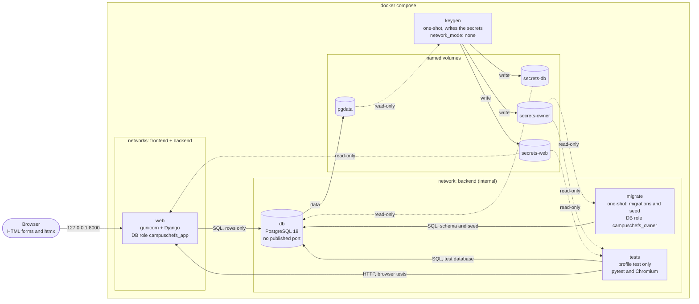
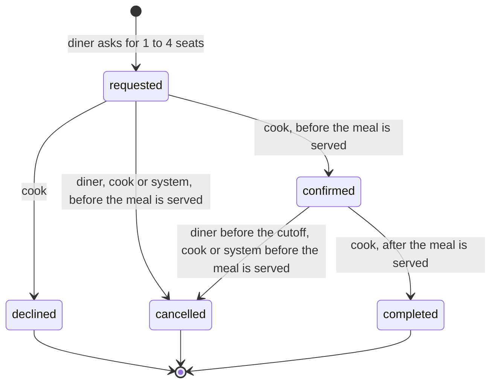

# Architecture notes

This page starts with the system as built: the containers, how they start, and the booking state machine. After that it records, phase by phase, the facts the plan said to confirm during implementation and every place the build departed from the plan (`docs/MODERNIZATION_PLAN.md`). The full design is in plan sections 2, 5, 6 and 8.

## Containers, networks and volumes



Solid arrows are traffic or writes. Dotted arrows are read-only volume mounts. This is the same diagram as in the README. `scripts/check_docs.py` (part of `make lint`) fails if either copy stops naming a service, network or volume that `compose.yaml` declares.

| Property | `keygen` | `db` | `migrate` | `web` | `tests` |
|---|---|---|---|---|---|
| Image | `alpine:3.24` | `postgres:18.7-alpine3.24` | built, `runtime` target | same image as `migrate` | built, `dev` target |
| Networks | none | `backend` | `backend` | `backend`, `frontend` | `backend` |
| Published port | none | none | none | `127.0.0.1:${WEB_PORT:-8000}` | none |
| Volumes | `secrets-db`, `secrets-owner`, `secrets-web` (write); `pgdata` (read-only) | `pgdata`; `secrets-db` (read-only) | `secrets-owner` (read-only) | `secrets-web` (read-only) | `secrets-owner`, `secrets-web` (read-only) |
| Bind mounts | `docker/keygen.sh` (read-only) | `docker/postgres-init/` (read-only) | none | none | the repository at `/src` (read-only); `test-results/` and `docs/screenshots/` (writable) |
| Starts after | nothing | `keygen` exited 0 | `db` healthy | `migrate` exited 0 | `db` healthy |
| Database role | none | `postgres` superuser, used only for init | `campuschefs_owner` | `campuschefs_app` | `campuschefs_owner`, and `campuschefs_app` for SEC-04 and SEC-05 |
| Hardening | no network, all capabilities dropped except `CHOWN` and `DAC_OVERRIDE`, `no-new-privileges` | `no-new-privileges`, memory and process limits | read-only root, `/tmp` as tmpfs, all capabilities dropped, `no-new-privileges` | as `migrate`, plus memory and process limits | none; it is a development tool |

`keygen` and `migrate` run once and exit. `web` restarts unless stopped. `tests` exists only under `--profile test`.

## Booking state machine

`bookings/services.py` holds the five allowed transitions in one table, `ALLOWED`, with who may take each one. Every transition runs in one transaction under a row lock on the meal.



- **A request is accepted only if** the meal is open, the cutoff has not passed, the diner is not the cook, the diner has no other active booking for it, and enough seats are left. The seats are counted under the lock (BOOK-06).
- **The system actor** cancels bookings when the cook cancels the meal or deletes their account (BOOK-12, ACCT-03).
- **Status codes follow one rule:** someone who is not the diner or the cook gets 404; a participant who may not take an existing transition gets 403; a transition that does not exist, or one outside its time limit, gets 409 (BOOK-09).
- **"Received" is not a state.** The cook marking a grocery share received sets a timestamp beside the status (CONTRIB-07).
- **"Expired" is not stored.** A request still waiting after the meal was served is shown as expired.

## Phase 1 records (2026-11-18)

### Versions tested

| Component | Version | How it was checked |
|---|---|---|
| Docker Engine | 29.9.3 | `docker version` |
| Docker Compose | v5.7.0 | `docker compose version` |
| Python image | `python:3.14.10-slim@sha256:9aaa4740…802f` | `docker buildx imagetools inspect` |
| uv | 0.13.7 (`ghcr.io/astral-sh/uv@sha256:96f40d39…b490`) | same |
| Postgres | `postgres:18.7-alpine3.24@sha256:b6972e11…f015`; postgres UID 70; `PGDATA=/var/lib/postgresql/18/docker` | `docker run … id postgres` |
| alpine (keygen) | `alpine:3.24@sha256:f59abe65…71bf` | `docker buildx imagetools inspect` |
| Django | 6.1.3 | `uv lock` |
| htmx | 4.0.1 (npm `htmx.org-4.0.1.tgz`, sha512 integrity matches the registry; published 2026-11-01) | npm registry |
| gitleaks | v8.30.1 | GitHub releases |
| Trivy | 0.76.1. Not 0.76.2 (2026-11-05), because it is less than 14 days old | GitHub releases |

The full digests are pinned in `Dockerfile`, `compose.yaml` and `.github/workflows/ci.yml`. CHK-08 enforces the pins.

### Questions phase 1 had to answer

- **Django CSP names:** the setting is `SECURE_CSP` and the middleware is `django.middleware.csp.ContentSecurityPolicyMiddleware`, with constants in `django.utils.csp.CSP`. Both were checked in the installed Django 6.1.3.
- **htmx 4 config keys:**
  - `includeIndicatorCSS: false` stops htmx from injecting its indicator stylesheet. The indicator CSS ships in `static/css/app.css` instead.
  - `<meta name="htmx-config">` accepts JSON when the value starts with `{`.
  - htmx 4 has **no `allowEval` switch.** It compiles JavaScript only for `hx-on` handlers and `js:` expressions, and this app uses neither. Under `script-src 'self'` any such use would fail, and E2E-06 would catch it.
- **`docker compose up --wait` with one-shot services:** it exits 0 when `keygen` and `migrate` have exited 0 and `web` and `db` are healthy (Compose v5.7.0). `make demo` still uses `scripts/wait-healthy.sh`, because that script also fails fast and prints logs when a one-shot service exits non-zero.
- **Image sizes:**
  - `campuschefs:local` (runtime): 173 MB.
  - `campuschefs:dev` (tests, with Chromium): 1.92 GB.

## Phase 1 deviations from the plan

Each item below is a deliberate change to the plan's text. None changes scope.

| Plan said | Built | Why |
|---|---|---|
| `make sast` runs in the `tests` container | `make sast` runs on the host with `uv run` | pip-audit needs PyPI/OSV access, and the `tests` container sits only on the internal `backend` network. CI was already on the host |
| `tests/conftest.py` | `conftest.py` at the repo root | The static-storage fixture must apply to the per-app tests (`core/tests/…`) as well as to `tests/` |
| Send `Cross-Origin-Opener-Policy: same-origin` everywhere | Sent only when `CC_DEMO_LOCAL_HTTP=false` (HTTPS) | Browsers ignore COOP on plain-HTTP origins and log a console error, which would fail E2E-06. It has no effect there anyway |
| OPS-03 POSTs to `/login` and expects 302 | Phase 1 POSTs to `/admin/login/` with wrong credentials and expects 200 (a 403 would mean the CSRF origin check failed) | `/login` arrives in phase 3. Phase 3 switches OPS-03 to `/login` with 302 |
| — | Runtime image: `apt-get upgrade`, and pip removed | Trivy found HIGH CVEs in pip's vendored urllib3 and msgpack and in Debian `zlib1g`. Nothing at runtime needs pip |
| — | The dev image installs `git` and `libatomic1` | SEC-06 needs git. Playwright's bundled Node needs `libatomic1` on slim Debian |
| — | Partial tests with a letter suffix (`LEG-06a`, `SEC-03a`, `OPS-01a`, `E2E-06a`, `AUTH-00a`) | CI enforces 90% coverage from phase 1. These test code that exists now, and the owning phase adds the full test under the plain ID |
| — | pytest-playwright `--output test-results/playwright` | The plugin deletes its output folder at startup, and `test-results` is a bind-mount point inside a read-only `/src` |

## Phase 3 records (2026-11-18)

- **OPS-03** now GETs `/login`, POSTs a real login with the CSRF token on port 8010 and expects 302. The script creates a throwaway account (`ops03@ops-check.example`, random password) through the `web` container, because the seeded personas have unusable passwords.
- **OPS-02** builds the secrets volume name from `${COMPOSE_PROJECT_NAME:-campuschefs}`, so a check run under another project name never removes the default stack's volume.
- **Failed-login limiter** (`core/ratelimit.py`): a failed login is a POST that re-renders the form (200). A successful login (302) clears the counter. Each failure is written with `cache.set(..., 15 min)`, not `cache.incr`, because `BaseCache.incr` re-sets the key with the default 5-minute timeout. The known gaps (not atomic across workers; anyone who knows an email can lock it for 15 minutes) are described in [`SECURITY.md`](SECURITY.md), under "The failed-login limiter".

## Phase 3 deviations from the plan

| Plan said | Built | Why |
|---|---|---|
| `/safety` arrives in phase 8 | A plain `/safety` page with the five points from plan 5.5, linked from the footer | SEC-03 is in the phase 3 exit and checks that `/safety` stays on when demo mode is off. Phase 8 owns the final copy and design |
| The demo-login route "exists only when `CC_DEMO_MODE=true`" | The route is always in the URLconf, and the view returns 404 (for every method) unless `CC_DEMO_MODE` is true | Same behaviour from outside, and the switch can be tested without reloading the URLconf |
| Login with "email and password" | The form field is named `username` (labelled "Email"), as in Django's `AuthenticationForm` and the admin login | One limiter wraps both `/login` and `admin.site.login` and reads the same field |
| — | Login matches the email case-insensitively (`UserManager.get_by_natural_key` uses `iexact`) | Emails are already unique on `Lower(email)`, so `Ava@…` and `ava@…` are one account |
| Account deletion, the diner path | The diner path, plus releasing any bring-list item that a cancelled booking had claimed | Leaving a claim on a cancelled booking would block that item for other diners. The cook path stays with ACCT-03 (phase 6) |
| — | "Try as demo cook" and "Try as demo diner" buttons on `/` and `/login` | Plan 1.2 demo layer; they make the demo login reachable without curl |
| — | codespell: `brunch` added to the ignore list, and the local `graft/` index skipped | `make lint` already failed on the phase 2 base: codespell reads the meal-type example "brunch" (seed and DATA-03) as a typo. `graft/` is a git-ignored local code index |
| — | `test_leg_02a_…` (letter suffix) | `/me` exists now, so the part of LEG-02 that phase 3 can prove (own profile shown, another user's never) runs now. Phase 6 adds the bookings part under the plain ID |

## Phase 4 records (2026-11-18)

- **Money:** `meals/money.py` holds `format_cents` (`400` → `$4.00`) and `suggested_share_cents` (estimate ÷ (seats + 1), rounded down to $0.25). The `money` template filter wraps `format_cents`. Forms take dollars (`DecimalField`, 2 places) and store integer cents; no model has a float or decimal column (CONTRIB-10).
- **Constraint checks in forms:** a ModelForm skips any model constraint that touches a field outside the form (`cook`, the `*_cents` fields). So `MenuItemForm.clean` checks the duplicate-name and one-specialty rules itself, and `OfferingForm.clean` checks the no-profit rule itself. The DB CHECK and unique constraints still back all three.
- **Help text is autoescaped.** The project partial `templates/partials/field.html` renders `help_text` without `|safe`, so the one dynamic help text (claimed bring-list items on the offering form) holds the cook's labels as plain text and the form does not call `escape`.
- **Seats taken** come from a correlated subquery (`OfferingQuerySet.with_seats_taken`), not a join, so text and filter joins on dishes cannot inflate the sum.

## Phase 4 deviations from the plan

| Plan said | Built | Why |
|---|---|---|
| The allergen lock is a phase 6 deliverable (MENU-05) | The lock is in `MenuItemForm` now, with a supporting test; MENU-05 itself stays in phase 6 | The phase 4 brief asked for it, and it needs only the existing `Booking` model |
| Plan 4.1 lists `/kitchen/setup`, `/kitchen/items/…` and `/kitchen/offerings/…` | Also a `/kitchen` page (bio, meals, menu) and `/kitchen/bio`; `/me` shows a short kitchen panel that links to it | The menu and meal lists are too long for the `/me` panel |
| Offering CRUD | Delete works only while a meal has no bookings; otherwise the cook gets a message | Offering cancellation (with system-cancelled bookings) is a phase 6 deliverable |
| — | A blank grocery share takes the suggested share; the edit form shows "Suggested share: $X.XX" | Plan 3.5 says the form suggests the share; this needs no JavaScript |
| — | An offering's dishes must match its meal type, and a new offering must be in the future | Search filters on the offering's meal type, so a lunch dish on a breakfast meal would mislead diners |
| — | The pickup note is shown to the cook and to confirmed diners now | Plan 3.1 rule; BOOK-14 (phase 6) tests the full matrix |
| — | `templates/403.html` | AZ-01 returns 403 to diners on kitchen routes; the page links to `/kitchen/setup` |
| — | The phase 3 `.summary` list on `/me` stacks below 40rem | Its `max-content` label column made `/me` 430 px wide at a 320 px viewport (found by the phase 4 screenshot check) |
| — | Supporting tests without a plan ID (`meals/tests/test_kitchen.py`, `test_public_pages.py`) | They cover the kitchen and public views for the 90% coverage gate |
| — | While a meal has requested or confirmed bookings, `OfferingForm` rejects a new serve time, fulfillment or share per seat, and a capacity below the seats held. `grocery_estimate` stays editable | Diners agreed to what they saw. The estimate needs no lock because the no-profit check already bounds it against the share and capacity |
| — | `MenuItemForm` rejects a meal-type change on a dish that is attached to any meal | Offerings require their dishes to match the meal type, so a re-typed dish would break the meals that use it |

## Phase 5 records (2026-11-18)

- **Search** is `meals/search.py::search_offerings`. The dietary filter drops any offering with a dish that lacks the tag, and the allergen filter drops any offering with a dish whose allergens overlap the excluded set. Both use an `OfferingItem` subquery, so the text-match join cannot change their meaning.
- **htmx 4 on a form:** `hx-get` on the `/search` form with `hx-trigger="submit, input delay:300ms"` sends every field of the form, and the bubbling `input` event from the text box, the selects and the checkboxes all trigger it. E2E-06 checks this in Chromium.
- **The phase 1 stub is gone:** the `search_stub` view, its URL, `STUB_DISHES`, `partials/search_stub_results.html` and `test_e2e_06a_…`. SRCH-07 replaces the partial test, and E2E-06 now types "pancakes" on `/` and on `/search`.

## Phase 5 deviations from the plan

| Plan said | Built | Why |
|---|---|---|
| — | A "Find a meal" link in the main nav | Search is the second of the three steps; LEG-08 (phase 8) checks every nav link returns 200 |
| — | Invalid filter values are listed above the results and ignored; the valid filters still apply | A tampered `campus` or `max_share` should not blank the whole page |
| — | An empty query lists every open meal | `/search` doubles as "browse meals"; the same holds when the home box is cleared |
| — | Supporting tests without a plan ID in `meals/tests/test_search.py` | They cover the meal and date filters, invalid input and pagination |

## Phase 6 records (2026-11-18)

- **State machine:** `bookings/services.py` holds `ALLOWED` (the 5 edges of plan 3.3), `request_booking`, `transition`, `available` (the action buttons) and `cancel_offering`. Each write locks the offering with `select_for_update` and runs in one transaction. The checks run in the order of the status-code rule: edge (409), then role (403), then time guard (409). The views return 404 to anyone who is not the diner or the cook before the service runs.
- **Contributions:** `bookings/contributions.py` holds the share snapshot, the custom no-profit cap (`seats × floor(estimate / capacity)`), the bring-list claim and its release, mark-received, and `with_totals` (subqueries for "Expected $X · Received $Y · Groceries $Z"). The claim is a conditional `UPDATE … WHERE claimed_by_booking IS NULL`, so two claims can never both win, even without the offering lock.
- **Races:** BOOK-06 and CONTRIB-04 run with `transaction=True` and two threads. Each thread has its own DB connection, and a barrier releases both at once.
- **Booking form:** `BookingRequestForm` is a plain `Form`. Status, diner and offering never come from the POST (AZ-08). The htmx path renders `meals/offering.html#booking_panel` (Django's built-in ``); without htmx, a successful request gets a 303 to `/bookings/<id>`. A rejected request re-renders with 200 and the error next to its field, so htmx swaps it in.

## Phase 6 deviations from the plan

| Plan said | Built | Why |
|---|---|---|
| `services.py` and `contributions.py` | Also `bookings/errors.py` (`BookingError` 409, `Forbidden` 403, `NotParticipant` 404, `BookingRejected`) | Both modules raise the same errors; a third module avoids a circular import |
| — | `test_leg_02a_…` became `test_leg_02_…` with the bookings part; the phase 4 supporting test `test_allergen_lock_while_item_has_active_bookings` became `test_menu_05_…` | The plain IDs own those tests now |
| Cook deletion cancels "the offering" (ACCT-03) | Only open offerings with a future serve time are cancelled; past meals and their bookings stay as they are | A meal already served cannot be cancelled (the system cancel needs `now < serve_at`) |
| — | A cook cannot cancel a meal after its serve time | Same time guard as the system cancel |
| "Expected" in the kitchen totals | The shares of confirmed and completed bookings; requested ones are not counted | A request is not yet an agreement |
| — | Marking a contribution received twice returns 409; a booking with `contribution=none` cannot be marked | Nothing changes, and there is nothing to receive |
| — | The cook sees a "Diners" list on the offering page, and the kitchen page shows the totals too | The cook needs a way to reach each booking, to complete it and mark it received |
| — | The seed sets each booking's `created_at` to its request time | `auto_now_add` stamped seed time, so the timeline showed "Requested" after "Confirmed" |
| — | The booking form has no `note` field | The brief lists none; terms cover what a diner wants to tell the cook |
| — | Account deletion blanks `terms` and `note` on all the diner's bookings, the text of their reviews and a cook's bio; the CHECK `booking_custom_needs_terms` now applies only to requested and confirmed bookings (migration `0003_relax_custom_terms_check`) | Deleted users' free text must not stay. Deletion cancels active bookings first, so every remaining row is non-active; an empty custom term reads "Custom terms (removed)" |

## Phase 8 records (2026-11-18)

### axe-core (A11Y-01)

| Item | Value |
|---|---|
| Package | npm `axe-core` 4.14.0, published 2026-10-05. Not 4.14.1 (2026-11-16), because it is less than 14 days old |
| Tarball integrity | `sha512-9WTZxEjsZ7b13TH8JPmbV2z8CHbl80/2hm3XPEG4JgNdQLK81IBRXmSxHfMAOkSqQeRxT/0dwNDz2GOm3zzpcQ==`. The downloaded `axe-core-4.14.0.tgz` hashes to the same value as the registry's `dist.integrity` |
| Vendored file | `tests/e2e/vendor/axe.min.js` (the tarball's `package/axe.min.js`), SHA-256 `20c09fe157a8a34a30e241aaa1fcdade657734f08ab379ecfbeb7d45cc46e878` |
| Licence | MPL-2.0, copied unchanged to `tests/e2e/vendor/axe-core.LICENSE`. The MIT `LICENSE` does not cover `tests/e2e/vendor/` |
| Checked on | 2026-11-18, against `https://registry.npmjs.org/axe-core` |

- **Pinned in the repo:** `tests/e2e/vendor/SHA256SUMS` holds the SHA-256 of `axe.min.js` and `axe-core.LICENSE`. The unit test `test_e2e_vendor_axe_matches_the_recorded_sha256` (`core/tests/test_design.py`) hashes both files, compares them with `SHA256SUMS`, and checks that the `axe.min.js` hash above appears in this file. A changed vendor file fails `make test`.
- **Reproduce the hash** (re-run on 2026-11-18, macOS, in an empty temporary folder):

  ```sh
  curl -fsS https://registry.npmjs.org/axe-core/4.14.0 -o meta.json
  python3 -I -c "import json,sys; print(json.load(open(sys.argv[1]))['dist']['integrity'])" meta.json
  curl -fsSO https://registry.npmjs.org/axe-core/-/axe-core-4.14.0.tgz
  echo "sha512-$(openssl dgst -sha512 -binary axe-core-4.14.0.tgz | openssl base64 -A)"
  mkdir x && tar -xzf axe-core-4.14.0.tgz -C x package/axe.min.js package/LICENSE
  shasum -a 256 x/package/axe.min.js x/package/LICENSE
  ```

  Result: both `sha512-` lines printed `sha512-9WTZxEjsZ7b13TH8JPmbV2z8CHbl80/2hm3XPEG4JgNdQLK81IBRXmSxHfMAOkSqQeRxT/0dwNDz2GOm3zzpcQ==`, so the tarball matches the registry's `dist.integrity`. The extracted `package/axe.min.js` hashed to `20c09fe157a8a34a30e241aaa1fcdade657734f08ab379ecfbeb7d45cc46e878` and `package/LICENSE` to `af175b9d96ee93c21a036152e1b905b0b95304d4ae8c2c921c7609100ba8df7e`, the same values as `tests/e2e/vendor/SHA256SUMS`.

- **Injection:** `tests/e2e/helpers.py` passes the file's text to `page.evaluate`. Playwright runs it through the DevTools protocol, which the page's CSP does not govern, so the app's CSP stays as it is and no inline script is added. `add_script_tag` would add an inline `<script>`, which `script-src 'self'` blocks.
- **Rules:** `axe.run` with `runOnly` tags `wcag2a`, `wcag2aa`, `wcag21aa` and `wcag22aa`. No rule is disabled, and there is no false positive to record. A planted image without `alt` and a planted low-contrast paragraph were both reported, which shows the run is live.
- **Pages:** in light and in dark mode, at 1280 px: `/`, `/how-it-works`, `/safety`, `/privacy`, `/register` (empty and submitted empty), `/login`, `/search?q=pancakes`, the home live-search results, a cook page, an offering, the 404 page; as the demo diner `/me`, `/me/edit`, the offering's booking form (empty and with errors) and a booking; as the demo cook `/me`, `/kitchen`, the dish form, the meal form and the same booking.

### What the browser tests found and fixed

- **Focus on a date input (E2E-03):** Tab stops four times in `<input type="date">`: month, day, year, then the picker button inside the input's shadow tree. On that fourth stop the input matches neither `:focus` nor `:focus-visible`, only `:focus-within`, so the search page's date filter had no focus outline. `input[type="date"]:focus-within` now draws the same outline.
- **axe:** no violations on the pages above. The design-system work had already fixed what an earlier pass would have caught.

### UX pass on the newer screens

- **Offering page:** the "Chip in" card moved to the left column, under the allergen notice, so the two columns balance and the booking form is no longer a long tail on the right. On a phone the order is dishes, allergens, chip in, when and where, then the form.
- **Booking form:** the bring-list item shows only when "Bring an item" is picked, and the terms and amount only when "Propose your own terms" is picked (CSS `:has()`, no JavaScript; the server still checks every field). The amount label lost its doubled "optional", and the bring-list and terms fields no longer say "Optional", because the choice above them makes them required. The field partial takes `hide_optional` for this.
- **Cook's view of an offering:** the panel heading reads "Your meal" instead of "Request a seat".
- **Search filters:** they now use the design-system field partial instead of Django's default field group. The labels match the other forms, the rows have the same gap, and the allergen filter uses the checkbox tiles (two columns on a phone) instead of a native fieldset border.
- **Kitchen:** quiet buttons in an action row keep their 44 px height but drop the wide button padding, and the "Delete" button names its meal for screen readers, as "Cancel meal" already did.
- **Screenshots:** `scripts/capture_screenshots.py --design` now also captures search, a cook page, an offering (visitor, diner, diner with errors, cook), a booking (diner and cook) and the kitchen, at 1280 px and 390 px, light and dark. Run `make reseed` first.

## Phase 8 deviations from the plan

| Plan said | Built | Why |
|---|---|---|
| LEG-06 checks `/` with an unreachable DB | The test sends a session cookie with that request | A visitor without a session cookie needs no query to render `/`, so that request returns 200 even with the DB down. A returning visitor reads the session table and gets the generic 500 page |
| `test_leg_06a_…` | Replaced by `test_leg_06_…` | The plain ID owns the full test now. `test_leg_06b_…` (the 500 page content) stays |
| A11Y-01 lists home, search, register, login, a cook page, an offering, a booking, `/me` and the menu form | Those pages plus `/how-it-works`, `/safety`, `/privacy`, the 404 page, `/kitchen`, the meal form and the error states, in light and dark | The brief asked for both colour schemes; the extra pages cost seconds |
| Plan 4.3: each step links to `/register`, `/search` and `/how-it-works#booking` | The home steps carry no links; one "Read the details" link after them leads to `/how-it-works`. A11Y-03 checks that, and that the steps sit on one line on desktop and wrap in order onto at most two lines on a phone | The phase 8a art-director review made the home steps one compact line, because the nav and the hero already link to `/how-it-works` |
| — | E2E tests fail on any console error, through the `new_page` fixture in `tests/e2e/conftest.py` | Plan 7.1 asks for a console-error listener on every page; Chromium reports each CSP violation as a console error. The deliberate 404 visit is the only error allowed |

## Phase 9 records (2026-11-18)

- **Static checks:** `make lint` runs CHK-01 to CHK-08 through `scripts/static_checks.py` and CHK-09 through codespell. They are not pytest tests, so they have no `test_chk_*` names.
- **Deploy check:** `make deploy-check` and SEC-02 both run `check --deploy --fail-level WARNING` with production settings and report no issues.
- **Logging:** `LOGGING` sends the root logger at INFO to stdout, so `docker compose logs web` shows the audit lines. Each line carries ids only.

## Phase 9 deviations from the plan

| Plan said | Built | Why |
|---|---|---|
| SEC-02 to SEC-09 are unit tests | SEC-08 stays in `scripts/smoke.sh` (marked `[smoke]`), and OPS-01 to OPS-03 stay in `scripts/ops-checks.sh` | The plan puts them there; they need the running stack |
| — | AUTH-10 `[e2e]` added in `tests/e2e/test_e2e_auth_09_csrf.py` | No plan phase owned it; it records every request URL of a login and register visit and finds no password |
| AI-01 to AI-05 | Not added | They belong to phase 12, which needs the owner's approval (D4) |
| — | `/search` sends `Vary: HX-Request` | The same URL returns a partial or a full page, so a shared cache must tell them apart |
| — | A race on a kitchen write (set-up, new dish, delete meal) gives a message or form error and no 500 | The OneToOne, the unique constraint and the PROTECT foreign key can all fire between the check and the write |
| — | The booking redirect helper passes `require_https=request.is_secure()` | An `http://` `next` on an HTTPS request is no longer followed |
| — | `ReviewAdmin` makes `booking` and `rating` read-only; the hide action writes an admin history entry and a message | Staff may moderate a review but not rewrite it, and the action leaves a trail |
| — | Supporting tests without a plan ID in `core/tests/test_phase9_hardening.py` | They cover the items above |

## Phase 11 records (2026-11-19)

### Tools pinned for the docs

| Tool | Pin | How it was checked |
|---|---|---|
| mermaid-cli | `minlag/mermaid-cli:12.0.1@sha256:18938e53497376d524e04b1fc0bf7b6d61a491ce9ff7032bb2855d57155acb10` | `docker buildx imagetools inspect minlag/mermaid-cli:12.0.1` gave this digest and an image creation time of 2026-11-02 (17 days before the check, so past the 14-day rule). Inside the image, `mmdc --version` prints `12.0.0` and the bundled `mermaid` package is 12.2.0. The npm registry has no `@mermaid-js/mermaid-cli` 12.0.1; the tag is the Docker image's own |
| ffmpeg (hero GIF) | `mwader/static-ffmpeg:9.0.2-1@sha256:f5d100184884eb3e82b0eb14bb5ebf98da99826ac824989720297fb9ef21c822` | `docker buildx imagetools inspect mwader/static-ffmpeg:9.0.2-1` gave this digest and a creation time of 2026-10-09 |

- **Mermaid render check:** `scripts/render-mermaid.sh` (or `make docs-check`) runs the plan's phase 11 loop for `README.md` and `docs/architecture.md` with `docs/puppeteer.json`. A diagram that does not parse makes it exit 1; this was tried with a deliberately broken diagram. The output goes to `test-results/`, which is git-ignored.
- **`docs/puppeteer.json`** repeats the image's own config: the path of its Chromium and `--no-sandbox`. Chromium's sandbox cannot start inside this unprivileged container. The container renders only this repository's own Markdown.
- **Docs link check:** `scripts/check_docs.py` checks every relative link, image path, `<source srcset>` path and heading anchor in `README.md` and `docs/*.md`, that every image has alt text, and that the container diagram names everything in `compose.yaml`. It needs no network, so it does not fetch external URLs. It runs in `make lint`, and so in CI.
- **Reduced motion:** the README hero is a `<picture>`. Its `<source media="(prefers-reduced-motion: reduce)">` gives readers who ask for reduced motion the still `walkthrough/01-home.png` in place of the 14-second loop. This is the project's answer to WCAG 2.2.2, which covers motion that starts by itself and lasts more than 5 seconds. A reader without that setting still gets the loop, with the still walkthrough linked directly under it. `check_docs.py` fails on any `.gif` in the docs that has no such still.
- **Pictures:**
  - `scripts/capture_screenshots.py --after` writes 12 PNGs to `docs/screenshots/after/`: the 8 the plan names, at 1280 px, and 4 more at 390 px. It only reads pages.
  - `--walkthrough` plays E2E-01 and E2E-02 and writes 14 PNGs to `docs/screenshots/walkthrough/`. It writes data, so `make screenshots` reseeds before and after it.
  - `scripts/build-hero-gif.sh` joins walkthrough pictures 01 to 08 into `docs/screenshots/after/hero.gif` (1120 x 700, 128 colours, no dithering, about 0.4 MB). The frames are not edited.
  - `scripts/check-image-metadata.sh docs/screenshots` covers PNG and GIF files and reports every image clean.
- **Image size:** after the merge of phase 12, `campuschefs:local` is 207 MB and `campuschefs:dev` is 1.97 GB (`docker images`). Before that merge they were 175 MB and 1.92 GB; the difference is the phase 12 dependencies.

## Phase 11 deviations from the plan

| Plan said | Built | Why |
|---|---|---|
| The exit block runs mermaid-cli in an inline loop | The same command lives in `scripts/render-mermaid.sh`, behind `make docs-check` | One place for the pinned image. The inline loop from the plan still works |
| The Mermaid render is a phase exit | It is not a CI step | The image is about 590 MB to pull on every run. CI runs the link, alt-text and diagram-name check through `make lint` instead |
| 8 named screenshots | Those 8, plus `phone-search`, `phone-offering`, `phone-booking` and `phone-kitchen`, plus the 14 walkthrough pictures | The owner asked for the user story at phone and desktop width, and `docs/walkthrough.md` needs a picture per step |
| A demo GIF is a stretch goal (plan 1.4) | Built, as the README hero | The owner asked for a hero that shows the real app |
| `cook.png` is "a cook page" | It shows a seeded cook who has reviews, not the demo cook | The demo cook has no reviews until E2E-02 runs, and the picture should show the two-part reviews |
| — | The diner's booking page no longer ends "with Marcus B.." | The name already ends in a full stop. Found while checking the screenshots |
| The README opens with a hero image or GIF | It is an `` inside `<picture>`, with a still for reduced motion | The loop runs for more than 5 seconds and a GIF cannot be paused, so a reader who asks for reduced motion gets a still |
| `SECURITY.md` documents `.edu` verification for a real deployment (plan 1.4) | It lists the missing email verification as a known gap, and the README lists verified campus email first under "What I would do next" | Same content, in the two places a reader looks |

## Phase 12 records (2026-11-19)

AI menu import (plan D4, option 1). It is off by default (`CC_AI_ENABLED=false`), and nothing here runs without the owner turning it on and supplying a key.

### Flow

1. A cook opens `/kitchen/import` (linked as "Paste a menu" in the kitchen, only when the flag is on) and pastes up to 4,000 characters.
2. `menuparse.service.parse_menu` sends the text to the Claude API with `client.messages.parse(output_format=MenuDraft)`. The reply is validated into a Pydantic `MenuDraft` (`menuparse/schema.py`) and checked a second time in our code.
3. The draft fills an unbound formset (`DraftDishForm`, a `MenuItemForm` subclass, so every dish rule applies). Nothing is written to the database on this request (AI-02).
4. The cook edits the dishes, may tick "Leave this dish out" on any of them, ticks one allergen confirmation for the whole draft, and posts to `/kitchen/import/confirm`. Only then are `MenuItem` rows saved, in one transaction, for the cook from the session. `allergens_confirmed_at` is set by `MenuItemForm.save`, which runs only after the tick (AI-05).

### Data sent

Only the pasted text, plus a fixed system prompt. No name, email, campus or id. This site does not store the text and never logs it. Anthropic receives it and may keep it for a limited time under its own terms, and the privacy page and the paste screen say so. The owner has not yet reviewed those terms (see the runbook's "Before you turn it on"). A test checks the request arguments (AI-02).

### Failure modes

| What happens | What the cook sees | What is logged |
|---|---|---|
| Flag off | 404 for every verb, for everyone | nothing, and the SDK is never imported (AI-01) |
| More than 4,000 characters | A validation error, and no API call (AI-04) | nothing |
| More than 5 drafts in 10 minutes, or 20 in a day, for one cook (`menuparse.views.DRAFT_LIMITS`, AI-06) | A friendly message with the manual link (HTTP 429), and no API call. The counters live in the `ratelimit` cache and fail closed | `menu draft blocked: rate_limited`, the limit name and the user id |
| No key, network error, timeout, 4xx or 5xx, any other exception | "Drafting a menu is not available right now", with a link to the manual form | model id, request id, error class |
| `stop_reason` is `refusal` | A refusal message, with the manual link | model id, request id, `refusal` |
| Output does not parse, has a value outside the enums, or has no dishes | A "could not use" or "no dishes" message, with the manual link | model id, request id, error class |

The SDK runs with `max_retries=0` and a 20 s timeout, so one request fits inside Gunicorn's 30 s worker timeout. Raw API messages never reach a page.

### Model output is untrusted

The allowed values come from `meals.models` (`MealType`, `Course`, `ALLERGENS`, `DIETARY_TAGS`), and import-time asserts fail if the schema drifts from them. `MenuDraft` forbids extra keys and caps each name at 80 and each description at 500 characters, and a draft at 20 dishes. The review page renders every value through Django's autoescaping, and CHK-05 still bans `|safe`.

### Versions

| Component | Version | Released | Note |
|---|---|---|---|
| anthropic | 2.5.0 | 2026-11-04 | Newest release at least 14 days old on 2026-11-19. Pinned in `pyproject.toml` |
| pydantic | 2.14.2 | 2026-10-29 | Same rule (2.14.3 is from 2026-11-05) |
| pydantic-core | 2.50.2 | 2026-10-29 | Transitive |
| httpx2 and httpcore2 | 2.16.0 | 2026-10-21 | Transitive. 2.16.1 and 2.16.2 are from 2026-11-16, so `uv.lock` holds 2.16.0 |
| jiter | 0.18.0 | 2026-10-23 | Transitive. 0.19.0 is from 2026-11-06 |
| other new transitive packages | annotated-types 0.8.0, anyio 4.16.0, docstring-parser 0.18.0, h11 0.16.0, httpx2-jsfetch 1.0, opentelemetry-api 1.45.2, sniffio 1.3.1, truststore 0.10.5, typing-extensions 4.16.0, typing-inspection 0.4.5 | all at least 14 days old (typing-inspection 0.4.5 is from 2026-11-04) | Dates from the PyPI JSON API |
| Model id | `claude-opus-5-5` | | From the Claude API documentation's model list (read 2026-11-03). Override with `CC_AI_MODEL`. Prices are on Anthropic's pricing page and are not repeated here |

### Phase 12 deviations from the plan

| Plan said | Built | Why |
|---|---|---|
| "The Claude model id" is verified at implementation | Default `claude-opus-5-5`, from the Claude API documentation's model list, not from a live `GET /v1/models` call | No key exists in this build and no real API call is allowed. The owner can set `CC_AI_MODEL` |
| — | No server-side refusal `fallbacks` | `messages.parse` is on the stable endpoint and the fallback needs the beta endpoint. A refusal is shown as a friendly message with the manual form |
| — | `effort: low` and no `thinking` setting | Extraction needs little reasoning. Opus 5.5 always thinks, and `low` keeps latency inside the worker timeout |
| — | `ANTHROPIC_API_KEY` is not in `compose.yaml` | CHK-06 bans a non-empty secret value in the file. The runbook shows an override file that mounts a key file and sets `ANTHROPIC_API_KEY_FILE` |
| — | The review page asks for one allergen confirmation for the whole draft, not one per dish | The plan's AI-05 says "the confirmation". Every dish is still checked by `MenuItemForm` rules |
| — | A `CC_AI_ENABLED` template variable from `core.context_processors.demo` | One place decides whether the kitchen link and the privacy line show |
| The image scan runs Trivy with its default secret rules | `docker/trivy-secret.yaml` allows one anchored path (`^opt/venv/lib/python3\.14/site-packages/anthropic/(types\|resources)/beta/`): the Anthropic SDK's `types/beta` and `resources/beta` modules | Their docstrings quote the literal `{"type": "service_account"}`, which Trivy's `gcp-service-account` rule reports as CRITICAL. It is documentation in a pinned third-party package. Every other path is still scanned |
