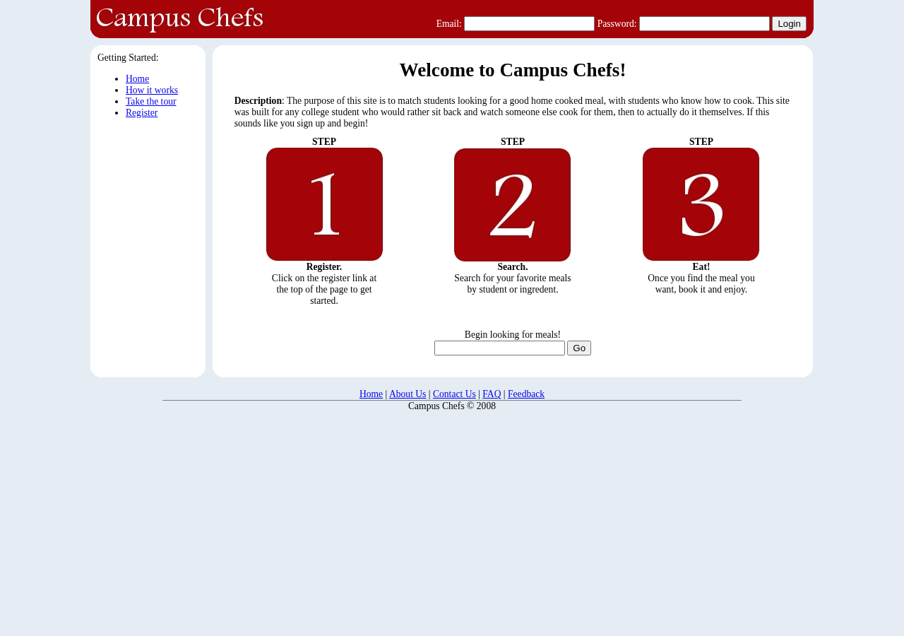

# Before and after: the 2008 code and the 2026 rebuild

This page is for developers. It shows what the 2008 PHP app did, with exact excerpts from `legacy/`, and what replaces each defect in the 2026 rebuild. Section numbers and test IDs refer to [`MODERNIZATION_PLAN.md`](MODERNIZATION_PLAN.md).

The 2008 app is never run. The "before" evidence is static: `legacy-support/render-static.sh` runs `php welcome.php` once, in a pinned container with no network, and writes the HTML to a git-ignored folder. `scripts/capture_screenshots.py --before` screenshots that file. No web server and no database are started, and no other legacy page is executed.

## 1. The 2008 landing page

Desktop (1280 px viewport) and phone (390 px viewport) captures of the rendered `view/welcome.php`:




What the captures show:

- The layout is a fixed-width page (`css/styles.css:7,108,180`, plan section 12). At a 390 px viewport the full-page capture is still 1084 px wide, so a phone has to scroll sideways.
- The rounded corners are images, not CSS (`src/main_corners.php`, `src/header.php`).
- The login form is in the header. Its `method` is `GET` (`src/header.php:11`), so the email and password end up in the URL.

The captures are made with Chromium from the HTML that PHP 8.5 produces for `welcome.php`. That page only includes other PHP files and prints HTML, so the markup is the same one PHP 5 produced. The fonts, the form controls and the scrollbars are Chromium's, not those of a 2008 browser.

The original images the page uses:

| Image | Used for | Size |
|---|---|---|
|  | Logo in the header (`src/header.php`) | 261×54 |
|  | Step 1, "Register" (`view/welcome.php:30`) | 167×161 |
|  | Step 2, "Search" (`view/welcome.php:37`) | 166×161 |
|  | Step 3, "Eat!" (`view/welcome.php:44`) | 166×161 |

The 2008 markup has no `alt` text on these images (plan section 12, `view/welcome.php:30,37,44`). The images are here only because they are the original artwork; the new app redraws the logo as SVG and builds the three steps in HTML and CSS (plan 4.3).

## 2. The login bypass

### The code

`legacy/src/login.php:7-8` reads the credentials from the query string and passes them through `htmlentities()`:

```php
$user_input_email = htmlentities($_GET["email"]);
$user_input_pass = htmlentities($_GET["password"]);
```

`legacy/src/sqlQueries.php:58` pastes both values into a SQL string:

```php
		$queryStatement = "SELECT * FROM user_info WHERE first_name = '".$email."' && password = '".$password."';";
```

Two more facts from the same files matter:

- The query compares the "email" input with the `first_name` column, not with an email column (plan 1.3 #6).
- If the query returns any row, `authenticate()` returns `"Valid"` (`sqlQueries.php:66-79`). `login.php` then prints a script that redirects the browser to `profile.php`. The user ID is discarded and no session is created (plan 1.3 #7). So "logging in" only changes where the browser goes.

### The payload

Send this as the email, with any password:

```
' OR 1=1 -- 
```

The payload ends with a space. MySQL treats `--` as a comment start only when a whitespace character follows it. With `x` as the password, the string built at `sqlQueries.php:58` is:

```sql
SELECT * FROM user_info WHERE first_name = '' OR 1=1 -- ' && password = 'x';
```

The first `'` closes the `first_name` string. `OR 1=1` makes the condition true for every row. `-- ` comments out the rest of the line, including the password check. The query returns rows, so `authenticate()` returns `"Valid"`.

This page does not run that request. The payload and the resulting SQL come from reading the code. The 2008 app is not run (the decision is recorded in plan 6.4 and D3).

### Why `htmlentities()` did not stop it

`htmlentities()` converts characters to HTML entities. It is meant for output that goes into HTML. It is not a SQL escaping function, and the way it was called here also left single quotes alone.

Two separate facts:

1. **The default flags did not encode single quotes.** The default `$flags` value was `ENT_COMPAT` until PHP 8.1.0. The PHP manual (`htmlentities`, checked 2026-11-18) describes the flags this way:
   - `ENT_COMPAT` converts double quotes and leaves single quotes alone.
   - `ENT_QUOTES` converts both double and single quotes.
   - `ENT_NOQUOTES` converts neither.
   - The 8.1.0 changelog row says the default changed from `ENT_COMPAT` to `ENT_QUOTES | ENT_SUBSTITUTE | ENT_HTML401`.

   The 2008 code was written for PHP 5, so it ran with the `ENT_COMPAT` behaviour. The payload has no `&`, `"`, `<` or `>`, and `ENT_COMPAT` does not touch `'`, so it passed through unchanged. As a check, with the pinned `php:8.5.11-cli-trixie` image and the flag named explicitly, `htmlentities("' OR 1=1 -- ", ENT_COMPAT)` returned `' OR 1=1 -- `. With `ENT_QUOTES` it returned `&#039; OR 1=1 -- `.

2. **Encoding quotes is still not SQL escaping.** Even with `ENT_QUOTES`, `htmlentities()` is the wrong tool here:
   - It does not touch backslashes. In the same check, a backslash came back unchanged. MySQL by default (without `NO_BACKSLASH_ESCAPES`) treats `\'` inside a string literal as a quote character that does not end the string. A backslash as the email and ` OR 1=1 -- ` as the password would, by the rules of MySQL string literals, turn the first literal into `' && password = ` and leave `OR 1=1 --` outside any string. This is reasoned from the query text and the MySQL rules, and was not run.
   - It changes the data. Stored and compared values would carry entities such as `&amp;` and `&#039;`, which is why plan 1.3 #2 lists the input encoding as a defect in its own right (and LEG-05 tests a password with `&`, `<`, `>`, `"` and `'` in it).
   - The other half of the problem is on output. `cook_main.php:36-41` echoes database values with no escaping at all (plan 1.3 #2), so input encoding was the only defence against HTML injection too.

The fix in 2026 is not a better escaping function. The new code never builds SQL from strings. It uses the Django ORM, and `CHK-04` fails the build if app code contains raw SQL calls.

## 3. The proof in 2026: AUTH-07

The regression test is **AUTH-07**. It is specified in plan section 7.2:

> AUTH-07 - given a user with first name "Ava" and email `ava.r@larkspur.example`, when someone logs in with `Ava` as the email, or with `' OR 1=1 -- `, then the login fails.

What it asserts:

- The seeded user exists, with first name `Ava` and a different email address.
- Logging in with the first name in the email field fails. That was the 2008 behaviour from `sqlQueries.php:58`, where the "email" was compared with `first_name`.
- Logging in with `' OR 1=1 -- ` as the email fails. This is the payload from section 2.

The test name starts with its ID, `test_auth_07_sqli_login_bypass_rejected`, so `make test K="auth_07"` selects it. It is written in phase 3 (plan section 9, phase 3 exit command). **It does not exist in this repository yet, so there is no 2026 test output on this page.** When phase 3 lands, the run URL goes in that phase's PR.

The related checks:

| ID | What it checks |
|---|---|
| AUTH-07 | The two logins above fail |
| SRCH-03 | The same kind of payload in search (`q=%' UNION SELECT password FROM accounts_user -- `) returns 200 with zero results, no `argon2$` and no database error |
| CHK-04 | App code contains no `.raw(`, `.extra(`, `RawSQL`, `connection.cursor` or `cursor.execute`, and bandit reports no B608 |

## 4. Before and after, defect by defect

The numbers in the first column are the plan's, from section 1.3 (`#`, `T`) and the file:line audit in section 12. Rows with no test ID in the last column are "Dropped" or "Replaced" in the plan. Everything in the "2026" column is a planned fix with its test ID. A fix counts as done only when its phase lands and the test passes.

| Plan ref | 2008 defect (file:line) | 2026 fix | Test or check |
|---|---|---|---|
| 1.3 #1 | SQL built from strings (`sqlQueries.php:40-43,58,87`) | ORM only | AUTH-07, SRCH-03, CHK-04 |
| 1.3 #2 | `htmlentities()` used as input sanitizing (`login.php:7-8`, `registration_form.php:13-25`, `successful.php:23-27`); DB values echoed unescaped (`cook_main.php:36-41`) | Store raw values, escape on output (template autoescape) | REG-09, LEG-05, CHK-05 |
| 1.3 #3 | Passwords stored and compared in plain text | Argon2id hashes | REG-01 |
| 1.3 #4 | Credentials sent over GET (`header.php:11`, `registration_form.php:29`) | POST-only views with CSRF | AUTH-03, REG-08, AUTH-10 |
| 1.3 #5 | DB user `root`, empty password (`db_information.php:4-5`) | Generated secrets per service; the app role runs DML only | SEC-04, SEC-05, SEC-08, CHK-06 |
| 1.3 #6 | "Email" compared with `first_name` (`sqlQueries.php:58`) | `USERNAME_FIELD="email"` | AUTH-07 |
| 1.3 #7 | `authenticate()` returns `"Valid"` and drops the user ID; no session (`sqlQueries.php:66-79`) | `login()` rotates the session key | AUTH-01 |
| 1.3 #8 | JavaScript redirect with stray quotes (`login.php:22`) | Server-side 302 | AUTH-01 |
| 1.3 #9, T4 | `//HACK! fix this`, `$userID = 1` (`cook_main.php:7-10`) | `request.user` and scoped querysets | LEG-02 |
| 1.3 #10 | The second "Gender:" label prints `$age` (`cook_main.php:39-40`) | Gender and age are no longer collected | LEG-01, REG-10 |
| 1.3 #11 | Menu and specialties hardcoded (`cook_main.php:44-108`) | `MenuItem` rows | MENU-03, MENU-04 |
| 1.3 #12 | Cook's email shown publicly (`cook_main.php:37`) | Email never rendered on public pages | AZ-06 |
| 1.3 #13 | `$profile_type="cook"` hardcoded (`profile.php:8`) | `/me` depends on whether a cook profile exists | LEG-03 |
| 1.3 #15 | Search posts to `hi.php`, "Under Construction"; `searchUsers()` empty | `/search` | SRCH-*, LEG-07 |
| 1.3 #16, #17 | Booking and comments never built | Booking state machine; `Review` with "the good" and "the bad" | BOOK-*, REV-* |
| 1.3 #18 | `successful.php` inserts on GET, with no validation or duplicate check, and always says "Thank you" | `RegistrationForm` and a case-insensitive unique email | REG-02, REG-03, REG-08 |
| 1.3 #19 | INSERT columns and values swapped: campus and profileType (`sqlQueries.php:40-43`) | Named ORM fields | LEG-04 |
| 1.3 #20 | Hardcoded `http://localhost/workspace/CampusChefs` URLs; `Campuschefs` casing in the footer (`footer.php:4-8`) | `` only | CHK-01, LEG-08 |
| 1.3 #21 | `die(... mysql_error())` leaks DB errors (`sqlQueries.php:16,24`) | `DEBUG=False`, generic 500 page | LEG-06 |
| 1.3 #23 | Fixed 1024 px layout, corner images, invalid CSS (`styles.css:1,7,9-10,31,76,86,180`) | `app.css` with tokens, `border-radius`, responsive | CHK-03, E2E-04 |
| 1.3 #24 | No alt text, labels not tied to inputs, HTML 4.01 Transitional | WCAG 2.2 AA with an axe gate | CHK-02, A11Y-01 |
| 1.3 #25 | Copyright sign is an ISO-8859-1 byte (`footer.php:11`) | UTF-8 everywhere | LEG-09 |
| 1.3 #28 | Typos: "ingredent" (`welcome.php:39`), "Potatoe" and "Macaronii" (`cook_main.php:104-105`) | Copy rewritten | LEG-10, CHK-09 |
| 1.3 #29 | "Register link at the top of the page", but the link was in the left nav (`welcome.php:32`) | The header has a Register button | |
| 1.3 T1 | TODO: transportation as radio buttons (`registration_form.php:57`) | Per-offering `fulfillment` radio (`pickup` or `dine_in`) | |
| 1.3 T2 | TODO: profile type as radio buttons (`:62`) | Role radio fieldset | REG-06 |
| 1.3 T3 | TODO: campus as a drop-down (`:67`) | `<select>` filled from the `Campus` table | REG-05 |
| 1.3 T6 | About, Contact, FAQ, Feedback and tour links all go to `hi.php` | `/how-it-works`, `/safety` and `/privacy` built; Contact and Feedback dropped | LEG-07 |
| 1.3 #31, #32 | A photo of a real person and possibly real names in the 2008 files | Never published: replaced at import (`legacy-support/REDACTIONS.md`) | SEC-06 |

Dropped or replaced with no behavioural test: the empty `customer_main.php` and the two empty HTML stubs (#14), the dangling `else` and the removed `mysql_*` extension (#22), the echo-only test scripts, which become a pytest suite (#26), and the unused PHP bean classes (#27). The `menu.php` typos and test blocks (#27) were logged here as the plan asks: the header comment says "Consumer class" (`menu.php:2-5`), "funtions" appears twice (`:16,33`), and the commented-out loop is missing a `$` (`:75`).
