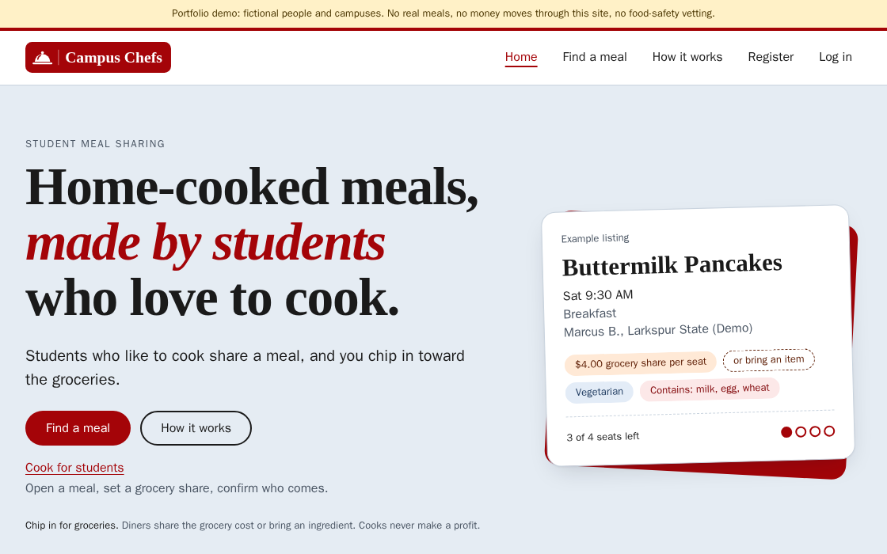
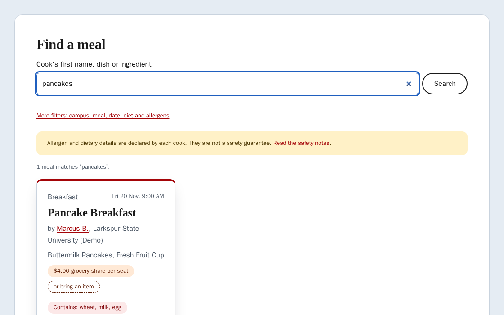
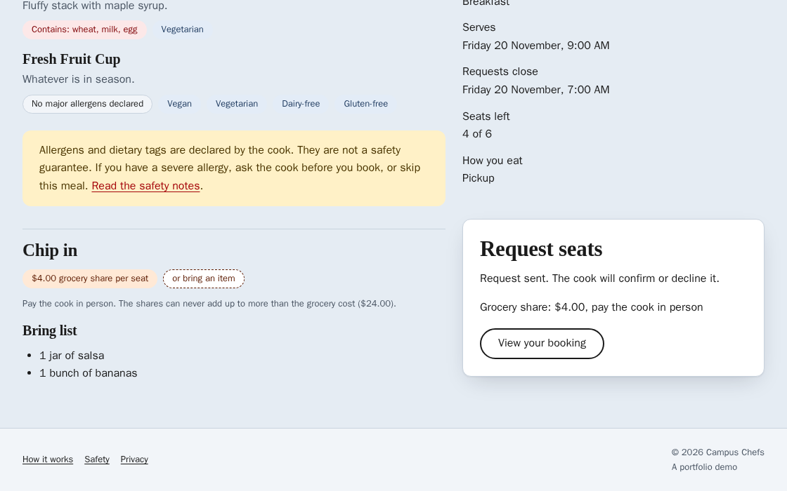
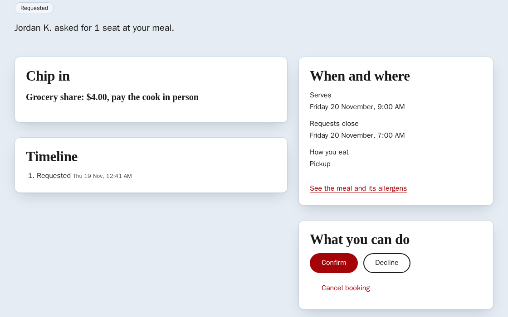
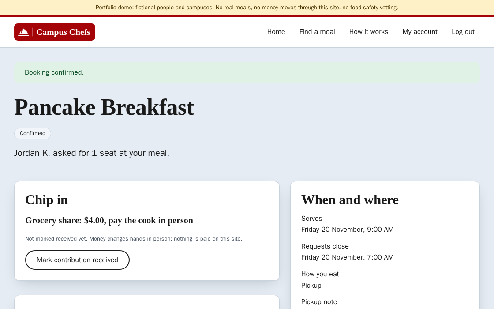
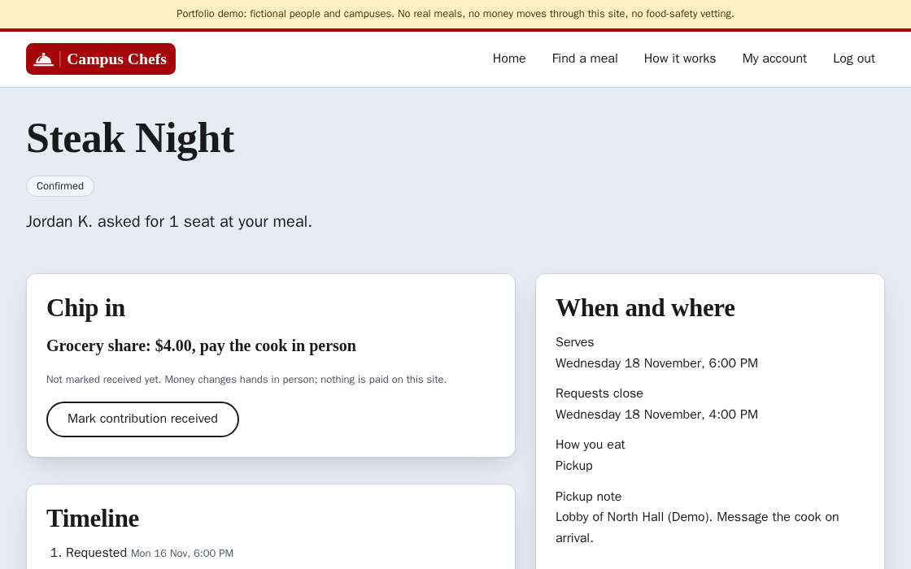
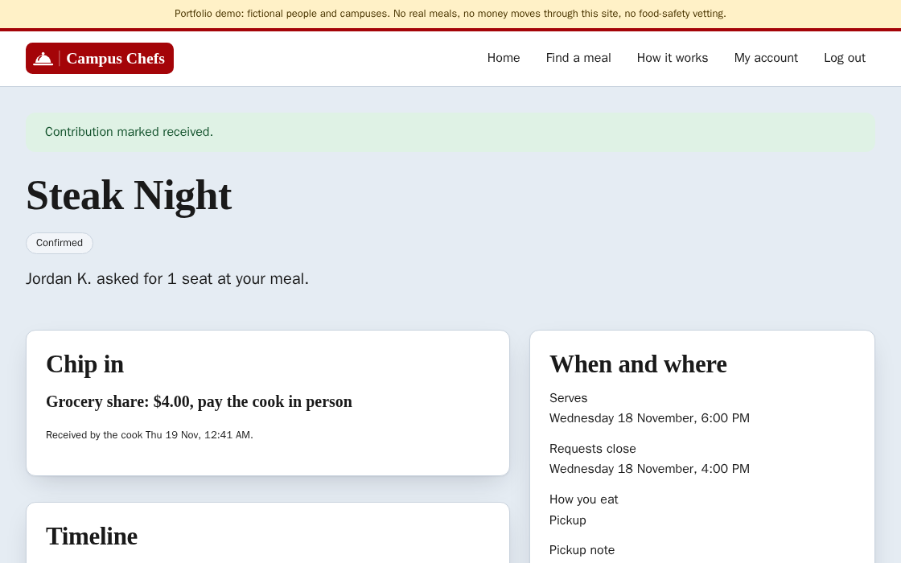
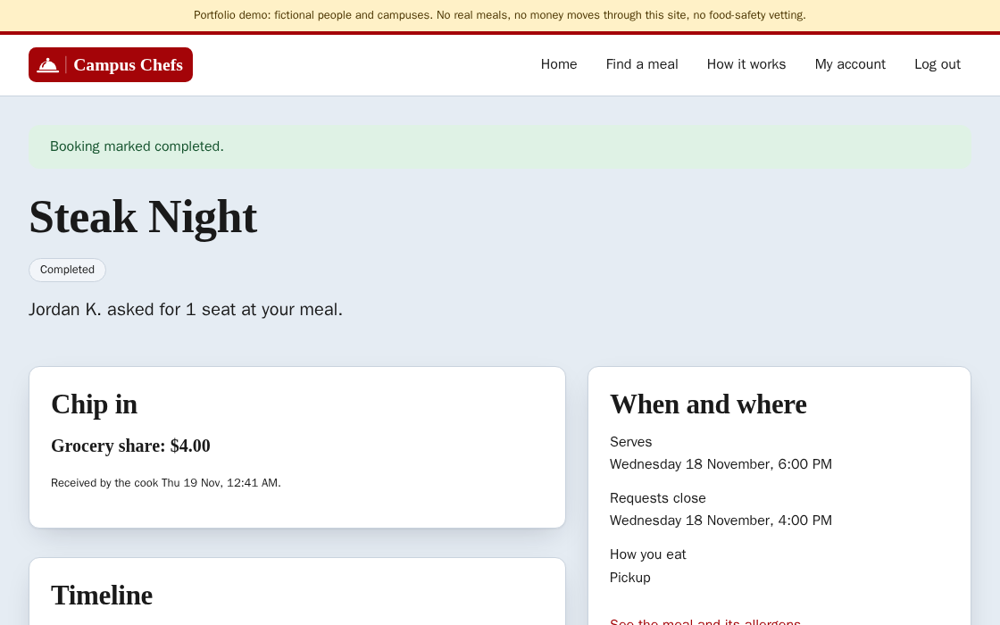
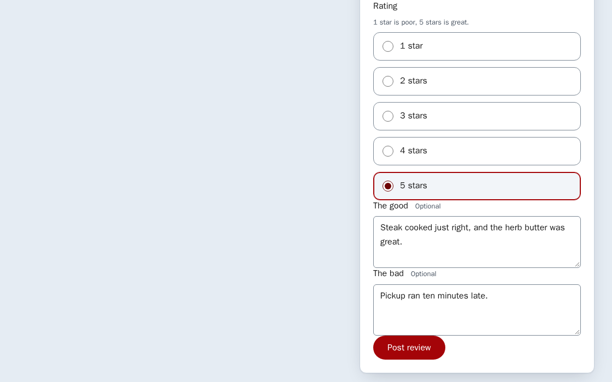
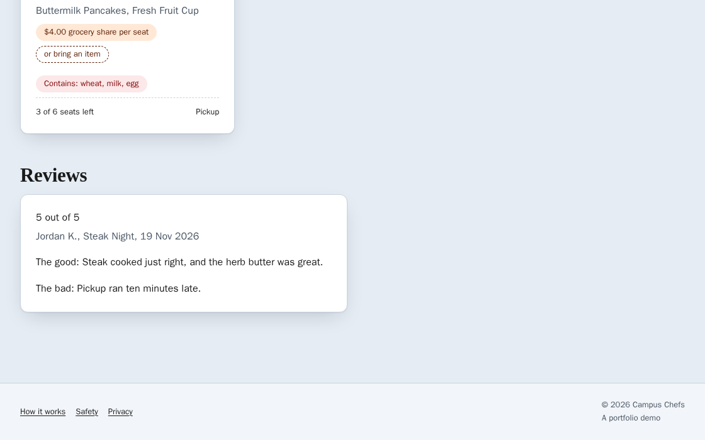

# Walkthrough: one meal, from search to review

This page follows one booking through the app, screen by screen. It is the same story the two main browser tests play on every CI run: **E2E-01** (a diner books and the cook confirms) and **E2E-02** (after the meal, the cook closes the booking and the diner reviews it). Both tests are in [`tests/e2e/test_e2e_flows.py`](../tests/e2e/test_e2e_flows.py).

Every picture is an unedited 1120 x 700 screen of the seeded demo, captured by `scripts/capture_screenshots.py --walkthrough`. The dates in them are relative to the day they were captured. To follow along yourself, run `make demo` and open <http://127.0.0.1:8000> ([README, "Run the demo"](../README.md#run-the-demo)).

The two people are seeded demo accounts. **Jordan K.** is the demo diner. **Marcus B.** is the demo cook. Neither has a password: you log in with the "Try as demo diner" and "Try as demo cook" buttons. Use two browser profiles, or one normal and one private window, to be both at once.

## Part 1: book a seat (E2E-01)

### 1. Start on the home page

The home page says what the app does and shows an example listing. The yellow banner at the top is on every page of the demo.



### 2. Search for a dish

Log in as the demo diner and type `pancakes` into the search box. The results appear under the box as you type. The server returns just the results, and htmx puts them on the page. With JavaScript off, the Search button loads the same results as a full page (E2E-05).



### 3. Open the meal

The meal page lists each dish with the allergens and dietary tags the cook declared, then when and where the meal is, and how many seats are left.


### 4. Choose how to chip in

This meal's groceries cost $24.00 and it has six seats, so the cook set the share at $4.00 a seat. The diner can pay that share, bring an item from the bring list instead, or propose other terms. The request cannot be sent until the allergen box is ticked (BOOK-02).


### 5. Send the request

Press **Request seats**. The form is replaced in place by a confirmation, and the share is fixed at the amount shown. If the cook edits the meal later, this booking keeps its $4.00 (CONTRIB-03).



### 6. The cook sees the request

In the other window, log in as the demo cook and open the booking from the account page. The cook sees who asked, for how many seats, and what they offered to chip in. The cook can confirm, decline or cancel.



### 7. The cook confirms

Press **Confirm**. Before it confirms, the app locks the meal's row and counts the confirmed seats again, so two confirmations at the same moment cannot overbook the meal (`bookings/services.py`). The cook now has a "Mark contribution received" button for later.



### 8. The diner sees the confirmation

Back in the diner's window, the booking is confirmed. The page says what to pay and that it is paid in person. A confirmed diner now also sees the cook's pickup note, which is hidden from everyone else (BOOK-14).


That is the end of E2E-01. The test asserts the "Request sent" text, the cook's "Booking confirmed" message, the Confirmed badge on the diner's page and the exact contribution line.

## Part 2: after the meal (E2E-02)

A booking can be completed only after the meal's serving time, so this part uses a booking that is already in the seed: Jordan's confirmed seat at Marcus's **Steak Night**, served yesterday.

### 9. The cook opens yesterday's booking

As the demo cook, open Steak Night from the kitchen's past meals and pick Jordan's booking. The share has not been marked received.



### 10. Mark the share received

Press **Mark contribution received**. This records the time. It is a field beside the booking's status, not a new status, and only the cook can set it (CONTRIB-07).



### 11. Mark the booking completed

Press **Mark completed** in the "What you can do" card. Completing is allowed only after the serving time (BOOK-11).



### 12. The diner writes a review

As the demo diner, open the same booking. A completed booking shows a review form for 14 days (REV-05). A review is a rating from 1 to 5 and two optional parts, "The good" and "The bad".



### 13. The review is posted

Press **Post review**. A booking can be reviewed once (REV-03).


### 14. The review is on the cook's page

Follow the cook's name to their public page. The review is listed with the diner's first name and initial, the meal and the date, and it now counts in the cook's average (REV-01).



That is the end of E2E-02. The test asserts both of the cook's messages, the Completed badge, the "review is posted" message, and that the cook's page lists the review text exactly once with "5 out of 5".

## Run the two tests

`make e2e` reseeds the demo data and runs every browser test. To run only these two:

```sh
make e2e K="e2e_01 or e2e_02"
```

The last line reads `2 passed, 356 deselected` and a time.

After clicking through by hand, run `make reseed` to put the demo data back. `make screenshots` does that for you when it recaptures these pictures.
